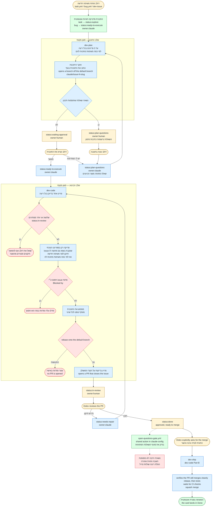

# צינור העבודה ב-GitHub: המנגנון המשותף

המסמך הזה הוא המקור היחיד למנגנון שעליו עובדים הסקילים הגנריים `dev-issue`, `dev-next`,
`dev-plan`, `dev-code`, `dev-ship` ו-`dev-setup`, בכל repo. הם מפנים אליו במקום לשכפל
אותו. שינוי בשמות התוויות או בסדר השלבים מתעדכן כאן קודם.

המנגנון נולד ב-WayOut (`dolev2/WayOut`), הועתק ל-CRM (`dolev2/charging-crm`) ב-2026-10-23,
והוכלל לכל הפרויקטים ב-2026-10-25. כל "מוקש" שמתועד כאן קרה באחד מהם.

**אין רוטינות ענן.** כל שלב (Plan, Code, Ship) רץ רק כשדולב מבקש אותו בסשן מקומי.

## מה משתנה מ-repo ל-repo, ואיפה זה נמצא

שום דבר לא מוגדר ידנית בסקילים. כל ריצה מתחילה ב:

```bash
python "$HOME/.claude/skills/dev-setup/scripts/pipeline_info.py"
```

| מה | מאיפה | דוגמה |
|---|---|---|
| ה-repo | `gh repo view` | `dolev2/charging-crm` |
| ה-branch הראשי | `defaultBranchRef` | `master` (בהמשך: `<default>`) |
| תווית האדם | תווית `owner:*` שאינה `owner:claude` | `owner:dolev` (בהמשך: `owner:<human>`) |
| שם הסמן המוסתר | `.github/scripts/sync_project.py`, או המשתנה `SYNC_MARKER` | `crm-sync`, `wayout-sync` |
| מספר הלוח | משתנה ה-repo `PROJECT_NUMBER` | `5` |
| הספרינט הנוכחי | ה-milestone הפתוח הנמוך ביותר שיש בו issues פתוחים | `W1 - CRM + Gmail` |
| פקודות הבדיקה | `CLAUDE.md` של ה-repo, סעיף הבדיקות | כולל חבילות מותנות כמו `-m live`, או "אין חבילה, הבדיקה היא preview" |
| מקורות האמת לדרישות | `CLAUDE.md` של ה-repo | עמוד התוכנית, `docs/` |
| כותרות גוף ה-issue | `.github/ISSUE_TEMPLATE/task.yml` ו-`bug.yml`, ורמת הכותרות של ה-issues הקיימים | עברית (`מה רוצים`) או אנגלית (`Goal`) |
| שורת התלות ותתי-כותרות ה-Plan | `CLAUDE.md` של ה-repo; בלי הנחיה שם, הנוסח העברי במסמך הזה | `תלוי ב:` / `Depends on:` |
| תוויות `area:*` | התוויות שקיימות ב-repo | |
| סוגי issues נוספים | תוויות שקיימות ב-repo, למשל `decision` | |

**הכותרות והנוסחים העבריים במסמך הזה הם של התבנית הסטנדרטית.** repo שהתבניות שלו באנגלית,
או שה-issues שלו כתובים ב-`##` ולא ב-`###`, נכתב בכותרות וברמה שלו. בכל מקום שכתוב כאן "מה
רוצים", "תלוי ב:", "שאלות פתוחות" או "יומן שינויים בתוכנית", הכוונה לסעיף המקביל ב-repo.

**שפה:** דיווחים לדולב ותגובות ב-issues בעברית. קוד, שמות branches וכותרות milestones באנגלית.

`ready: False` פירושו שהצינור לא הותקן ב-repo הזה. במקרה כזה מפעילים את `dev-setup` ולא
מאלתרים.

**סקילים ספציפיים ל-repo גוברים.** אם ב-`.claude/skills/` של ה-repo יש סקיל שמכסה את אותו שלב
(למשל `<repo>-plan`), משתמשים בו ולא בגרסה הגנרית. `pipeline_info.py` מציג אותם
תחת `repo_skills`.

## התרשים: הצינור במבט אחד



**מקרא:** צהוב: פעולה של דולב · כחול: Claude, בסקיל · ירוק: אוטומציה ב-GitHub Actions ·
אדום: שער שעוצר או מתריע.

**התרשים הוא חלק מהמנגנון, לא איור נלווה.** כל שינוי בשלבים, בתוויות, בשערים או
באוטומציות מתעדכן בו באותו commit שמשנה את ההתנהגות.

**כלל עריכה לתרשים: כל שורה בתווית היא עברית בלבד או אנגלית בלבד.** Mermaid מייצר SVG בלי
כיווניות RTL, ושורה מעורבת נסדרת מחדש משמאל לימין. הפתרון הוא פיצול לשורות חד-כיווניות, לא
תווי כיווניות נסתרים. `wrappingWidth` מונע קיצוץ של מזהים ארוכים כמו `status:ready-to-execute`.

### מתי נכנסת כל אוטומציה

| מנגנון | מתי | מה עושה | טוקן |
|---|---|---|---|
| **dev-issue** | כשדולב מבקש לפתוח או לפרק משימה | פותח issues במבנה של התבנית, עם תוויות, milestone, sub-issues וקישורי Blocked by | `gh` המקומי |
| **dev-next** | "בוא נעבוד על המשימה הבאה" | בוחר את המשימה שהכי הרבה משימות בספרינט מחכות לה, ומעביר ל-dev-plan או ל-dev-code | `gh` המקומי |
| **dev-plan** | כשדולב מבקש | קולט `status:explore` וגם `status:plan-questions` שחזרו עם `owner:claude`; עד 3 בריצה | `gh` המקומי |
| **dev-code** | כשדולב מבקש | קולט `status:needs-repair` ואז `status:ready-to-execute`, בספרינט הנוכחי; issue אחד בריצה | `gh` המקומי |
| **dev-ship** | כשדולב מבקש לשחרר | rebase, בדיקות, PR, CI, squash-merge, `status:done`, ניקוי | `gh` המקומי |
| `sync-project.yml` | אירוע issue, ועוד סקר כל 15 דקות | מסנכרן תוויות ושדות הלוח, דו-כיוונית | `PROJECT_TOKEN` (PAT) |
| `open-questions-gate.yml` | כל נגיעה ב-`status:done`, וגם עריכת גוף | קורא ל-action המשותף ב-`claude-config`; מתריע על שאלה פתוחה, ומסיר את התווית לבד כשכולן מסומנות | `GITHUB_TOKEN` |

**אין תזמון.** שלב התכנון משאיר תוכניות ב-`status:waiting-approval`, ושלב הקוד לוקח רק מה
שכבר `status:ready-to-execute`. כלומר שום קוד לא נכתב על תוכנית שדולב לא אישר.

**למה הסקר של 15 הדקות:** גרירת כרטיס בלוח של פרויקט בבעלות משתמש לא מייצרת webhook. תווית
שמוסיפים ישירות על ה-issue מפעילה הכל מיד; גרירה בלוח מגיעה רק בסקר הבא.

**שתי נקודות שהתרשים לא מראה במפורש:**
- merge לעולם אינו אוטומטי. `status:done` פירושו "אושר, מוכן ל-merge". הבקשה המפורשת של
  דולב היא מה שמתיר אותו.
- ספרינט הוא milestone, לא שדה Iteration. דולב קובע את תוכנו; Claude לעולם לא משייך בעצמו.

## למה תוויות ולא שדות הפרויקט

שדות של GitHub Projects v2 הם משאב ברמת המשתמש, והשאילתות עליהם שבירות. תוויות הן ברמת
ה-repo ופשוטות. לכן:

- **התוויות הן מקור האמת.** זה מה ש-Claude קורא וכותב, תמיד.
- **לוח ה-Project הוא התצוגה האנושית.** דולב גורר בו כרטיסים, ו-`sync-project.yml` מסנכרן
  דו-כיוונית. כלל ההכרעה מתועד בראש `.github/scripts/sync_project.py`.
- Claude **לא** קורא ולא כותב לשדות הפרויקט. ניסיון שנכשל בהרשאות הוא צפוי, לא באג.

**שמות האופציות בלוח הם חוזה עם הסקריפט.** שינוי שם של אופציה בשדה Status, Owner או Area
מחייב עדכון של `STATUS_OPTIONS` / `OWNER_OPTIONS` / `AREA_OPTIONS` ב-`sync_project.py` באותו
זמן. בלי זה הסנכרון מדלג בשקט (`field has no option`).

**מוקש (2026-09-23):** `projectV2.items` מחזיר רשימה ריקה עבור פרויקט שאוכלס דרך ה-API, גם
כשהפריטים קיימים. `issue.projectItems` מחזיר אותם מיד. לכן `sync_project.py` קורא את הלוח
**מצד ה-issue**. אל "תפשט" את זה חזרה: רשימה ריקה נראית לסקריפט כמו "לא נגעו בלוח".

## אוצר המילים

| תווית | משמעות | מי מזיז הלאה |
|---|---|---|
| `owner:claude` | ממתין ל-Claude | Claude, כשסיים |
| `owner:<human>` | ממתין לדולב | דולב |
| `status:explore` | ממתין לתכנון | Claude (Plan) |
| `status:plan-questions` | יש שאלה פתוחה על התוכנית, של Claude או של דולב | מי ש-`owner` מצביע עליו |
| `status:waiting-approval` | התוכנית מוכנה, ממתינה לאישור | דולב |
| `status:ready-to-execute` | מאושר לביצוע | Claude (Execute) |
| `status:needs-repair` | חזר לתיקון אחרי בדיקה | Claude (Execute) |
| `status:in-review` | Claude סיים, PR פתוח | דולב |
| `status:done` | אושר, מוכן ל-merge | Claude (Merge, רק בבקשה מפורשת) |
| `status:backlog` | רעיון, לא בצינור | דולב |
| `area:*` | אזור, לפי מה שקיים ב-repo | Claude ממלא אם חסר |
| `bug` / `task` | סוג | — |
| `has-open-questions` | נכתבת רק ע"י שער השאלות | — |

`status:*` ו-`owner:*` הן קבוצות בלעדיות. תמיד להסיר את הקודמת באותה פקודה שמוסיפה את החדשה:

```bash
gh issue edit <N> --add-label "status:waiting-approval" --add-label "owner:<human>" \
                  --remove-label "status:explore"  --remove-label "owner:claude"
```

## מה למצוא בתחילת ריצה

```bash
gh issue list --state open --label "owner:claude" --json number,title,labels,updatedAt
```

סדר הטיפול: `status:needs-repair` לפני `status:ready-to-execute` לפני `status:plan-questions`
לפני `status:explore`. קודם לתקן משהו שדולב כבר בדק, אחר כך לסיים משהו שהתחלנו, ורק בסוף
להתחיל חדש. בתוך כל רמה, לפי הדירוג בסעיף "סדר בתוך הספרינט".

**מ-`waiting-approval` חזרה לתכנון זה מסלול לגיטימי.** אם יש לדולב הסתייגות, הוא כותב אותה
בתגובה ומחזיר ל-`status:plan-questions` + `owner:claude`. התווית משמשת בשני הכיוונים, ומה
שמבדיל ביניהם הוא `owner`. תווית נפרדת (`status:plan-rejected`) נשקלה ונדחתה.

**`status:plan-questions` + `owner:claude` שייך לשלב ה-Plan.** זה המצב שאליו ה-issue נוחת
ברגע שדולב עונה. ב-24.09.2026 זה היה חור אמיתי: Plan חיפש רק `explore` ו-Code רק
`ready-to-execute`/`needs-repair`, וה-issue נתקע בשקט. שתי השאילתות של Plan הן התיקון; אל
תאחד אותן.

## לפני שנוגעים ב-issue: לקרוא את כל ההקשר

```bash
gh issue view <N> --comments
gh issue view <N> --json body,labels,projectItems,title
```

ובנוסף:

1. **sub-issues** ו-issues שמפנים אליו:
   ```bash
   gh api graphql -f query='
     query($owner:String!,$repo:String!,$num:Int!){
       repository(owner:$owner,name:$repo){
         issue(number:$num){
           subIssues(first:50){ nodes{ number title state } }
           timelineItems(first:100, itemTypes:[CROSS_REFERENCED_EVENT]){
             nodes{ ... on CrossReferencedEvent { source { ... on Issue { number title state } } } }
           }
         }}}' -F owner={owner} -F repo={repo} -F num=<N>
   ```
   (`gh` ממלא `{owner}` ו-`{repo}` מה-repo הנוכחי.) כל sub-issue פתוח הוא חלק מהמשימה, ולא
   סוגרים את האם לפניו.
2. **ה-PR המקושר**: סעיף Development, או `gh pr list --search "<N>"`.
3. **התלויות**: הסעיף הבא.

## תלויות: קישורי Blocked by

**מקור האמת לתלות הוא קישור "Blocked by" המובנה של GitHub**, לא טקסט. השורה `תלוי ב: #A, #B.`
בגוף נשארת לקריאה, ומי שמשנה תלות מעדכן את שניהם יחד.

```bash
# מה חוסם את <N>
gh api repos/{owner}/{repo}/issues/<N>/dependencies/blocked_by \
  --jq '.[] | "\(.number) \(.state) \(.title)"'

# להוסיף: <N> חסום ע"י <B>. ה-API מקבל את ה-id של B, לא את המספר
BID=$(gh api repos/{owner}/{repo}/issues/<B> --jq .id)
gh api -X POST repos/{owner}/{repo}/issues/<N>/dependencies/blocked_by -F issue_id=$BID

# להסיר
gh api -X DELETE repos/{owner}/{repo}/issues/<N>/dependencies/blocked_by/$BID
```

**חסום = יש לפחות blocker אחד פתוח.** blocker סגור לא חוסם, והקישור נשאר כתיעוד.

- **Execute אוכף.** issue חסום לא נלקח לביצוע. הריצה מדלגת עליו ומציינת במה הוא חסום.
- **Plan לא אוכף.** כדאי לתכנן לפני שהחוסמים מוכנים. Plan מוסיף קישור כשהחקירה מגלה תלות
  שלא נרשמה, ומציין בתוכנית הנחות על blocker שעוד לא תוכנן.
- **issue מטריה** לא נלקח לביצוע. כל sub-issue מקבל קישורים משלו. issue שתלוי במטריה כולה
  נשאר חסום עד שהמטריה נסגרת.
- **פרט שאדם עוד צריך לספק** (דולב, לקוח, שותף) הוא שאלה פתוחה ב-`status:plan-questions`, לא
  קישור Blocked by. מקשרים רק כשהעבודה עצמה לא יכולה להתחיל עד שה-issue האחר נסגר.

## סדר בתוך הספרינט: מה שהכי הרבה עבודה מחכה לו, קודם

**המשקל של issue הוא מספר ה-issues הפתוחים בספרינט שמחכים לו** דרך Blocked by, ישירות או
בעקיפין. issue שמחכה דרך שני מסלולים נספר פעם אחת. נספרים כל ה-issues בספרינט, גם של דולב.
issue מחוץ לספרינט לא מוסיף משקל.

**הסדר:** רמת הסטטוס, בתוכה משקל מהגבוה לנמוך, ובשוויון מספר ה-issue. ב-`dev-plan` וב-`dev-code`
רמת הסטטוס מעל המשקל. **`dev-next` בוחר לפי משקל בלבד**, על כל הספרינט: הוא מחפש את צוואר
הבקבוק, ואם הוא אצל דולב, אומר את זה.

```bash
R="$HOME/.claude/skills/dev-setup/scripts/rank_issues.py"
python "$R"                                                        # כל הספרינט
python "$R" --owner claude --status plan-questions --status explore
python "$R" --owner claude --status needs-repair --status ready-to-execute
```

סדר ה-`--status` הוא סדר הרמות. הסקריפט מסמן `BLOCKED by #N` ולא מסנן. בדיקות:
`test_rank_issues.py` ליד הסקריפט.

**למה לפי משקל:** issue שהרבה עבודה מחכה לו הוא צוואר הבקבוק, ולסגור אותו קודם משחרר הכי הרבה
issues. ל-GitHub אין תצוגה כזו: הוא סופר רק חוסמים ישירים, לא את כל השרשרת.

## סעיף ה-Plan: איפה הוא גר ואיך מעדכנים אותו

**התוכנית חיה בגוף ה-issue**, תחת הכותרת `Plan` של התבנית:

```markdown
### Plan

**Branch:** `claude/issue-<N>-<slug>`

#### בקצרה
- **הבעיה:** <מה לא עובד היום או מה חסר, ולמי>
- **מה ישתנה:** <מה אפשר יהיה לעשות אחרי השינוי, במילים של המשתמש>
- **מה לא כלול, ואיפה כן:** <שורה לכל דבר: מה, ובאיזו משימה (#B, שם)>
- **החלטות שמחכות לדולב:** <"שאלות 1–3 למטה", או "אין">

#### פירוט טכני

##### הגישה
<הגישה הטכנית, צעד אחר צעד>

##### קבצים שצפויים להשתנות
- `path/to/file.ext`: <מה משתנה>

##### בדיקות
<מה נבדק, ובאיזה קובץ>

#### יומן שינויים בתוכנית
- 2026-09-23: נכתבה לראשונה.
- 2026-09-25: הגישה השתנתה מ-X ל-Y, בעקבות תשובתך מה-24: <מה ולמה>.
```

**שתי רמות פירוט.** "בקצרה" נכתב בשביל ההחלטה: דולב מאשר או מחזיר תוכנית על סמך החלק הזה
בלבד, ו"פירוט טכני" נכתב בשביל הביצוע. הכללים ל"בקצרה":
- עד 8 שורות, בשפה של העסק ובמונחים של המילון ב-`CLAUDE.md` של ה-repo.
- בלי שמות קבצים, פונקציות או endpoints, ובלי קוד. מספרי issues כן, תמיד עם השם שלהם.
- כל מה שמשנה התנהגות שמשתמש רואה (כלל חדש, שגיאה חדשה, שלב שזז לבד) מופיע כאן, גם אם
  הוא מפורט שוב למטה.

**"פירוט טכני"** מתחיל תמיד ב"הגישה" ונגמר ב"קבצים" וב"בדיקות". ביניהם מוסיפים תת-כותרות
לפי הצורך (למשל מבנה נתונים, migration). **לא מוסיפים סעיף גבולות נפרד** ("הגבול מול #X"):
הגבול כתוב רק בשורה "מה לא כלול, ואיפה כן", ונימוק טכני לגבול נכנס ל"הגישה".

השאלות עצמן גרות בסעיף `שאלות פתוחות` הנפרד (למטה), לא בתוך התוכנית.

כשדולב עונה: לקרוא את **כל** השרשור, לעדכן את הסעיפים במקום, ולהוסיף שורה ליומן. לעולם לא
למחוק את היומן. אם כבר כתוב ב-Plan שם branch, משתמשים בו ולא ממציאים חדש.

**הסעיפים שאדם כתב** (מה רוצים / Goal, הקשר / Context, מה קורה בבאג) נשארים זהים אות באות
בכל שכתוב של הגוף. Claude כותב רק את Plan ואת שאלות פתוחות, ואת השורות שהוא עצמו הוסיף
(`תלוי ב:`, צ'קליסט של מטריה).

לעריכת הגוף:
1. **לקרוא את הגוף מחדש רגע לפני העריכה** (`gh issue view <N> --json body --jq .body`), לא
   להשתמש בעותק מתחילת הריצה. הסנכרון כותב את הסמן מחדש אחרי כל שינוי תוויות, ועותק ישן
   מחזיר אותו לאחור.
2. לכתוב את הטקסט המלא לקובץ זמני, **בסיומות שורה LF**. ב-Windows קובץ עם CRLF חזר מ-GitHub
   כ-`\r\r\n` (22.10.2026). מ-Python: `Path(f).write_bytes(text.encode("utf-8"))`.
3. `gh issue edit <N> --body-file <file>`. **לעולם לא** `gh api ... -f body=...` או מחרוזת JSON:
   כך נוצר גוף עם `\n` מילולי (WayOut #49, 24.09.2026).
4. לוודא: `gh issue view <N> --json body --jq .body` מציג שורות אמיתיות.

**אזהרה: הסמן המוסתר.** בתחתית הגוף יש `<!-- <marker>: ... -->` (השם מ-`pipeline_info.py`)
ששייך ל-workflow הסנכרון. לשמר אותו בכל עריכה, **ולעולם לא לשנות את תוכנו או לכתוב אותו
ב-issue חדש.** הסמן הוא המצב האחרון שסונכרן; מי שמעדכן אותו יחד עם התוויות גורם ללוח הישן
להיראות כשינוי החדש, והסנכרון מחזיר את התוויות לאחור (CRM #22, 23.10.2026). משנים תוויות בלבד.

## שאלות פתוחות: הסעיף, והשער שמגן עליו

לכל issue יש סעיף `שאלות פתוחות` בגוף. **כל שאלה היא תיבת סימון**, ושאלה שנענתה מסומנת ולא
נמחקת:

```markdown
### שאלות פתוחות
- [ ] האם להחיל את הדילול גם על מכפיל ההון?
- [x] באיזה מטבע להציג? — הוחלט: מטבע הדיווח. 22.09.2026
```

הסעיף הוא **המקור היחיד** שנקרא אוטומטית. שאלה בתגובה נועדה לקריאה אנושית, ושלב ה-Plan
מעתיק אותה לסעיף.

אם יש בגוף כמה כותרות בשם הזה, הסעיף הוא **האחרון** מביניהן, והוא נגמר בכותרת הבאה באותה
רמה או ברמה גבוהה יותר (Osea #1, 24.10.2026).

`open-questions-gate.yml` בודק את הסעיף בכל נגיעה ב-`status:done`. נשארה תיבה לא מסומנת: הוא
מגיב, מוסיף `has-open-questions`, **ומפיל את הריצה בכוונה** (המייל הוא ערוץ ההתראה). הסטטוס לא
משתנה. כשכל התיבות מסומנות, התווית יורדת לבד. סעיף בלי אף תיבה נקרא במצב מקל: כל שורה לא ריקה
היא שאלה פתוחה.

**לשער יש עותק אחד.** הסקריפט והבדיקות שלו גרים ב-`claude-config`, ב-`dev-setup/actions/open-questions-gate/`.

כל ריפו מחזיק רק workflow קצר שקורא ל-`dolev2/claude-config/dev-setup/actions/open-questions-gate@main`.

תיקון שנכנס ל-main כאן מגיע לכל הריפואים מיד, ותקלה שנכנסת לשם שוברת את כולם יחד; לכן הבדיקות ב-CI.

העותקים המקומיים שהיו קודם התפצלו זה מזה (CRM #55, 25.10.2026).

ה-action נמצא בריפו פרטי, אז הוא זמין רק כשהגישה ל-actions של `claude-config` מוגדרת `user`, ורק לריפואים פרטיים. אחרת הריצה נופלת ב-"Unable to resolve action".

## ספרינטים: milestones, לא שדה Iteration

**הספרינט הוא milestone של GitHub.** milestone הוא ברמת ה-repo, ו-`gh issue list --milestone`
פשוט עובד. ללוח יש שדה `Milestone` מובנה שמשקף אותו. הכותרות באנגלית בכוונה, כי הן עוברות
כארגומנט בשורת פקודה. ייתכן שלכל milestone יש issue עוטף, והמשימות הן sub-issues שלו; ה-CLAUDE.md
של ה-repo אומר אם כן.

**הספרינט הנוכחי = ה-milestone הפתוח בעל המספר הנמוך ביותר שיש בו issues פתוחים.** אין תאריכי
יעד (החלטה מודעת, 2026-09-24). כשספרינט נגמר, הבא הופך לנוכחי בלי שאף אחד מעדכן.

**הכלל שחייב להישמר:** סריקה (בלי מספר issue) לא מושכת משימה מחוץ ל-milestone הנוכחי, **גם
כשהתור ריק**. תור ריק פירושו שהספרינט נקי: לדווח ולעצור.

**issue שדולב נקב בשמו** ("תממש את #50") מטופל גם כשהוא מחוץ לספרינט או בלי milestone (החלטה
ב-WayOut #119, 2026-10-25). מציינים בדיווח שהוא מחוץ לספרינט, ולא משייכים לו milestone. כל שאר
השערים (`owner:claude`, Blocked by, WIP) חלים עליו כרגיל.

**הסינון בלוח מקודד בשם.** אין ל-GitHub `milestone:@current`. בסיום ספרינט מעדכנים את פילטר
התצוגות, בממשק או בפקודה:

```bash
gh api graphql -f query='query($o:String!,$n:Int!){user(login:$o){projectV2(number:$n){views(first:20){nodes{id name filter}}}}}' -F o=<owner> -F n=<PROJECT_NUMBER>
gh api graphql -f query='mutation($id:ID!,$f:String!){updateProjectV2View(input:{viewId:$id,filter:$f}){projectV2View{name filter}}}' \
  -F id=<view id> -F f='milestone:"<next sprint>"'
```

**מוקש (WayOut, 24.09.2026):** פילטר על שדה שאינו קיים לא מחזיר שגיאה, רק תצוגה ריקה.

משימה בלי milestone היא backlog מכוון. אין לגעת בה.

## כמה issues בריצה אחת, ומתי בכלל לא להתחיל

**Execute: issue אחד בדיוק בכל ריצה.** לסשן יש עותק עבודה אחד; issue שני בריצה פירושו שהקומיטים
שלו נוחתים על ה-branch של הקודם, וה-PR שלו נושא בשקט קוד לא קשור. וכל issue נוסף נכתב בקונטקסט
דחוס, באיכות נמוכה יותר.

**שער WIP:** לפני issue **חדש** (לא תיקון):

```bash
gh issue list --state open --label "status:in-review" --json number --jq length
```

שלושה ומעלה: **לא מתחילים בלי לשאול.** מדווחים כמה ממתינים (עם קישורים) ושואלים את דולב אם
להמשיך בכל זאת; ממשיכים רק על "כן" מפורש (החלטה ב-WayOut #119, 2026-10-25). החסם הוא קצב
הביקורת של דולב, ו-PR שממתין מזדקן מול ה-branch הראשי. `status:needs-repair` פטור מהשאלה.

**Plan: עד שלושה issues בריצה.** הוא לא כותב קוד, אז רק הקונטקסט מגביל אותו.

## עותק העבודה: לא מחליפים branch בתיקייה המשותפת

התיקייה הראשית של ה-repo (`C:\dev\CRM` וכו') היא עותק משותף: דולב וסשנים אחרים עובדים בה,
לפעמים באמצע branch אחר עם שינויים שלא נשמרו. `git checkout` שם גורר שינויים לא-מקומטים בשקט
ל-branch הלא נכון. לכן:

- **Plan לא עושה checkout בכלל.** הוא יוצר את ה-branch ישירות ב-remote וקורא את הקוד העדכני
  משם:
  ```bash
  git fetch origin <default>
  git push origin origin/<default>:refs/heads/claude/issue-<N>-<slug>   # ה-branch נוצר ב-GitHub
  git show origin/<default>:path/to/file                                 # קריאת קובץ עדכני
  git grep <pattern> origin/<default> -- <path>                          # חיפוש בקוד העדכני
  ```
  כשהתיקייה עצמה נקייה, על `<default>` ומעודכנת (`git status -sb` מראה שאין פיגור), אפשר לקרוא
  ממנה ישירות.
- **Code עובד ב-worktree**, תיקייה נפרדת עם ה-branch שלו. אם הסשן כבר רץ ב-worktree משלו (Claude
  Desktop פותח כך סשנים; `git rev-parse --git-dir` מכיל `/worktrees/`), עובדים בו. אחרת: כלי
  `EnterWorktree` אם הוא זמין, ואם לא:
  ```bash
  git fetch origin claude/issue-<N>-<slug>
  git worktree add "<parent of repo>/worktrees/<repo>-issue-<N>" -B claude/issue-<N>-<slug> origin/claude/issue-<N>-<slug>
  ```
  ומשם כל פקודה רצה בתיקייה הזו (נתיב מלא או `git -C <path>`), כי ה-shell עלול לחזור לתיקייה
  הראשית בין פקודות.
- **בסוף ריצת Code**, אחרי ה-PR: אם ה-worktree נקי, `git worktree remove <path>` (הפקודה מסרבת
  כשיש בו שינויים, וזה המצב שבו עוצרים ומדווחים). ה-branch נשאר ב-remote לסבב התיקון הבא.

**אם בכל זאת עובדים בתיקייה המשותפת** (דולב ביקש במפורש), כלל העץ הנקי חל בין issue ל-issue:

```bash
test -z "$(git status --porcelain)" || { echo "working tree not clean — stopping"; exit 1; }
git checkout <default>
```

שתי הפקודות, בסדר הזה. `git diff` לא רואה קבצים חדשים, ולכן `git status`. פלט לא ריק: **לעצור
ולדווח, לא לנקות**.

## מוסכמת branches ו-PR

- branch: `claude/issue-<N>-<slug-אנגלי-קצר>`. גם `dev-ship` משתמש בשם הזה כשהעבודה שייכת ל-issue.
- הקישור ל-issue נוצר דרך `Closes #<N>` בגוף ה-PR.
- שם הסשן: `/rename claude/issue-<N>-<slug>` כשמתחילים לעבוד על ה-branch.
- מחיקת branches אחרי merge: ההגדרה "Automatically delete head branches" של ה-repo.

### עדכון מול ה-branch הראשי: לפני הבדיקות, לא אחריהן

ה-branch הראשי זז בזמן שכותבים: כמה סשנים ו-worktrees עובדים במקביל, ושלב התכנון פותח את
ה-branch יום או יותר לפני הקוד. לכן, בכל שלב שמגיע ל-PR:

```bash
git fetch origin <default>
git rebase origin/<default>
```

**קודם rebase, אחר כך הבדיקות.** כך מתגלה התנגשות סמויה: שני שינויים שמתמזגים בלי התנגשות
טקסטואלית, אבל יחד הקוד שבור.

- **rebase ולא merge.** ההיסטוריה לינארית וה-PRים נסגרים ב-squash.
- **branch נחתך מ-`origin/<default>`** אחרי fetch, לא מה-branch המקומי.
- **branch שכבר נדחף מתעדכן ב-`git push --force-with-lease`**, לעולם לא `--force`.
- **התנגשות היא עצירה, לא משימה.** `git rebase --abort`, השארת `owner:claude`, תגובה עם רשימת
  הקבצים, ואין PR.

בשלב ה-Merge: `gh pr view <N> --json mergeable,mergeStateStatus`. כל תשובה שאינה `MERGEABLE`:
rebase, דחיפה, בדיקות מחדש, ורק אז merge.

**לפני כל merge, גם ה-CI**, אם יש ב-repo workflow שרץ על PR. ב-repo פרטי בחשבון חינמי אין branch
protection, ו-PR אדום ניתן ל-merge. לכן מחכים:

```bash
gh pr checks <N> --watch --fail-fast
```

אין checks בכלל (`no checks reported`): לציין את זה בדיווח, ולהמשיך על סמך הבדיקות המקומיות.

## בדיקות

- **הפקודות הן של ה-repo**, מ-CLAUDE.md. בלי פקודות שם: מה שה-CI מריץ. בלי שניהם: לשאול את
  דולב.
- **חבילות מותנות.** אם CLAUDE.md מגדיר חבילה שרצה רק כשנוגעים באזור מסוים (למשל `-m live`
  ב-WayOut כשנוגעים ב-`backend/data_sources/`), בודקים את ה-diff מול `origin/<default>`
  (`git diff --name-only origin/<default>...HEAD`) ומריצים אותה כשהשינוי נוגע באזור.
- **repo בלי חבילה אוטומטית**, ש-CLAUDE.md שלו מגדיר בדיקה ידנית (למשל preview בדפדפן לאתר
  סטטי): הבדיקה הידנית היא הבדיקה. מריצים אותה ומתעדים מה נבדק, ולא מוסיפים חבילה.
- בכל מקרה אחר: טסט לכל endpoint, פרמטר או תיקון באג, ו-repo בלי חבילה מקבל את הראשונה.
- **כישלון בהרצת הבדיקות אינו היתר לדלג עליהן.** תלויות חסרות מתקינים.

## הכללים שלא משתנים

- לא לנחש על issue לא ברור. לשאול בתגובה ולהעביר ל-`owner:<human>`.
- לא לבצע merge בלי בקשה מפורשת של דולב על ה-issue הספציפי, גם כשהתווית `status:done`.
- לא לגעת ב-issue שאין עליו `owner:claude`.
- לא להמציא נתונים עסקיים. מה שחסר הוא שאלה פתוחה, לא טקסט.
