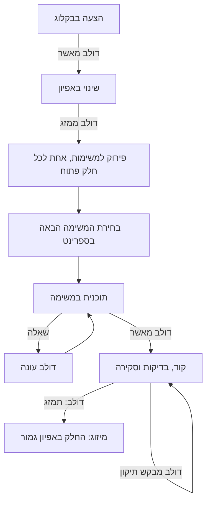
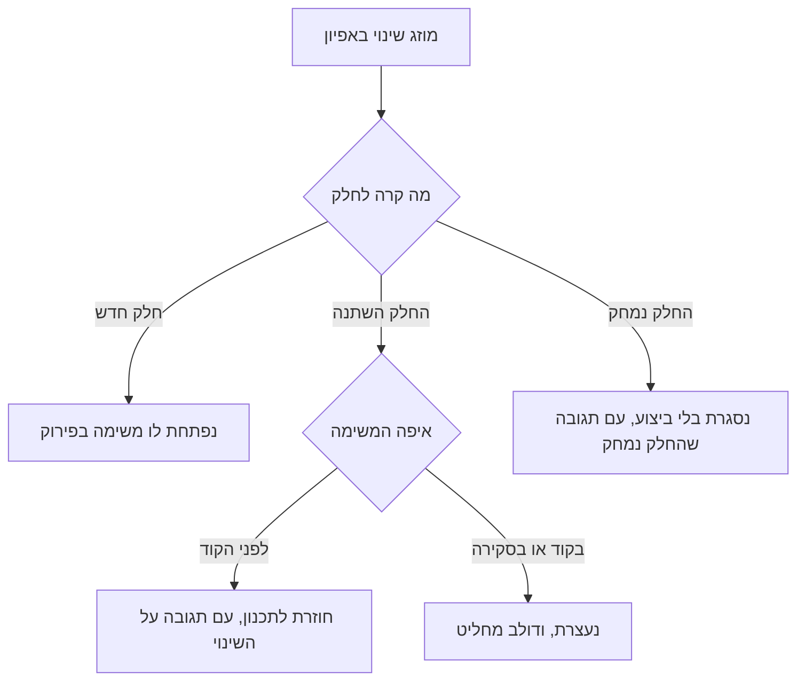

# האפיון של claude-config

האפיון הזה אומר מה יש ב-claude-config, למה, ומה עוד פתוח.

הקוראים: דולב, שמחליט מה נבנה, והסוכנים, שמתכננים וכותבים קוד לפי האפיון.

<!-- toc -->
## תוכן העניינים

- [מה זה claude-config, ולמה](#מה-זה-claude-config-ולמה)
- [איך התהליך עובד, מקצה לקצה](#איך-התהליך-עובד-מקצה-לקצה)
- [איך קוראים את המסמך הזה](#איך-קוראים-את-המסמך-הזה)
- [פרק 1 · צינור העבודה](#פרק-1--צינור-העבודה)
  - [היסודות](#היסודות)
    - [הסטטוס אומר של מי התור (S-1.1)](#s-11--הסטטוס-אומר-של-מי-התור) · גמור: [#110](https://github.com/dolev2/claude-config/issues/110)
    - [הספרינט הוא milestone (S-1.2)](#s-12--הספרינט-הוא-milestone) · גמור: [#11](https://github.com/dolev2/claude-config/issues/11)
    - [החלטות בחלון השאלות (S-1.23)](#s-123--החלטות-בחלון-השאלות) · גמור: [#126](https://github.com/dolev2/claude-config/issues/126)
    - [הסנכרון עם הלוח (S-1.9)](#s-19--הסנכרון-עם-הלוח) · גמור: [#3](https://github.com/dolev2/claude-config/issues/3)
    - [התצוגות של הלוח (S-1.10)](#s-110--התצוגות-של-הלוח) · גמור: [#13](https://github.com/dolev2/claude-config/issues/13)
  - [רעיון ואפיון](#רעיון-ואפיון)
    - [שינוי באפיון (S-1.11)](#s-111--שינוי-באפיון) · גמור: [#227](https://github.com/dolev2/claude-config/issues/227)
    - [כל שינוי מתחיל באפיון (S-1.34)](#s-134--כל-שינוי-מתחיל-באפיון) · גמור: [#239](https://github.com/dolev2/claude-config/issues/239)
    - [הפורמט של קובץ אפיון והבדיקה שלו (S-1.28)](#s-128--הפורמט-של-קובץ-אפיון-והבדיקה-שלו) · גמור: [#226](https://github.com/dolev2/claude-config/issues/226)
    - [תוכן עניינים שמתעדכן עם הכותרות (S-1.35)](#s-135--תוכן-עניינים-שמתעדכן-עם-הכותרות) · גמור: [#230](https://github.com/dolev2/claude-config/issues/230)
    - [המצב וה-issue בתוכן העניינים (S-1.39)](#s-139--המצב-וה-issue-בתוכן-העניינים) · גמור: [#279](https://github.com/dolev2/claude-config/issues/279)
    - [כל פרק אומר איפה הוא גר (S-1.38)](#s-138--כל-פרק-אומר-איפה-הוא-גר) · פתוח: [#278](https://github.com/dolev2/claude-config/issues/278)
    - [האפיון מתאר מה, לא איך (S-1.40)](#s-140--האפיון-מתאר-מה-לא-איך) · פתוח: [#281](https://github.com/dolev2/claude-config/issues/281)
    - [האפיון כתוב כמצב נתון (S-1.45)](#s-145--האפיון-כתוב-כמצב-נתון) · גמור: [#314](https://github.com/dolev2/claude-config/issues/314)
    - [האפיון כתוב בסעיפים (S-1.46)](#s-146--האפיון-כתוב-בסעיפים) · גמור: [#325](https://github.com/dolev2/claude-config/issues/325)
  - [פתיחת משימות](#פתיחת-משימות)
    - [פתיחת issues (S-1.12)](#s-112--פתיחת-issues) · גמור: [#11](https://github.com/dolev2/claude-config/issues/11)
    - [באג (S-1.5)](#s-15--באג) · גמור: [#11](https://github.com/dolev2/claude-config/issues/11)
    - [משימות על ניהול העבודה (S-1.6)](#s-16--משימות-על-ניהול-העבודה) · גמור: [#38](https://github.com/dolev2/claude-config/issues/38)
    - [משימות שעולות כסף (S-1.7)](#s-17--משימות-שעולות-כסף) · גמור: [#43](https://github.com/dolev2/claude-config/issues/43)
  - [בחירת המשימה הבאה](#בחירת-המשימה-הבאה)
    - [המשימה הבאה (S-1.13)](#s-113--המשימה-הבאה) · גמור: [#6](https://github.com/dolev2/claude-config/issues/6)
    - [הסדר בתוך הספרינט (S-1.3)](#s-13--הסדר-בתוך-הספרינט) · גמור: [#295](https://github.com/dolev2/claude-config/issues/295)
    - [בקשה של משימה מושהית (S-1.44)](#s-144--בקשה-של-משימה-מושהית) · גמור: [#310](https://github.com/dolev2/claude-config/issues/310)
    - [סקירת העבודה במילה אחת (S-1.41)](#s-141--סקירת-העבודה-במילה-אחת) · גמור: [#287](https://github.com/dolev2/claude-config/issues/287)
    - [גרף החסימות בסקירה (S-1.48)](#s-148--גרף-החסימות-בסקירה) · גמור: [#344](https://github.com/dolev2/claude-config/issues/344)
    - [גרף החסימות הלחיץ (S-1.50)](#s-150--גרף-החסימות-הלחיץ) · גמור: [#355](https://github.com/dolev2/claude-config/issues/355)
  - [תכנון](#תכנון)
    - [תכנון (S-1.14)](#s-114--תכנון) · גמור: [#11](https://github.com/dolev2/claude-config/issues/11)
    - [שער השאלות הפתוחות (S-1.8)](#s-18--שער-השאלות-הפתוחות) · גמור: [#2](https://github.com/dolev2/claude-config/issues/2)
    - [המסלול הקטן (S-1.4)](#s-14--המסלול-הקטן) · גמור: [#107](https://github.com/dolev2/claude-config/issues/107)
    - [אישור תוכנית מתחיל קידוד (S-1.43)](#s-143--אישור-תוכנית-מתחיל-קידוד) · גמור: [#300](https://github.com/dolev2/claude-config/issues/300)
  - [קוד ומסירה](#קוד-ומסירה)
    - [קוד (S-1.15)](#s-115--קוד) · גמור: [#6](https://github.com/dolev2/claude-config/issues/6)
    - [מסירה עשירה לסקירה (S-1.25)](#s-125--מסירה-עשירה-לסקירה) · גמור: [#127](https://github.com/dolev2/claude-config/issues/127)
    - [משימות המשך במסירה (S-1.47)](#s-147--משימות-המשך-במסירה) · פתוח: [#335](https://github.com/dolev2/claude-config/issues/335)
  - [מיזוג](#מיזוג)
    - [מיזוג (S-1.16)](#s-116--מיזוג) · גמור: [#6](https://github.com/dolev2/claude-config/issues/6)
  - [התקנה בריפו](#התקנה-בריפו)
    - [התקנת הצינור בריפו (S-1.17)](#s-117--התקנת-הצינור-בריפו) · גמור: [#2](https://github.com/dolev2/claude-config/issues/2)
    - [טפסי ה-issues המשותפים (S-1.18)](#s-118--טפסי-ה-issues-המשותפים) · גמור: [#11](https://github.com/dolev2/claude-config/issues/11)
    - [deploy רק כשהאתר משתנה (S-1.22)](#s-122--deploy-רק-כשהאתר-משתנה) · גמור: [#50](https://github.com/dolev2/claude-config/issues/50)
  - [הידע על הצינור](#הידע-על-הצינור)
    - [התרשים והעמוד "חייו של issue" (S-1.26)](#s-126--התרשים-והעמוד-חייו-של-issue) · גמור: [#84](https://github.com/dolev2/claude-config/issues/84)
    - [ידע מסודר ומעודכן על הצינור (S-1.27)](#s-127--ידע-מסודר-ומעודכן-על-הצינור) · גמור: [#152](https://github.com/dolev2/claude-config/issues/152)
    - [מבחנים לסקילים (S-1.33)](#s-133--מבחנים-לסקילים) · גמור: [#183](https://github.com/dolev2/claude-config/issues/183)
    - [בודק תבנית בתרחיש כתוב בצורה שהמנוע מבין (S-1.49)](#s-149--בודק-תבנית-בתרחיש-כתוב-בצורה-שהמנוע-מבין) · גמור: [#347](https://github.com/dolev2/claude-config/issues/347)
    - [הרצה חוזרת של תרחישים שנכשלו היא הרצה לכל תרחיש (S-1.51)](#s-151--הרצה-חוזרת-של-תרחישים-שנכשלו-היא-הרצה-לכל-תרחיש) · פתוח: [#363](https://github.com/dolev2/claude-config/issues/363)
    - [תרחיש שנכשל בסקיל שלא השתנה נבדק קודם על main (S-1.52)](#s-152--תרחיש-שנכשל-בסקיל-שלא-השתנה-נבדק-קודם-על-main)
- [פרק 2 · המתזמר](#פרק-2--המתזמר)
  - [הסבב](#הסבב)
    - [מתזמר שמריץ את הספרינט (S-2.1)](#s-21--מתזמר-שמריץ-את-הספרינט) · גמור: [#150](https://github.com/dolev2/claude-config/issues/150)
    - [אפיון ופירוק ראשונים בכל ספרינט (S-2.14)](#s-214--אפיון-ופירוק-ראשונים-בכל-ספרינט) · גמור: [#296](https://github.com/dolev2/claude-config/issues/296)
    - [מצב הספרינט בתמונה אחת (S-2.2)](#s-22--מצב-הספרינט-בתמונה-אחת) · גמור: [#174](https://github.com/dolev2/claude-config/issues/174)
    - [חלון אחד לכל ההחלטות (S-2.3)](#s-23--חלון-אחד-לכל-ההחלטות) · גמור: [#150](https://github.com/dolev2/claude-config/issues/150)
  - [הבנים](#הבנים)
    - [פתיחת בן והחוזה שלו (S-2.4)](#s-24--פתיחת-בן-והחוזה-שלו) · גמור: [#150](https://github.com/dolev2/claude-config/issues/150)
    - [המעקב דרך GitHub, בלי הודעות (S-2.5)](#s-25--המעקב-דרך-github-בלי-הודעות) · גמור: [#184](https://github.com/dolev2/claude-config/issues/184)
    - [הבן מחכה ל-CI ומתקן אותו בעצמו (S-2.15)](#s-215--הבן-מחכה-ל-ci-ומתקן-אותו-בעצמו) · גמור: [#336](https://github.com/dolev2/claude-config/issues/336)
    - [מצב בן: עובד, חסום, סיים או נכשל (S-2.6)](#s-26--מצב-בן-עובד-חסום-סיים-או-נכשל) · גמור: [#150](https://github.com/dolev2/claude-config/issues/150)
    - [בן שסיים עובר לארכיון (S-2.7)](#s-27--בן-שסיים-עובר-לארכיון) · גמור: [#203](https://github.com/dolev2/claude-config/issues/203)
    - [באג, קישור או פיצול שבן מצא (S-2.8)](#s-28--באג-קישור-או-פיצול-שבן-מצא) · גמור: [#150](https://github.com/dolev2/claude-config/issues/150)
    - [משימת המשך שבן מציע עולה בחלון (S-2.16)](#s-216--משימת-המשך-שבן-מציע-עולה-בחלון) · פתוח: [#337](https://github.com/dolev2/claude-config/issues/337)
  - [המיזוג והתחזוקה](#המיזוג-והתחזוקה)
    - [מיזוג מהמתזמר (S-2.9)](#s-29--מיזוג-מהמתזמר) · גמור: [#150](https://github.com/dolev2/claude-config/issues/150)
    - [שינוי בצינור באמצע ספרינט (S-2.10)](#s-210--שינוי-בצינור-באמצע-ספרינט) · גמור: [#192](https://github.com/dolev2/claude-config/issues/192)
    - [branches יתומים בסוף הספרינט (S-2.11)](#s-211--branches-יתומים-בסוף-הספרינט) · גמור: [#206](https://github.com/dolev2/claude-config/issues/206)
    - [מסירה למתזמר חדש (S-2.12)](#s-212--מסירה-למתזמר-חדש) · פתוח: [#272](https://github.com/dolev2/claude-config/issues/272)
    - [המתזמר החדש מאמץ את הבנים (S-2.13)](#s-213--המתזמר-החדש-מאמץ-את-הבנים) · פתוח: [#273](https://github.com/dolev2/claude-config/issues/273)
- [פרק 3 · השומרים](#פרק-3--השומרים)
  - [מיזוג ו-git](#מיזוג-ו-git)
    - [אישור לפני כל מיזוג (S-3.1)](#s-31--אישור-לפני-כל-מיזוג) · גמור: [#61](https://github.com/dolev2/claude-config/issues/61)
    - [מיזוג שביקשת עובר בלי חלון נוסף (S-3.11)](#s-311--מיזוג-שביקשת-עובר-בלי-חלון-נוסף) · גמור: [#301](https://github.com/dolev2/claude-config/issues/301)
    - [כותרת המיזוג באה מה-PR (S-3.2)](#s-32--כותרת-המיזוג-באה-מה-pr) · גמור: [#87](https://github.com/dolev2/claude-config/issues/87)
    - [בלי force push (S-3.3)](#s-33--בלי-force-push) · גמור: [#61](https://github.com/dolev2/claude-config/issues/61)
    - [`/compact` אחרי מיזוג (S-3.4)](#s-34--compact-אחרי-מיזוג) · גמור: [#199](https://github.com/dolev2/claude-config/issues/199)
    - [הגנה על ה-branch הראשי (S-3.12)](#s-312--הגנה-על-ה-branch-הראשי) · גמור: [#162](https://github.com/dolev2/claude-config/issues/162)
  - [התיקייה והקבצים](#התיקייה-והקבצים)
    - [שמירה על התיקייה הראשית (S-3.5)](#s-35--שמירה-על-התיקייה-הראשית) · גמור: [#62](https://github.com/dolev2/claude-config/issues/62)
    - [כל סוכן כותב רק בחלק שלו (S-3.6)](#s-36--כל-סוכן-כותב-רק-בחלק-שלו) · גמור: [#261](https://github.com/dolev2/claude-config/issues/261)
    - [עברית בסקריפטי PowerShell (S-3.7)](#s-37--עברית-בסקריפטי-powershell) · גמור: [#63](https://github.com/dolev2/claude-config/issues/63)
    - [עיצוב אוטומטי לקובץ Python (S-3.8)](#s-38--עיצוב-אוטומטי-לקובץ-python) · גמור: [#64](https://github.com/dolev2/claude-config/issues/64)
  - [סשנים](#סשנים)
    - [חלון לסשן-בן עם הרשאות רחבות (S-3.9)](#s-39--חלון-לסשן-בן-עם-הרשאות-רחבות) · גמור: [#175](https://github.com/dolev2/claude-config/issues/175)
    - [מתזמר לא פועל בכללים ישנים (S-3.10)](#s-310--מתזמר-לא-פועל-בכללים-ישנים) · פתוח: [#271](https://github.com/dolev2/claude-config/issues/271)
- [פרק 4 · הכללים](#פרק-4--הכללים)
  - [איך Claude עונה לדולב](#איך-claude-עונה-לדולב)
    - [תשובה כמו דוח מנהלים (S-4.1)](#s-41--תשובה-כמו-דוח-מנהלים) · גמור: [#6](https://github.com/dolev2/claude-config/issues/6)
    - ["מה פתוח" בסוף כל תשובה (S-4.2)](#s-42--מה-פתוח-בסוף-כל-תשובה) · גמור: [#181](https://github.com/dolev2/claude-config/issues/181)
  - [נהלי הקוד](#נהלי-הקוד)
    - [נהלי קוד כלליים ולפי שפה (S-4.3)](#s-43--נהלי-קוד-כלליים-ולפי-שפה) · גמור: [#20](https://github.com/dolev2/claude-config/issues/20)
    - [מתי מפצלים קובץ (S-4.14)](#s-414--מתי-מפצלים-קובץ)
    - [מה בודקים בכל שינוי (S-4.4)](#s-44--מה-בודקים-בכל-שינוי) · גמור: [#109](https://github.com/dolev2/claude-config/issues/109)
    - [תרשים הסכמה (ERD) (S-4.5)](#s-45--תרשים-הסכמה-erd) · גמור: [#118](https://github.com/dolev2/claude-config/issues/118)
    - [נהלי git (S-4.6)](#s-46--נהלי-git) · גמור: [#31](https://github.com/dolev2/claude-config/issues/31)
    - [דפי החלטות (S-4.13)](#s-413--דפי-החלטות) · גמור: [#187](https://github.com/dolev2/claude-config/issues/187)
    - [מדריך הקבצים (S-4.11)](#s-411--מדריך-הקבצים) · גמור: [#28](https://github.com/dolev2/claude-config/issues/28)
    - [מפת הריפו בתיקיות (S-4.12)](#s-412--מפת-הריפו-בתיקיות) · גמור: [#277](https://github.com/dolev2/claude-config/issues/277)
    - [lint אחיד (S-4.10)](#s-410--lint-אחיד) · גמור: [#21](https://github.com/dolev2/claude-config/issues/21)
  - [הסביבה](#הסביבה)
    - [המחשב של דולב (S-4.7)](#s-47--המחשב-של-דולב) · גמור: [#27](https://github.com/dolev2/claude-config/issues/27)
    - [סשן ענן (S-4.8)](#s-48--סשן-ענן) · גמור: [#136](https://github.com/dolev2/claude-config/issues/136)
  - [משימות תהליך](#משימות-תהליך)
    - [משימות תהליך נכנסות לכללים רק באישור (S-4.9)](#s-49--משימות-תהליך-נכנסות-לכללים-רק-באישור) · פתוח: [#338](https://github.com/dolev2/claude-config/issues/338)
- [פרק 5 · סביבת הענן](#פרק-5--סביבת-הענן)
  - [ההקמה](#ההקמה)
    - [סשן ענן טוען את ההגדרות של claude-config (S-5.1)](#s-51--סשן-ענן-טוען-את-ההגדרות-של-claude-config) · גמור: [#132](https://github.com/dolev2/claude-config/issues/132)
    - [ריענון בתחילת כל סשן (S-5.2)](#s-52--ריענון-בתחילת-כל-סשן) · גמור: [#132](https://github.com/dolev2/claude-config/issues/132)
    - [שליטה מהטלפון בסשן שרץ על המחשב (S-5.3)](#s-53--שליטה-מהטלפון-בסשן-שרץ-על-המחשב) · גמור: [#132](https://github.com/dolev2/claude-config/issues/132)
  - [GitHub בענן](#github-בענן)
    - [הסקריפטים קוראים מ-GitHub בלי GraphQL (S-5.4)](#s-54--הסקריפטים-קוראים-מ-github-בלי-graphql) · גמור: [#138](https://github.com/dolev2/claude-config/issues/138)
    - [הסקילים עובדים בענן דרך טבלה אחת (S-5.5)](#s-55--הסקילים-עובדים-בענן-דרך-טבלה-אחת) · גמור: [#139](https://github.com/dolev2/claude-config/issues/139)
    - [ה-branch ושם הסשן בענן (S-5.6)](#s-56--ה-branch-ושם-הסשן-בענן) · גמור: [#134](https://github.com/dolev2/claude-config/issues/134)
  - [ההרשאות](#ההרשאות)
    - [כלים שגרתיים בלי חלון אישור (S-5.7)](#s-57--כלים-שגרתיים-בלי-חלון-אישור) · גמור: [#155](https://github.com/dolev2/claude-config/issues/155)
    - [חלונות שהשירות מכריח (S-5.8)](#s-58--חלונות-שהשירות-מכריח) · גמור: [#179](https://github.com/dolev2/claude-config/issues/179)
<!-- /toc -->

## מה זה claude-config, ולמה

התיקייה claude-config היא המקום שממנו Claude Code טוען את ההגדרות של דולב, בכל סשן ובכל ריפו.

המטרה: שכל עבודה עם Claude תתנהל באותה דרך, בלי להסביר אותה מחדש בכל פרויקט.

יש לו ארבע מטרות:
1. **התשובות של Claude לדולב הן דוח מנהלים:** בעברית, השורה התחתונה קודם, וכל שאלה בחלון השאלות.
2. **אותם נהלים בכל ריפו:** איך כותבים קוד, מה בודקים, ואיך עובדים עם git.
3. **צינור עבודה אחד לכל המשימות:** מהרעיון ועד המיזוג, כשדולב מחליט בכל שער ו-Claude עושה את השאר.
4. **שומרים שאוכפים את מה שאסור לשכוח:** מיזוג רק באישור, בלי לדרוס עבודה, ובלי לשבור את ההגדרות החיות.

הכל עובד גם בסשן ענן, כשדולב לא יושב מול המחשב.

שם גם אפשר להריץ ספרינט שלם מסשן אחד.

## איך התהליך עובד, מקצה לקצה

כל עבודה עוברת באותו סדר:
1. **הצעה:** רעיון נכנס לבקלוג כ-issue.\
   עדיין לא מחליטים עליו.
2. **אפיון:** כשדולב מאשר את ההצעה, Claude מכניס אותה לאפיון של הריפו, ב-PR: חלק חדש, או שינוי בחלק קיים.\
   האפיון הוא אחד לכל הריפו, ולא מסמך לכל הצעה או לכל issue.\
   המיזוג של ה-PR הוא האישור של ה"מה".\
   מה שלא ברור נשאל, ולא מומצא.
3. **פירוק ל-issues:** כל חלק פתוח באפיון הופך ל-issue משלו, שמצביע על החלק במזהה שלו.\
   קישורי ה-Blocked by בין ה-issues נוצרים רק לפי התלויות שכתובות באפיון, ומהם נקבע הסדר.
4. **בחירת המשימה הבאה:** בתוך הספרינט, באג קודם, אחריו משימת `process`, ואחריה משימה ממטרייה שכבר התחילה.\
   בתוך כל קבוצה, המשימה שהכי פחות משימות מחכות לה, כדי שנושא ייגמר לפני שעוברים לאחר.\
   משימה שדולב השהה לא נבחרת.
5. **תוכנית:** Claude חוקר וכותב את ה"איך" בגוף ה-issue.\
   שאלה עוצרת את התור לטובת דולב, ודולב מאשר את התוכנית.\
   משימה קטנה ובאג מדלגים על האישור.
6. **קוד:** Claude כותב ב-branch משלו, מריץ בדיקות, סוקר את השינוי ובודק את מה שהמשתמש רואה.\
   באותו PR הוא מסמן את החלק באפיון כגמור.\
   הוא מוסר את ה-PR לדולב לסקירה, עם קישור לשינויים וצילומים.
7. **מיזוג:** רק כשדולב מבקש בצ'אט, על משימה מסוימת.\
   הסימון באפיון נכנס יחד עם הקוד, וה-issue נסגר.

התרשים מראה את הסדר, ואת השערים שבהם דולב מחליט:

בכל רגע תווית אחת אומרת של מי התור: של Claude או של דולב.

המתזמר מריץ את התכנון והקוד של כמה משימות במקביל, ומרכז את כל ההחלטות של דולב בחלון אחד.

הוא גם מריץ את האפיון ואת הפירוק, ראשונים בכל ספרינט: הצעה שדולב שייך לספרינט מקבלת אפיון לפני שהמשימות שלה נכנסות לתכנון.

## איך קוראים את המסמך הזה

המסמך מחולק לחמישה פרקים:
1. צינור העבודה.
2. המתזמר.
3. השומרים.
4. הכללים.
5. סביבת הענן.

האפיון מתאר את כל מה שיש בריפו: כל יכולת קיימת היא חלק גמור, וכל משימה פתוחה שאינה בבקלוג היא חלק פתוח, שהיא מצביעה עליו.

חלק גמור מתאר את מה שהקוד והמסמכים עושים.

כל יכולת היא חלק עם מזהה קבוע, `S-<פרק>.<חלק>`, ש-issues מצביעים עליו.

**שורת המצב:**
1. **חלק גמור** מתחיל בשורה `**מצב:** Done (#N)`, עם ה-issue שבנה אותו.\
   יכולת שנבנתה לפני שהיו issues מסומנת ב-Done של ה-issue הראשון שנגע בה.
2. **חלק פתוח** מתחיל בשורה `**מצב:** פתוח (#N)`, עם ה-issues שבונים אותו.
3. **הכתוב "שופר ב-#X"** אומר ש-issue אחר שיפר את היכולת אחרי שנבנתה.

## פרק 1 · צינור העבודה

איך משימה עוברת מרעיון למיזוג בכל ריפו של דולב: התוויות, הספרינט, השלבים `dev-*`, וההחלטות שבדרך.
הקוראים: דולב, שמחליט בכל שער, והסוכנים שמריצים את השלבים.

### היסודות

#### S-1.1 · הסטטוס אומר של מי התור
**מצב:** Done (#110)

לכל issue בצינור יש תווית סטטוס אחת בדיוק, והיא לבדה אומרת של מי התור: של Claude או של דולב.
המצבים:
1. ממתין לתכנון.
2. שאלה לדולב.
3. תוכנית שמחכה לאישור.
4. מאושר לביצוע.
5. חזר לתיקון.
6. בסקירה.
7. מוזג.
8. בבקלוג.

כל מעבר הוא החלפה של תווית אחת באחרת, באותה פעולה.
תשובה של דולב לשאלה, או תוכנית שהוא מחזיר, מחזירות את ה-issue לתכנון, ושם התוכנית מתעדכנת ולא נכתבת מאפס.
לא כלול: הלוח, שמשקף את התוויות (S-1.9).

#### S-1.2 · הספרינט הוא milestone
**מצב:** Done (#11)

ספרינט הוא milestone של GitHub, בלי תאריכי יעד.
הספרינט הנוכחי הוא ה-milestone הפתוח עם המספר הנמוך ביותר שיש בו issues פתוחים. כשהוא מתרוקן, הבא הופך לנוכחי לבד.
דולב קובע מה בספרינט. Claude לא משייך milestone, חוץ מבאג ומשימת `process`, שנפתחים תמיד בספרינט הנוכחי.
סריקה לא מושכת משימה מחוץ לספרינט, גם כשהתור ריק. issue שדולב נקב בשמו מטופל גם מחוצה לו.
issue פעיל בלי ספרינט מדווח כהתראה, ולא מתוקן לבד (שופר ב-#55).
כל הכלים מחשבים את הספרינט הנוכחי באותו כלל.

#### S-1.23 · החלטות בחלון השאלות
**מצב:** Done (#126)

ההחלטות של דולב מוצעות לו בחלון השאלות בצ'אט: תשובה לשאלה, אישור תוכנית, מיזוג או תיקון.
ההמלצה ראשונה. קודם מוצבת התווית, ואחר כך נשאלת השאלה, כך שריצה שאף אחד לא ענה לה נשארת נכונה.
החלטה באה רק מדולב עצמו, ולא מהודעה של סשן אחר.

#### S-1.9 · הסנכרון עם הלוח
**מצב:** Done (#3)

הלוח של כל ריפו משקף את תוויות הסטטוס, בכיוון אחד: מהתווית לעמודה (שופר ב-#111).
1. ‏issue שנסגר כהושלם מקבל `status:done` (שופר ב-#97).
2. ‏issue שנסגר כ-not planned יוצא מהלוח לארכיון (שופר ב-#219).
3. ‏issue של החלטה לא מקבל עמודה מחדש (שופר ב-#128).

סריקה מרכזית אחת עוברת על כל הלוחות כל כמה שעות, ונכשלת כשמספר הלוחות שהיא רואה שונה מהצפוי (שופר ב-#46, #49, #129).
עותק אחד שלו משרת את כל הריפואים.

#### S-1.10 · התצוגות של הלוח
**מצב:** Done (#13)

התקנת הצינור יוצרת את התצוגות של הלוח, ותצוגת הספרינט עוקבת אחרי הספרינט הנוכחי בלי עדכון ידני (שופר ב-#17).

### רעיון ואפיון

#### S-1.11 · שינוי באפיון
**מצב:** Done (#227)

הסקיל `dev-spec` כותב את ה"מה" וה"למה" של שינוי בתוך האפיון של הריפו: מוסיף חלקים, או משנה חלקים קיימים.
הוא פותח את השינוי כ-PR, והמיזוג הוא האישור של ה"מה".
השינוי נכנס לפרק של הנושא שלו, או לפרק חדש (שופר ב-#242).
הוא רץ כשדולב מבקש, על הצעה בבקלוג או על משימה שהתוצר שלה הוא אפיון.
הוא רץ גם בבן של המתזמר, על הצעה שדולב שייך ל-milestone של הספרינט (S-2.14).
מה שלא ברור לא נכתב כדרישה: הוא שאלה פתוחה בגוף ה-PR.
לא כלול: הפירוק ל-issues, שהוא של `dev-issue` (S-1.12).

#### S-1.34 · כל שינוי מתחיל באפיון
**מצב:** Done (#239)

כל שינוי בפיתוח עובר קודם דרך האפיון של הריפו.
קודם מחליטים איפה באפיון השינוי יושב: חלק חדש, או שינוי בחלק קיים.
רק משם יוצאים לפירוק ל-issues.
מה הכלל:
1. **אפיון אחד לכל ריפו**, והנושאים הם פרקים בתוכו, כמו באפיון הזה.
2. **issue נפתח רק מחלק באפיון.** משימה לא נפתחת מהטופס בלי חלק, ומשימה קטנה לא מוסיפה חלק לאפיון בתוך ה-PR של הקוד.
   משימה שאין לה חלק פתוח, או שמשנה חלק גמור, נפתחת כהצעה בבקלוג, עם ההצעה לכתוב לה אפיון.
3. **הבקלוג פטור:** הצעה נשארת בלי חלק עד שמתחילים לעבוד עליה. אז קודם משנים את האפיון, ורק אחר כך עובדים על המשימה.
4. **קשר בשני הכיוונים:** כל issue מצביע על החלק שלו, וכל חלק מצביע על ה-issue שלו.
   חלק פתוח מקבל שורה עם מספר ה-issue מתחת לכותרת, כמו שחלק גמור כותב אותו בשורת ה-Done.
5. **חלק שבוטל או הוחלף נמחק מהקובץ** (S-1.28).
   ה-issue שמצביע עליו נסגר כ-not planned, עם תגובה שאומרת שהחלק שלו נמחק מהאפיון, ובאיזה שינוי.
6. **חלק שהשתנה:** ה-issue שלו חוזר לתכנון, עם תגובה שאומרת מה השתנה, והתוכנית מתעדכנת.
   issue שכבר בקוד או בסקירה נעצר, ודולב מחליט.
7. **מי מעדכן:** אחרי מיזוג של PR שמשנה את האפיון, `dev-ship` מציע את העדכון של ה-issues, יחד עם הצעת הפירוק.
   הרשימה מוצגת לדולב לפני שמשהו משתנה.

מה קורה ל-issue אחרי מיזוג של שינוי באפיון:

הבדיקה: משימה שנפתחת בלי חלק באפיון לא עוברת לתכנון, וחלק שנמחק סוגר את ה-issue שלו עם תגובה שמסבירה למה.

#### S-1.28 · הפורמט של קובץ אפיון והבדיקה שלו
**מצב:** Done (#226)

האפיון מחולק לחלקים, וכל חלק מקבל מזהה קבוע ושורת מצב: גמור, או פתוח עם ה-issues שבונים אותו.
חלק שבוטל נמחק, והמספר שלו לא חוזר. אין סימון "מחוץ להיקף" (שופר ב-#242).
issue מצביע על החלקים שלו בשורת `אפיון:`.

בדיקה ב-CI:
1. **נכשלת** על שגיאה בקובץ (מזהה כפול, כותרת שבורה, שורת מצב לא מוכרת).
2. **מזהירה** על פער בין issues לאפיון:
   1. על חלק פתוח בלי שורה.
   2. על שורת "פתוח" שה-issue שלה סגור או לא מצביע על החלק.
   3. על "מחוץ להיקף".
   4. על יותר מקובץ אפיון אחד.

טבלה אחת מראה לכל חלק את המצב שלו ואת ה-issue שלו.

#### S-1.35 · תוכן עניינים שמתעדכן עם הכותרות
**מצב:** Done (#230)

כל קובץ אפיון נפתח בתוכן עניינים: הפרקים, הקבוצות והחלקים, וכל שורה היא קישור לכותרת שלה.
בשורה של חלק השם בא קודם, והמזהה בסוגריים אחריו.
תוכן העניינים לא נכתב ביד: הבדיקה כותבת אותו מהכותרות.
חלק שנוסף, שנמחק או ששמו השתנה בלי שתוכן העניינים עודכן מכשיל את הבדיקה ב-PR.
קובץ בלי תוכן עניינים רק מקבל אזהרה, ו-`--toc` כותב לו אחד.

#### S-1.39 · המצב וה-issue בתוכן העניינים
**מצב:** Done (#279)

בתוכן העניינים, ליד כל חלק, מופיעים גם המצב שלו וה-issue שלו: גמור או פתוח, ועם הקישור ל-issue.
כך מי שפותח את האפיון רואה בתמונה אחת מה נבנה ומה עוד פתוח, בלי לגלול ובלי עמוד נוסף.
תוכן העניינים נכתב אוטומטית מהקובץ, והבדיקה נכשלת כשהוא לא תואם (S-1.35).

#### S-1.38 · כל פרק אומר איפה הוא גר
**מצב:** פתוח (#278)

כל פרק באפיון נפתח בשורה "בריפו:", שמפנה לתיקיות שבהן הפרק גר.
כך מי שקורא פרק, אדם או סוכן, מגיע ממנו לתיקייה, ומשם ל-README שלה ולקובץ.
השורה ברמת הפרק ולא ברמת החלק: תיקייה כמעט לא זזה, וקובץ זז הרבה.
פרק שהשורה שלו מפנה לתיקייה שלא קיימת מכשיל את הבדיקה של האפיון.
תלוי ב-S-4.12.

#### S-1.40 · האפיון מתאר מה, לא איך
**מצב:** פתוח (#281)

חלק באפיון אומר מה המשתמש רואה, מי מחליט, מה אסור ומה קורה בכל מצב.
הוא לא חוזר על פרטים שמסמך בעלים אחראי עליהם: סדר מדויק, צורות של פקודות, ספירות ושמות של כלים.
כשפרט כזה חשוב להבנה, החלק מפנה אליו במילים, בלי להעתיק אותו.
כך שינוי במימוש לא משאיר את האפיון מאחור.

כל חלק באפיון כתוב כך.

#### S-1.45 · האפיון כתוב כמצב נתון
**מצב:** Done (#314)

כל חלק באפיון מתאר את המערכת כפי שהיא, בהווה.
הוא לא מספר מה היה לפניו, ולא משווה בין מצב קודם לחדש.
חלק ששינוי משנה מתוקן באותו PR, ואומר מה נכון, עם הפניה לחלק שמפרט.
ההיסטוריה של השינוי ב-issue, ב-PR, ב-git, ובדף ההחלטה כשיש אחד.
הכלל המלא, עם מה שמותר בפורמט: מסמך הפורמט של האפיון.

#### S-1.46 · האפיון כתוב בסעיפים
**מצב:** Done (#325)

כשאפשר לחלק לסעיפים כדי שהקריאה תהיה טובה יותר, האפיון תמיד מחולק:
1. נקודתיים שפותחות כמה פריטים: רשימה ממוספרת, פריט בשורה.
2. כמה מקרים עם תוצאה שונה: סעיף לכל מקרה.
3. סדר של צעדים: רשימה לפי הסדר.
4. חלק שמערבב כמה נושאים: תת-כותרת מודגשת לכל נושא.

רעיון אחד נשאר משפט: סעיפים לא באים בכוח.
הרשימות נראות נכון מימין לשמאל: המספרים בצד ימין, וכל סעיף מתחיל במילה בעברית.
הכלל המלא: מסמך הפורמט של האפיון.

### פתיחת משימות

#### S-1.12 · פתיחת issues
**מצב:** Done (#11)

הסקיל `dev-issue` פותח משימות, באגים ורעיונות לבקלוג בפורמט של הצינור: הסעיפים, התוויות, ה-milestone וקישורי Blocked by.
הוא גם מפצל משימה ל-sub-issues, ומפרק אפיון ל-issue לכל חלק פתוח.
הרשימה מוצגת לדולב לפני שנוצר משהו.
משימה נפתחת רק מחלק פתוח באפיון (S-1.34).
אחרי שנפתחה משימה לחלק, PR קטן כותב בחלק את מספר ה-issue שלו, ודולב ממזג אותו (שופר ב-#243).

#### S-1.5 · באג
**מצב:** Done (#11)

באג נפתח מהטופס ישר לביצוע, בלי שלב אישור.
לפני השורה הראשונה של הקוד הוא מקבל תוכנית מקוצרת בגוף ה-issue (שופר ב-#167).
באג שהתיקון שלו מוחק משהו, משנה חוזה או מוסיף תלות חוזר לתכנון מלא.
הבאג מצביע על החלק באפיון שהוא שובר, ולא מקבל חלק חדש.

#### S-1.6 · משימות על ניהול העבודה
**מצב:** Done (#38)

משימת `process` היא משימה על הצינור ועל הנהלים, ולא על הפרויקט: למשל יישור קו של ריפו עם claude-config.
המקום שלה בדירוג ב-S-1.3, והספרינט שבו היא נפתחת ב-S-1.2.

#### S-1.7 · משימות שעולות כסף
**מצב:** Done (#43)

משימה שדורשת הוצאה כספית מסומנת `costs-money`, ומושהית עד שדולב מאשר את ההוצאה.
היא יוצאת מהדירוג, ו-`dev-next` לא מציע אותה. משימה שדולב ביקש בשמה עובדת כרגיל.
רק דולב מסיר את הסימון.

### בחירת המשימה הבאה

#### S-1.13 · המשימה הבאה
**מצב:** Done (#6)

הסקיל `dev-next` בוחר את המשימה הבאה לפי הסדר של S-1.3, ומנתב אותה לתכנון או לקוד לפי הסטטוס.
כשהתור מחכה לדולב, הוא אומר את זה במילים, ולא מתחיל כלום.

#### S-1.3 · הסדר בתוך הספרינט
**מצב:** Done (#295)

המטרה: נושא נגמר עד הסוף לפני שעוברים לנושא אחר.

**מה לא נכנס לדירוג:**
1. **משימה עם חוסם פתוח** דרך קישור Blocked by.
   היא מופיעה ברשימת הדירוג עם המספרים של המשימות שחוסמות אותה, אבל לא נבחרת עד שהן נסגרות.
2. **משימה שדולב השהה** (S-1.44).
   משימה שחסומה בה דרך Blocked by מופיעה בדירוג כ"מחכה למשימה מושהית", עם המספר שלה.
3. **משימה שעולה כסף** (S-1.7).

**הסדר בין כל השאר**, מלמעלה למטה:
1. **באג.**
2. **משימת `process`** (S-1.6).
3. **משימה ממטרייה שכבר התחילה:** במטרייה יש לפחות sub-issue אחד שנסגר, או שנמצא בסקירה או בתיקון.
4. **כל השאר.**

בתוך כל קבוצה, נבחרת המשימה שהכי פחות משימות אחרות מחכות לה דרך קישורי Blocked by.
בשוויון, המשימה עם המספר הנמוך יותר.

מה דולב רואה:
1. **ב-`dev-next`:** ליד המשימה שנבחרה, למה היא נבחרה: "באג", "process", "ממטרייה #N שהתחילה", או "הכי פחות חוסמת".
2. **ברשימת הדירוג:** המשימות המושהות ברשימה נפרדת, "מושהה בידי דולב", כמו שורת `costs-money`.
3. **במתזמר:** הבנים נפתחים לפי אותו סדר, ומשימה מושהית לא נכנסת לתמונת הספרינט כמוכנה לבן.

דולב יכול לבקש בדיקה של הסדר כולו: אילו קישורים חסרים, מיותרים, או משימות שכדאי לאחד.

#### S-1.44 · בקשה של משימה מושהית
**מצב:** Done (#310)

המטרה: משימה שדולב ביקש לא נתקעת שוב בשלב הבא בגלל ההשהיה.

**השהיה:** כשדולב מבקש להשהות משימה, Claude שם עליה את התווית `paused`.
אם דולב אמר למה, Claude כותב ב-issue תגובה שמתחילה ב-`סיבת השהיה:`, עם הסיבה במילים של דולב.
דולב יכול גם לשים את התווית בעצמו. אז אין סיבה כתובה, אלא אם הוא כתב תגובה כזו.
התגובה האחרונה שמתחילה ב-`סיבת השהיה:` היא הסיבה.

**מה קורה כשדולב מבקש משימה מושהית במספר שלה** (למשל "תתכנן את #20"):
1. Claude עוצר לפני שהוא מתחיל, ושואל בחלון השאלות אם להסיר את התווית `paused`.
2. בשאלה מוצגת הסיבה להשהיה, אם היא כתובה. אם לא, כתוב שאין סיבה כתובה.
3. האפשרויות:
   1. **להסיר ולהמשיך** (מומלץ): התווית מוסרת, והמשימה חוזרת לדירוג.
   2. **להמשיך בלי להסיר:** Claude מבצע רק את השלב שביקש, והמשימה נשארת מחוץ לדירוג.
   3. **לא להתחיל:** המשימה נשארת מושהית, וכלום לא קורה.

**מה דולב רואה אחרי הבחירה:** שורה בצ'אט שאומרת אם התווית הוסרה.

Claude שם או מסיר את התווית רק כשדולב ביקש או בחר בזה.

#### S-1.41 · סקירת העבודה במילה אחת
**מצב:** Done (#287)

דולב כותב מילה אחת (`/status`, או "סטטוס") ומקבל תמונה של העבודה בריפו שהסשן נמצא בו.
הסקירה רק קוראת. היא לא משנה תווית, לא פותחת issue ולא מתחילה עבודה.

מה הוא רואה: ארבע טבלאות, ובכל אחת מספר issue כקישור, תיאור קצר, סטטוס, והחלק שלו באפיון.
החלק מוצג במזהה שלו (כמו S-1.41), כקישור שפותח את הכותרת שלו באפיון. משימה בלי חלק, כמו הצעה בבקלוג, מקבלת קו.
1. **מה מוזג לאחרונה:** חמש המשימות האחרונות שהגיעו ל-Done, מהחדשה לישנה.
2. **מה פתוח בספרינט:** כל המשימות הפתוחות בספרינט הנוכחי (S-1.2), בסדר של S-1.3.
3. **מה חסום:** משימות שמחכות למשימה אחרת (וליד כל אחת, על מה היא מחכה), ומשימות שעולות כסף ומחכות לאישור ההוצאה (S-1.7).
4. **מה מחכה לדולב:** תוכניות לאישור, שאלות פתוחות ו-PR לסקירה.

מתחת לטבלאות: גרף החסימות של הספרינט (S-1.48).

מצבים:
1. **טבלה ריקה:** מוצגת עם שורה אחת שאומרת שאין כלום, ולא נעלמת. כך ברור שהיא נבדקה.
2. **אין ספרינט פתוח:** הטבלה השנייה אומרת את זה, ושאר הטבלאות מוצגות כרגיל.
3. **ריפו בלי הצינור:** משפט אחד שאומר שהצינור לא מותקן, עם ההצעה להתקין אותו (S-1.17), ובלי טבלאות.
4. **GitHub לא עונה:** הודעה שאומרת מה לא נקרא, בלי טבלאות חלקיות שנראות שלמות.
5. **רוחב טלפון:** הטבלאות קצרות מספיק לקריאה בצ'אט בטלפון. התיאור מקוצר, והקישור מוביל לפרטים.
6. **האפיון לא נקרא:** הטבלאות מוצגות כרגיל, והקישור של החלק מוביל לקובץ האפיון ולא לכותרת.

תלוי ב-S-2.2: הסקירה קוראת את אותה תמונה של הספרינט שהמתזמר קורא, ולא מחשבת אותה מחדש.
לא כלול: בחירת המשימה הבאה, שהיא של S-1.13, וסקירה של כמה ריפואים יחד.

#### S-1.48 · גרף החסימות בסקירה
**מצב:** Done (#344)

כל סקירה (S-1.41) מסתיימת בגרף של הספרינט הנוכחי: מי מחכה למי, ומה המצב של כל אחד.
דולב רואה במבט אחד מה פנוי לעבודה, ואיזו משימה עוצרת שרשרת שלמה.

**מה בגרף:**
1. **צומת לכל משימה פתוחה בספרינט**, גם בלי חסימות.\
   על הצומת המספר, תיאור קצר, והסטטוס, באותן מילים של הטבלאות.
2. **חץ מהחוסם למשימה שמחכה לו**, לפי קישורי Blocked by. הגרף נקרא מלמעלה למטה: מה שפנוי למעלה, ומה שמחכה מתחתיו.
3. **חוסם מחוץ לספרינט** מופיע כצומת מסומן, שונה במראה, עם הסטטוס שלו.
4. **חוסם שנסגר** לא מופיע, וגם החץ שלו לא: הוא כבר לא עוצר כלום.

**איך הוא מוצג:** בלוק Mermaid בצ'אט, מתחת לטבלה האחרונה.\
   באפליקציה הוא מוצג כתרשים. בטרמינל הוא נשאר טקסט, ומי שקורא אותו עדיין רואה מי מחכה למי.\
   הצמתים בצ'אט לא לחיצים. מתחת לגרף קישור לאותו גרף בעמוד, שבו כל צומת מוביל למשימה, ל-PR ולסשן שלה (S-1.50).

**מצבים:**
1. **אין משימות פתוחות בספרינט:** במקום הגרף שורה אחת שאומרת שאין מה להציג.
2. **אין ספרינט פתוח:** במקום הגרף אותה שורה שהטבלה השנייה מציגה.
3. **אין אף חסימה:** הגרף מוצג, עם צמתים בלי חצים.
4. **הרבה משימות:** כל המשימות מוצגות. הכיוון מלמעלה למטה, כך שהגרף גדל לגובה ולא לרוחב.
5. **רוחב טלפון:** התיאור על הצומת מקוצר, כמו בטבלאות.
6. **GitHub לא עונה:** אין גרף, כמו שאין טבלאות (S-1.41).
7. **ריפו בלי הצינור:** אין גרף, רק המשפט של S-1.41.

תלוי ב-S-1.41: הגרף נבנה מאותה תמונה של הספרינט שהטבלאות נבנות ממנה, ולא נקרא מחדש.
לא כלול: גרף של כמה ספרינטים או כמה ריפואים.

#### S-1.50 · גרף החסימות הלחיץ
**מצב:** Done (#355)

כל סקירה (S-1.41) מעדכנת עמוד קבוע אחד לכל ריפו, עם גרף החסימות של הספרינט, ובו כל צומת לחיץ.
דולב מגיע מהגרף ישר למשימה, ל-PR שלה ולסשן שעובד עליה, בלי לחפש אותם.
הגרף בצ'אט נשאר טקסט (S-1.48), כי האפליקציה לא פותחת קישור מתוך תרשים בצ'אט.

**מה בעמוד:**
1. **אותו גרף כמו בצ'אט:** אותם צמתים, אותם חצים, ואותו סדר מלמעלה למטה.
2. **על כל צומת עד שלושה קישורים קטנים, וכל אחד נפתח בלחיצה אחת:**
   1. המשימה ב-GitHub. תמיד קיים.
   2. ה-PR הפתוח של המשימה, כשיש אחד.
   3. הסשן של המשימה, כשיש סשן שמסומן כשייך לה ולא עבר לארכיון. גם סשן שסיים את התור שלו ומחכה לסקירה נחשב.
3. **מעבר עכבר או נגיעה בצומת** מדגישים את החצים שלו: על מה הוא מחכה, ומי מחכה לו.
4. **שורת זמן** בראש העמוד: מתי הוא עודכן, כדי שיהיה ברור כמה הוא טרי.

**מתי הוא מתעדכן:** בכל סקירה, לאותו קישור.\
   הקישור קבוע לריפו, ולכן אפשר לשמור אותו במועדפים.\
   הסקירה מציגה את הקישור בשורה אחת מתחת לגרף שבצ'אט.

**מצבים:**
1. **אין משימות פתוחות בספרינט, או אין ספרינט פתוח:** העמוד מתעדכן עם אותה שורה שמופיעה בצ'אט במקום הגרף.
2. **אין PR ואין סשן למשימה:** על הצומת רק הקישור למשימה.
3. **כמה סשנים לאותה משימה:** קישור לכל אחד, מהחדש לישן.
4. **רשימת הסשנים לא נקראה:** הגרף מוצג בלי קישורי סשן, ובראש העמוד שורה שאומרת שהם לא נקראו.
5. **העמוד לא התעדכן:** הסקירה בצ'אט מוצגת כרגיל, ובמקום הקישור שורה שאומרת שהעמוד לא עודכן ולמה.
6. **GitHub לא עונה:** העמוד לא מתעדכן, כמו שאין טבלאות (S-1.41). הגרסה הקודמת נשארת, עם שורת הזמן שלה.
7. **ריפו בלי הצינור:** אין עמוד.
8. **הרבה משימות:** העמוד גדל לגובה, כמו הגרף בצ'אט.
9. **רוחב טלפון:** הגרף גולל לרוחב בתוך המסגרת שלו, והעמוד עצמו לא. הקישורים על הצומת גדולים מספיק לנגיעה.
10. **שפה וכיוון:** העמוד בעברית מימין לשמאל, ובמצב בהיר וכהה.

תלוי ב-S-1.48: העמוד מציג את אותו גרף, מאותה תמונה של הספרינט.
לא כלול: עריכה מהעמוד (שינוי תווית, פתיחת סשן), עדכון אוטומטי בלי סקירה, וגרף של כמה ספרינטים או כמה ריפואים.

### תכנון

#### S-1.14 · תכנון
**מצב:** Done (#11)

הסקיל `dev-plan` חוקר issue וכותב לו תוכנית בגוף, בשתי רמות: "בקצרה" לדולב, ו"פירוט טכני" לסוכן.
התוכנית נערכת בגוף ולא נכתבת בתגובה, וההיקף נבדק לפני שהיא נכתבת.

**מה יש בתוכנית:**
1. סעיף קבוע של חוויית משתמש (שופר ב-#102).
2. ב"בקצרה" יש גם קטע "איפה באפיון": כמה משפטים שמספרים את השינוי כסיפור, בתוך ההקשר שלו.\
   הם אומרים באיזה פרק הוא יושב ומה הפרק עושה, איזו בעיה החלק פותר ולמה זה חשוב, ומה בא לפניו או אחריו.\
   המתזמר מראה את ההסבר בשאלת האישור (שופר ב-#238, #325).
3. שאלה לדולב נכתבת כסעיף עם תיבת סימון ריקה (S-1.8).

**מתי התוכנית מקוצרת או לא נכתבת:**
1. התוכנית של issue עם חלק באפיון מקוצרת ל"איך", כי ה"מה" כבר אושר במיזוג של האפיון.
2. ‏issue בלי חלק פתוח באפיון, שאינו באג, לא מקבל תוכנית: הוא חוזר לבקלוג כהצעה (שופר ב-#243).

התוכנית מחכה לאישור של דולב, חוץ מהמסלול הקטן (S-1.4), והאישור מתחיל את הקוד (S-1.43).

#### S-1.8 · שער השאלות הפתוחות
**מצב:** Done (#2)

כל issue עם שאלה פתוחה לא מסומנת מקבל `has-open-questions`, והבדיקה של ה-PR שלו נכשלת עד שכל השאלות מסומנות.

השער יודע:
1. לדלג על קווים מפרידים.
2. לדלג על ה-footer שהענן מוסיף לכל גוף (שופר ב-#142).
3. לספור גם שאלה מודגשת (שופר ב-#153).

עותק אחד של השער משרת את כל הריפואים.

#### S-1.4 · המסלול הקטן
**מצב:** Done (#107)

משימה קטנה מדלגת על אישור התוכנית, ועוברת ישר לביצוע עם תוכנית מקוצרת.
היא קטנה רק כשכל ארבעת התנאים מתקיימים:
1. עד כשלושה קבצים.
2. בלי שינוי שמשתמש רואה.
3. בלי מחיקה.
4. בלי שינוי חוזה או תלות חדשה.

דולב רואה אותה בסיכום התכנון וב-PR, ויכול להחזיר אותה למסלול הרגיל.
משימה שגדלה בביצוע מעבר לתנאים נעצרת וחוזרת לתכנון.

#### S-1.43 · אישור תוכנית מתחיל קידוד
**מצב:** Done (#300)

כשדולב מאשר תוכנית בצ'אט, הקוד מתחיל להיכתב מיד, באותו סשן.
אין צעד נפרד של "עכשיו תתחיל לקודד": האישור הוא ההתחלה.

מה דולב רואה:
1. **בשאלת האישור:** הכפתור אומר שהאישור מתחיל קידוד ("מאשר, תתחיל לקודד"). "אקרא ב-GitHub ואחזור" נשאר, ולא משנה כלום.
2. **אחרי הלחיצה:** שורה אחת בצ'אט שהמשימה אושרה והקידוד התחיל, ואז העבודה עצמה, עד המסירה לסקירה.
3. **אישור במלל חופשי** ("מאשר", "יאללה, תקודד"): נחשב כמו הכפתור. הסתייגות במלל מחזירה את התוכנית לתיקון, ולא מתחילה קוד.
4. **כמה תוכניות שאושרו באותה ריצה:** כולן נכתבות, אחת אחרי השנייה, לפי הסדר של הספרינט. כל אחת נמסרת לסקירה בנפרד, עם שאלת מיזוג משלה.
5. **משימה שנחסמה בינתיים** (קישור "Blocked by" פתוח): היא מאושרת, אבל הקוד לא מתחיל. שורה בצ'אט אומרת מה חוסם אותה, והעבודה עוברת לבאה.
6. **ריצה בלי אדם בצ'אט:** אין חלון, ולכן אין אישור. התוכנית מחכה לאישור.

לא כלול:
1. אישור ב-GitHub (הזזת תווית ביד): אין סשן שמחכה לו, והמשימה מחכה לריצת הקוד הבאה.
2. המתזמר: הוא כבר פותח בן למשימה שאושרה (S-2.3).

### קוד ומסירה

#### S-1.15 · קוד
**מצב:** Done (#6)

הסקיל `dev-code` מממש issue מאושר, ב-worktree משלו (בסשן ענן: ב-clone של הסשן, S-5.6), ופותח PR. הוא לא ממזג.

**הכתיבה והבדיקות:**
1. משימה גדולה נכתבת במקביל, סוכן לכל חלק (שופר ב-#72).
2. הבדיקות הממוקדות רצות בזמן הכתיבה, והחבילות המלאות רצות פעם אחת, במקביל, אחרי ה-rebase (שופר ב-#74).
3. החוויה נבדקת בדפדפן מול סעיף חוויית המשתמש, ברוחב מחשב וטלפון (שופר ב-#102).

**ה-PR:**
1. בזמן ש-CI רץ, סוכן סוקר את ה-diff, והאפליקציה עולה לסקירה עם קישור (שופר ב-#42, #73).
2. ה-PR מסמן את החלק באפיון כגמור, כך שהמצב בקובץ משתנה רק במיזוג.
3. ‏PR אדום לא נמסר לסקירה.\
   בבן של מתזמר, הבן מחכה ל-CI ומתקן אותו בעצמו (S-2.15).
4. ממצא של הסקירה שבתוך התוכנית מתוקן באותו PR.\
   ממצא מחוץ לתוכנית לא מתוקן בו: הוא משימת המשך מסוג מוצר (S-1.47).

#### S-1.25 · מסירה עשירה לסקירה
**מצב:** Done (#127)

כשמשימה מוכנה לסקירה, דולב מקבל:
1. קישור לשינויים.
2. צילומי מסך של המסך שהשתנה.\
   בענן הצילומים ברוחב מחשב וטלפון. במחשב רק ברוחב מחשב, כי שם אין כלי שמצלם ברוחב טלפון אמיתי.

ההערה ב-issue אומרת מה השתנה, מה נבדק, מה מצאה הסקירה ומה תוקן.
משימות ההמשך, מוצר ותהליך, יושבות בהערה תחת כותרת קבועה אחת (S-1.47).
המסירה לא שולחת התראה לטלפון: דולב רואה שמשימה מוכנה לפי ההודעה בצ'אט ולפי התווית.
גם הסקילים, התרשים והעמוד "חייו של issue" לא מזכירים התראה (שופר ב-#236).

#### S-1.47 · משימות המשך במסירה
**מצב:** פתוח (#335)

משימת המשך היא עבודה שהריצה מצאה, ושלא נכנסת ל-PR הזה.
היא מוצעת, ותמיד באותו מקום, כדי שאף הצעה לא תלך לאיבוד.

**שני סוגים:**
1. **מוצר:** עבודה בקוד של הריפו שעובדים עליו, שהסקירה של הקוד או הבדיקה בדפדפן מצאו מחוץ לתוכנית.\
   דוגמה: מסך שכן שמציג את אותו שדה בלי עיצוב.\
   משימת מוצר נפתחת בריפו שעובדים עליו.
2. **תהליך:** שינוי בכלל, בסקיל או ב-`CLAUDE.md`, בגלל משהו שקרה בריצה.\
   דוגמה: פקודה שנכשלה בענן כי הכלל לא אמר שהיא חסומה שם.\
   משימת תהליך נפתחת ב-claude-config, והכללים שלה ב-S-4.9.

ההבדל בשאלה אחת: האם השינוי הוא במה שהריפו עושה (מוצר), או באיך Claude עובד (תהליך).

**איפה ההצעה כתובה:**
1. **בהערת המסירה ב-issue**, תחת הכותרת הקבועה `#### משימות המשך`, אחרי "מה מצאה הסקירה".
2. **לכל משימה סעיף משלה, שמתחיל בסוג שלה:** מוצר או תהליך.
3. **בסעיף של משימת מוצר:**
   1. מה רוצים, במשפט אחד.
   2. למה זה לא נכנס לתוכנית.
   3. איפה זה נמצא, ומי מצא: הסקירה, או הבדיקה בדפדפן.
4. **בסעיף של משימת תהליך:** מה קרה, הכלל, איפה הוא יגור, המקור, והריפו שבו היא תיפתח (S-4.9).
5. **אין משימות:** הכותרת נשארת, ותחתיה "אין משימות המשך", כדי שיהיה ברור שאף אחת לא נשכחה.
6. **ממצא שבתוך התוכנית** לא נכנס לכאן: הוא מתוקן באותו PR (S-1.15).

**כמה משימות:** אין מגבלה.\
כל מה שעבר את הסינון של הסוג שלו נכתב.\
משימת תהליך עוברת סינון משלה (S-4.9).

**מה קורה להצעה:**
1. **דולב בצ'אט:** כל משימה היא שאלה בחלון השאלות, אחרי שאלת המיזוג.\
   משימת המשך אחת בכל חלון. השאר עולות בחלונות הבאים, אחת בכל פעם.\
   השאלה אומרת את הסוג. האפשרויות, לשני הסוגים:
   1. לפתוח אותה כהצעה בבקלוג, בלי ספרינט.
   2. לפתוח אותה כהצעה בבקלוג, בספרינט הנוכחי. כך היא מאושרת לאפיון (S-2.14).
   3. לדחות אותה. שום דבר לא נפתח, והדחייה נכתבת בתגובה ב-issue.
   4. ניסוח אחר במלל חופשי. ההצעה נפתחת בניסוח שלו.
2. **בלי אדם בצ'אט**, וזה לא בן של מתזמר: כל משימה נפתחת כהצעה בבקלוג, בלי ספרינט, בריפו של הסוג שלה.
3. **בן של מתזמר:** לא שואל. המשימות נשארות בהערת המסירה, והמתזמר מביא אותן לחלון שלו (S-2.16).

משימת המשך תמיד נפתחת כהצעה בבקלוג, ולא כמשימה: אין לה עדיין חלק באפיון (S-1.34).\
ההצעה מקשרת ל-issue שממנו היא באה, גם כשהיא בריפו אחר.

**מה דולב רואה בתגובות ב-issue:**
1. **בהערת המסירה:** הכותרת `#### משימות המשך`, וכל משימה עם הסוג שלה בתחילת הסעיף.
2. **אחרי הבחירה:** תגובה שאומרת לכל משימה את הסוג, מה נבחר, ואם נפתחה הצעה: הקישור אליה, באיזה ריפו.

לא כלול: באג שהסקירה מוצאת. באג נשאר במסלול שלו (S-1.5, S-2.8).

### מיזוג

#### S-1.16 · מיזוג
**מצב:** Done (#6)

הסקיל `dev-ship` ממזג PR אחד, מקצה לקצה: rebase, בדיקות, CI ירוק, squash, `status:done`, וניקוי.
אות המיזוג הוא בקשה של דולב בצ'אט על issue מסוים, ולא תווית ולא Approve (שופר ב-#108).

**אחרי המיזוג:**
1. הניקוי שלם, בלי להחליף branch בתיקייה המשותפת (שופר ב-#166), ומוצע סשן למשימה הבאה.
2. אחרי מיזוג של שינוי באפיון, מוצעים הפירוק ל-issues והעדכון של ה-issues הקיימים (S-1.34).
3. ההודעה האחרונה נגמרת בפקודת `/compact` מוכנה להעתקה (S-3.4).

### התקנה בריפו

#### S-1.17 · התקנת הצינור בריפו
**מצב:** Done (#2)

הסקיל `dev-setup` מתקין את הצינור בריפו:
1. התוויות.
2. בדיקה שהטפסים המשותפים מגיעים.
3. השער.
4. הסנכרון.
5. הספרינטים.
6. הלוח.
7. שורה שמפנה לצינור בהנחיות של הריפו.

כל צעד מוצע, ודולב מאשר. תווית שכבר קיימת לא נדרסת.
ריפו שהאפיון שלו עוד לא בסדר העבודה (הצעה, אפיון, issue, קוד) מקבל הצעה לעבור אליו (S-1.34).

#### S-1.18 · טפסי ה-issues המשותפים
**מצב:** Done (#11)

הטפסים של משימה ושל באג גרים בעותק אחד, בריפו הציבורי של דולב, ומשם מגיעים לכל הריפואים.
שינוי בטופס מגיע לכולם מיד.

#### S-1.22 · deploy רק כשהאתר משתנה
**מצב:** Done (#50)

ריפו עם אתר ב-Netlify מקבל כלל שמדלג על deploy כשהאתר לא השתנה, כדי לחסוך קרדיטים.
ההתקנה מגלה כלל חסר או שונה מהתבנית.

### הידע על הצינור

#### S-1.26 · התרשים והעמוד "חייו של issue"
**מצב:** Done (#84)

תרשים של הצינור ועמוד "חייו של issue" מראים לבני אדם איך משימה עוברת את השלבים.
לעמוד גרסה בעברית וגרסה באנגלית, שמתארות אותו תהליך.
כל שינוי בשלבים, בתוויות או בשערים מעדכן את התרשים ואת שתי הגרסאות באותו PR, ומי שממזג מפרסם אותן מחדש.

#### S-1.27 · ידע מסודר ומעודכן על הצינור
**מצב:** Done (#152)

לכל כלל בצינור יש קובץ בעלים אחד, שמחזיק את הנוסח המלא, בענן ובמחשב.
מפת הבעלים אומרת איזה קובץ מחזיק כל כלל, וכל מקום אחר מפנה אליו ולא מעתיק.
מי שמשנה כלל מתחיל במפה.
מי שקורא את מסמכי הצינור מבין את הצינור בלי לקרוא את הסקילים עצמם.
לא כלול: פיצול מסמכי הצינור הארוכים, שהוא הצעה בבקלוג (#234).
תלוי ב-S-1.34.

#### S-1.33 · מבחנים לסקילים
**מצב:** Done (#183)

תרחישים קבועים לכל סקיל של הצינור, שתופסים נסיגה כשמשנים את הטקסט של סקיל.
לכל תרחיש: הקלט, ומה חייב לקרות (התוויות, מבנה גוף ה-issue, העצירה לפני מיזוג).
סט נפרד של תרחישים נשמר בצד ולא מכווננים עליו, כדי שהציון לא ייראה טוב יותר מהשימוש האמיתי.
התרחישים מכסים את `dev-ship`, `dev-code` ו-`dev-plan`.
ההרצה רק כשנוגעים בסקיל, ולא בכל PR.
הבדיקה: שינוי שמקלקל בכוונה כלל בסקיל (למשל מוריד את העצירה לפני מיזוג) נתפס בהרצה.
לא כלול: בדיקת קצה לקצה אוטומטית בדפדפן, שהוחלט לא לבנות (S-4.4).
תלוי ב-S-1.34.

#### S-1.49 · בודק תבנית בתרחיש כתוב בצורה שהמנוע מבין
**מצב:** Done (#347)

בודק שמחפש תבנית בפלט של תרחיש כתוב רק בצורה שמנוע ההרצה של התרחישים תומך בה.
כך כישלון של בודק אומר שהסקיל טעה, ולא שהתבנית לא נקראה.

**הכלל, בנוהל הבדיקות, בסעיף של תרחישי הסקילים:**
1. **בלי דגלים בתוך התבנית**, כמו הדגל שמשנה את המשמעות של תחילת שורה.\
   המנוע לא תומך בהם, והבודק נכשל גם כשההתנהגות נכונה.
2. **שורה שלמה בקובץ** נבדקת כשורה שמתחילה בתחילת הקובץ או אחרי ירידת שורה, ונגמרת בירידת שורה.
3. **המקור והתאריך** כתובים בשורה של הכלל (S-4.9): #310 ו-PR #313.

**מה כותב התרחישים רואה:**
1. **כותב בודק חדש** מוצא את הכלל ליד ההוראות להרצת התרחישים, עם הצורה שכן עובדת.
2. **הבודקים שבתרחישים** כתובים כולם בלי דגל כזה.

עבודה בלי מסך: זה כלל בנוהל, ומי שרואה אותו הוא הסוכן שכותב תרחיש.

הבדיקה: בודק חדש בתרחיש נכתב בלי דגל בתוך התבנית, ושורה שלמה נבדקת בצורה של סעיף 2.

לא כלול: בדיקה אוטומטית שמכשילה בודק עם דגל כזה. דולב החליט ב-12.11.2026: רק הכלל בנוהל (PR #343).

תלוי ב-S-1.33.

#### S-1.51 · הרצה חוזרת של תרחישים שנכשלו היא הרצה לכל תרחיש
**מצב:** פתוח (#363)

מי שמריץ שוב תרחישים שנכשלו מריץ את כולם, ולא רק חלק מהם בלי לדעת.
כך "עברו בהרצה החוזרת" במסירה אומר שכל תרחיש שנכשל רץ שוב ועבר.

**הכלל, בנוהל הבדיקות, בסעיף של תרחישי הסקילים:**
1. **בחירה של תרחיש אחד:** כל הרצה של התרחישים בוחרת תרחיש אחד בשמו.\
   שתי בחירות באותה הרצה לא מריצות את שניהם: רק האחרונה רצה, בלי אזהרה.
2. **הרצה חוזרת של כמה תרחישים:** הרצה נפרדת לכל תרחיש שנכשל.
3. **המקור והתאריך** כתובים בשורה של הכלל (S-4.9): #334 ו-PR #346, 12.11.2026.

**מה מי שמריץ את התרחישים רואה:**
1. **סוכן שמריץ שוב תרחישים שנכשלו** מוצא את הכלל ליד ההוראות להרצת התרחישים, ומריץ כל אחד בנפרד.
2. **המסירה** מדווחת שורה לכל תרחיש שרץ שוב, עם התוצאה שלו (S-1.25).

עבודה בלי מסך: זה כלל בנוהל, ומי שרואה אותו הוא הסוכן שמריץ את התרחישים.

הבדיקה: מי שמריץ שוב שני תרחישים שנכשלו מריץ שתי הרצות, ושני התרחישים מופיעים בתוצאה.

לא כלול: שינוי בכלי ההרצה עצמו, כך שיקבל כמה תרחישים או ייעצר על בחירה כפולה. הוחלט שהכלל בנוהל מספיק, כמו ב-S-1.49 (דולב, 12.11.2026, ב-#350).

תלוי ב-S-1.33.

#### S-1.52 · תרחיש שנכשל בסקיל שלא השתנה נבדק קודם על main

תרחיש שנכשל בסקיל שה-diff לא נגע בו מורץ שוב על ה-branch הראשי, לפני שמישהו מתקן אותו.
כך כישלון שהיה שם לפני ה-PR נכתב במסירה ככישלון קיים, ולא מתוקן בדרך אגב ב-PR שלא קשור אליו.

**הכלל, בנוהל הבדיקות, בסעיף של תרחישי הסקילים:**
1. **מתי:** תרחיש נכשל, והסקיל שלו לא השתנה ב-diff.
2. **הבדיקה:** אותו תרחיש בלבד, בשמו, רץ שוב על הגרסה העדכנית של ה-branch הראשי, בלי השינוי של ה-PR.\
   הריצה נעשית בעותק של הריפו שנמצא מחוץ לתיקייה הזמנית של המערכת ומחוץ לתיקיית הבית, כי מנוע התרחישים לא רץ משם.\
   הבחירה של התרחישים מוגדרת כך שהתרחיש באמת נבחר: ריצה על ה-branch הראשי בלי diff לא בוחרת אף תרחיש.
3. **התוצאה, לפי המקרה:**
   1. **נכשל גם על ה-branch הראשי:** זה כישלון קיים.\
      הוא נכתב במסירה, עם הריצה על ה-branch הראשי והתוצאה שלה, ומוצע כמשימת המשך (S-1.47).\
      הוא לא מתוקן ב-PR.
   2. **עובר על ה-branch הראשי:** הכישלון בא מה-PR, ומטפלים בו כמו בכל תרחיש שנכשל.
4. **המקור והתאריך** כתובים בשורה של הכלל (S-4.9): #336 ו-PR #354, 12.11.2026.

**מה מי שמריץ את התרחישים רואה:**
1. **סוכן שתרחיש נכשל לו בסקיל שלא נגע בו** מוצא את הכלל ליד ההוראות להרצת התרחישים, ומריץ אותו על ה-branch הראשי לפני כל תיקון.
2. **המסירה** אומרת על כל כישלון כזה שהוא קיים, עם התוצאה על ה-branch הראשי, ומציעה לו משימת המשך (S-1.25, S-1.47).

עבודה בלי מסך: זה כלל בנוהל, ומי שרואה אותו הוא הסוכן שמריץ את התרחישים.

הבדיקה: בן שנתקל בתרחיש שנכשל בסקיל שלא נגע בו מריץ אותו על ה-branch הראשי, ומדווח עליו במסירה ככישלון קיים במקום לתקן אותו.

לא כלול:
1. **תיקון התרחישים שכבר נכשלים על ה-branch הראשי:** כל אחד הוא משימה משלו, כמו שני תרחישי השער של `dev-plan` (#359).
2. **שינוי בכלי ההרצה,** כך שיריץ לבד את התרחיש שנכשל על ה-branch הראשי: הכלל בנוהל מספיק, כמו ב-S-1.49 וב-S-1.51.

תלוי ב-S-1.33, S-1.47.

## פרק 2 · המתזמר

סשן ענן אחד שמריץ את כל הספרינט: פותח סשן-בן לכל משימה שכבר לא חסומה, עוקב אחריהם, ומרכז מול דולב את כל ההחלטות.
הקוראים: דולב, שמפעיל אותו ועונה בחלון אחד, והסוכנים שרצים כמתזמר או כבן.
מה שהבנים עושים בפועל (תכנון, קוד) מתואר בפרק של צינור העבודה. כאן רק הניהול שלהם.

### הסבב

#### S-2.1 · מתזמר שמריץ את הספרינט
**מצב:** Done (#150)

דולב מפעיל את המתזמר בסשן ענן, במשפט כמו "תריץ את הספרינט".
המתזמר פותח בן לכל משימה שכבר לא חסומה, עד שלושה בנים פעילים לכל ריפו: בן תכנון למשימה שמחכה לתוכנית, ובן קוד למשימה מאושרת.
הוא לא מתעורר מעצמו בלי סיבה (שופר ב-#203), ולא ממזג בלי בקשה של דולב על אותו issue.
בתחילת הסבב דולב רואה תמונה: מה נפתח עכשיו, מה מחכה לחוסם או לקובץ משותף, ומה מחכה לו.
כל בדיקה נגמרת בשורת סיכום אחת, וכשאין מה לפתוח ואין מה לשאול, השורה אומרת למה הספרינט מחכה.
לא כלול: האפיון והפירוק ל-issues של הספרינט, שהם של S-2.14.

#### S-2.14 · אפיון ופירוק ראשונים בכל ספרינט
**מצב:** Done (#296)

המתזמר מריץ את האפיון ואת הפירוק ל-issues של הספרינט לפני התכנון והקוד שלו.
הצעה מאושרת לאפיון באחת משתי דרכים: דולב מבקש "תכתוב אפיון ל-#N" בצ'אט, או משייך אותה ל-milestone של הספרינט. המתזמר קורא את הדרך השנייה.
**הצעה בבקלוג שדולב שייך ל-milestone של הספרינט היא הצעה מאושרת לאפיון.** אין לזה תווית: ההצעה נשארת `status:backlog` עד הפירוק.
הצעה בלי ספרינט לא נוגעים בה.
**issue בבקלוג עם milestone של הספרינט, שחלק פתוח באפיון כבר מצביע עליו, הוא המשימה של החלק ולא הצעה.** הוא לא מקבל בן אפיון ולא פירוק: המתזמר שואל אם להחזיר אותו לתכנון או להוריד אותו מהספרינט. באישור, ה-issue מקבל את שורת האפיון של החלק ובן תכנון (שופר ב-#334).
PR אפיון נספר להצעה רק כשהוא מקושר אליה, ולא כשהוא רק מזכיר אותה.

הסבב:
1. **בן אפיון:** בתחילת כל בדיקה, הצעה מאושרת שאין לה PR אפיון פתוח מקבלת בן אפיון, לפני כל בן אחר.
   הוא תופס מקום מתוך שלושת הבנים, ובמקומות שנשארו ממשיכים התכנון והקוד של שאר המשימות.
2. **שאלות של האפיון:** הבן כותב אותן בתגובה ב-issue, כמו כל בן, והן עולות בחלון השאלות.
3. **מיזוג האפיון:** PR האפיון עולה לחלון כשאלת מיזוג רגילה (S-2.9). המיזוג הוא האישור של ה"מה" (S-1.11).
4. **הפירוק:** אחרי המיזוג, רשימת ה-issues של הפירוק עולה בחלון השאלות, ונפתחת רק אחרי שדולב מאשר.
   המשימות החדשות נכנסות לספרינט של ההצעה, וההצעה נסגרת.
5. **אחר כך כרגיל:** בבדיקה הבאה, המשימות החדשות מקבלות בני תכנון לפי סדר הבחירה (S-1.3).

מה דולב רואה:
1. **בתמונה של תחילת הסבב:** שורה לכל הצעה מאושרת: מחכה לבן אפיון, בכתיבה, אפיון לסקירה, או פירוק לאישור. issue שחלק כבר מצביע עליו: חוזר לתכנון.
2. **בחלון השאלות:** שאלות האפיון, המיזוג שלו, ורשימת הפירוק, בסדר החשיבות של S-2.3. issue שחלק כבר מצביע עליו עולה בשאלה "להחזיר לתכנון", ולא כרשימת פירוק.
3. **כשאין מה לפתוח:** שורת הסיכום אומרת אם הספרינט מחכה לאפיון או לפירוק.

לא כלול: אפיון להצעה שלא שויכה לספרינט, ואפיון לבאג או למשימה קטנה (S-1.11).

#### S-2.2 · מצב הספרינט בתמונה אחת
**מצב:** Done (#174)

בכל בדיקה המתזמר קורא את מצב הספרינט בפעולה אחת: מה מוכן לבן, מה מחכה לדולב, ומה מוכן למיזוג.
משימה שנוגעת בקובץ שבן אחר כבר משנה מחכה, והמתזמר אומר על איזה issue (שופר ב-#203).
פערים בין issues לאפיון מופיעים כשורות בסיכום, ולא עוצרים כלום (שופר ב-#227).
issue עוטף נחשב רק כשיש לו sub-issue פתוח (שופר ב-#211).

#### S-2.3 · חלון אחד לכל ההחלטות
**מצב:** Done (#150)

כל מה שמחכה לדולב נאסף לחלון שאלות אחד, הכי חשוב ראשון:
1. שאלות של תוכנית.
2. תוכנית לאישור.
3. ‏PR מוכן למיזוג.
4. בן שנתקע.

שאלת מיזוג מראה (שופר ב-#203):
1. את מפת השינויים.
2. את מצב ה-CI.
3. עם אילו משימות פעילות ה-PR חולק קבצים.

יש רק שאלת מיזוג אחת בכל חלון.
אחרי הבחירה המתזמר מזיז את התווית, כותב תגובה, ופותח בן חדש כשצריך.

### הבנים

#### S-2.4 · פתיחת בן והחוזה שלו
**מצב:** Done (#150)

כל בן נפתח עם הריפו, עם השם של סשן ענן (S-5.6), ועם תגיות שמזהות את המתזמר, את הריפו ואת ה-issue (שופר ב-#217).

הבן מקבל חוזה קבוע של תשעה סעיפים:
1. לעבוד רק על ה-issue שלו וב-branch שלו.
2. לא לשאול את דולב ישירות. שאלה נכתבת ב-issue, והתור נגמר.
3. לא להוסיף ולא להסיר קישורים, ולא לפצל משימות. הוא מציע, והמתזמר מחליט (S-2.8).
4. לא לשלוח הודעות. הדיווח הוא מה שב-GitHub.
5. לעולם לא למזג. הוא עוצר אחרי PR ירוק, תווית והערת מסירה.
6. לא לגעת ב-issues אחרים, ולא להוסיף תווית שלא קיימת בריפו.
7. לא לפרסם את העמודים של "חייו של issue": זה של מי שממזג.
8. לא לקרוא לאף כלי של ניהול הסשנים, כי כל קריאה כזו מקפיצה לדולב חלון.\
   זה כולל את ההרשמה לאירועי ה-PR: הם של המתזמר (S-2.5). הבן מחכה ל-CI בדרך אחרת (S-2.15).
9. לדלג על שער המשימות שבסקירה: המתזמר כבר בדק אותו לפני שפתח את הבן.

הדיווח של הבן הוא מה שהוא משאיר ב-GitHub: התוכנית והתווית, או PR, תווית והערת מסירה.
הערת המסירה מחזיקה גם את משימות ההמשך, מוצר ותהליך, תחת הכותרת הקבועה `#### משימות המשך` (S-1.47).
בן אחד לכל issue: לפני שנפתח בן חדש, הקודם עובר לארכיון.
בן שנפתח בלי הריפו לא יכול לעבוד, ולכן הריפו תמיד מועבר לו (שופר ב-#206).

#### S-2.5 · המעקב דרך GitHub, בלי הודעות
**מצב:** Done (#184)

בן לא שולח הודעות, כי כל הודעה מקפיצה לדולב חלון הרשאה.
שלושה דברים מעירים את המתזמר, ואף אחד מהם לא מקפיץ חלון:
1. בדיקה ברקע, שיוצאת כשהסטטוס של issue של בן זז או כשנוספה בו תגובה.
2. אירוע ב-PR של בן: CI, תגובה, מיזוג.
3. בדיקת גיבוי מתוזמנת, שתופסת בן שנעצר בלי לכתוב כלום.
תגובה של המתזמר עצמו מסומנת, ולא מעירה אותו (שופר ב-#203).
מה שהעיר את המתזמר הוא אות, לא החלטה: הוא בודק ב-GitHub את התוכנית, את ה-PR ואת מה שלא אמור להיות שם.

#### S-2.15 · הבן מחכה ל-CI ומתקן אותו בעצמו
**מצב:** Done (#336)

ה-CI של ה-PR של בן הוא באחריות הבן, עד שהוא ירוק.
הבן לא נרשם לאירועי ה-PR: הם מגיעים רק לסשן אחד, והוא של המתזמר (S-2.5).
החלק חל על בן קוד ועל בן אפיון.

**איך הבן מחכה:**
1. **בדיקה ברקע** על תוצאות ה-CI של ה-commit האחרון ב-PR, שנגמרת כשכל הבדיקות הסתיימו.
2. **אותה דרך בכל בן**, כתובה בסקיל ובחוזה, ולא מאולתרת בכל פעם מחדש.
3. **בלי כלים של ניהול הסשנים**, ובלי המתנה שחוסמת את הבן בלי סוף.

**מה קורה לפי התוצאה:**
1. **ירוק:** הבן מוסר כרגיל: התווית והערת המסירה בבן קוד, והתגובה עם הקישור בבן אפיון.
2. **אדום:** הבן קורא את הבדיקה שנכשלה, מתקן באותו branch, דוחף, ומחכה שוב.\
   אין גבול למספר סבבי התיקון: הבן ממשיך עד שה-CI ירוק.
3. **אדום שהבן לא יכול לתקן מתוך ה-branch** (חסר לו מפתח, או שירות שהרשת של הסביבה חוסמת): הבן כותב תגובה ב-issue (מה נכשל, מה ניסה, וקישור לבדיקה), ומסיים את התור בלי מסירה.\
   המתזמר מביא את זה לחלון כבן שנתקע (S-2.6).
4. **ה-CI לא מסתיים תוך 30 דקות**, או לא מתחיל בכלל: אותה תגובה, עם מה שחסר, והתור נגמר.
5. **אין CI בריפו:** אין למה לחכות, והבן מוסר מיד. הערת המסירה אומרת שאין CI.

**מה דולב רואה:**
1. **כשהכל תקין:** כלום בזמן ההמתנה. בהערת המסירה שורת CI ירוקה, וכמה סבבי תיקון היו.
2. **כשהבן נתקע:** שאלה בחלון של המתזמר, עם הבדיקה שנכשלה וקישור אליה.\
   ‏PR אדום לא מגיע אליו כשאלת מיזוג (S-1.15).

**מה המתזמר עושה עם אירועי ה-PR:** הוא נרשם אליהם כשהבן מסר, ומשתמש בהם רק אחרי המסירה: CI שנפל אחרי rebase, תגובה, מיזוג.

#### S-2.6 · מצב בן: עובד, חסום, סיים או נכשל
**מצב:** Done (#150)

המתזמר מבחין בין:
1. בן שעובד.
2. בן שחסום על חלון הרשאה.\
   בן חסום מדווח לדולב: איזה כלי, באיזה סשן, עם קישור, ושזה חלון הרשאה ולא שאלה.
3. בן שסיים את התור.\
   בן שסיים ומחכה להחלטה לא נחשב חסום ולא נספר בתקרה (שופר ב-#189).
4. בן שנכשל.

כשהחשבון עובר לחיוב נוסף (overage), לא נפתח בן חדש, ודולב נשאל. שום צעד לא מציע שדרוג או שירות בתשלום.

#### S-2.7 · בן שסיים עובר לארכיון
**מצב:** Done (#203)

בן שסיים את התור עובר לארכיון באותה בדיקה שבה המתזמר אימת את מה שהשאיר ב-GitHub.
לפני כן דולב מקבל שורה: כמה חלונות הרשאה יגיעו, ושהם חלונות הרשאה.
השיחה של הבן נשארת לקריאה. תשובה, החזרה או תיקון פותחים בן חדש.
בסוף הספרינט כל בן שעוד לא בארכיון עובר אליו, כגיבוי.

#### S-2.8 · באג, קישור או פיצול שבן מצא
**מצב:** Done (#150)

בן לא נוגע בקישורים ובפיצולים. הוא מציע בתגובה, והמתזמר מחליט:
1. באג שפוגע במשימות אחרות נפתח בספרינט, חוסם את המשימות שנפגעות, והבנים שלהן נעצרים עד שהוא נסגר.
2. באג שנוגע רק למשימה של הבן מתוקן באותו branch.
3. קישור או פיצול שהבן מציע נשאלים בחלון של דולב. חפיפת קבצים לבדה לא מצדיקה קישור.
4. משימת המשך שבן מציע, מוצר או תהליך, עולה בחלון של דולב (S-2.16).

#### S-2.16 · משימת המשך שבן מציע עולה בחלון
**מצב:** פתוח (#337)

כל משימת המשך שבן מציע בהערת המסירה מגיעה לחלון השאלות של דולב, משני הסוגים: מוצר ותהליך (S-1.47).
המתזמר מחפש אותן תחת הכותרת הקבועה, ולא בטקסט חופשי.

**מה המתזמר עושה:**
1. **קורא את הכותרת** `#### משימות המשך` בהערת המסירה של כל בן קוד שסיים.
2. **שאלה לכל משימה**, עם האפשרויות של S-1.47: בקלוג בלי ספרינט, בקלוג בספרינט הנוכחי, דחייה, או ניסוח אחר.
3. **המקום בחלון:** אחרי שאלת המיזוג של אותו issue, אם יש.\
   משימת המשך אחת בכל חלון, מכל הבנים יחד. השאר מחכות לבדיקה הבאה, ונכנסות לסיכום של הדחיסה.
4. **אחרי הבחירה:** הבחירה נכתבת בתגובה ב-issue של הבן, כך שהמשימה לא נשאלת שוב.\
   משימה שאושרה נפתחת כהצעה בבקלוג, בריפו של הסוג שלה (S-1.47, S-4.9), עם קישור ל-issue שממנו היא באה.\
   משימה ששויכה לספרינט מקבלת בן אפיון בבדיקה הבאה (S-2.14), אם היא בריפו של הספרינט.

**מה דולב רואה:**
1. **בשאלה:** הסוג, מה רוצים, למה זה לא נכנס לתוכנית או מה קרה, ומאיזה issue ו-PR זה בא.\
   במשימת תהליך גם הריפו שבו היא תיפתח.
2. **אחרי הבחירה:** שורה בסיכום הבדיקה: נפתחה הצעה, עם הקישור, או נדחתה.
3. **הערה בלי הכותרת, או משימה בלי סוג:** המתזמר לא מנחש. היא לא עולה, ובסיכום הבדיקה שורה שהערת המסירה של הבן לא בפורמט.

לא כלול: באג, קישור או פיצול שבן מציע. הם נשארים במסלול של S-2.8.

תלוי ב-S-1.47.

### המיזוג והתחזוקה

#### S-2.9 · מיזוג מהמתזמר
**מצב:** Done (#150)

מיזוג אחד בכל פעם, רק על בקשה של דולב לאותו issue, בהקלדה או בחלון.
המתזמר ממזג בעצמו, באותה דרך שבה ממזגים מחוץ לו: rebase, בדיקות ו-CI מחדש בכל פעם שה-branch הראשי זז.
אחרי מיזוג הוא מציע `/compact`, עם הפקודה המלאה.
החפיפה עם עבודה פעילה נמדדת לפי הקבצים שה-PR משנה בפועל, ולא רק לפי התוכנית (שופר ב-#203).

#### S-2.10 · שינוי בצינור באמצע ספרינט
**מצב:** Done (#192)

כשמוזג שינוי בצינור באמצע ספרינט, המתזמר מזהה אותו.
1. **שינוי בסקילים, בסקריפטים או בשומרים:** המתזמר מרענן את הקבצים וקורא את הסקיל מחדש.
2. **שינוי בהנחיות, בכללים או בהגדרות, שנטענים רק בפתיחת סשן:** המתזמר מוסר את הספרינט למתזמר חדש (S-2.12).

הזיהוי עובד גם מריפו של פרויקט, שאין לו גישה ל-API של claude-config (שופר ב-#211, #214).
כשהזיהוי לא רץ, דולב מקבל שורה על זה.

#### S-2.11 · branches יתומים בסוף הספרינט
**מצב:** Done (#206)

כל branch של משימה שנסגרה נשאר ב-GitHub, ומהענן אי אפשר למחוק אותו.
לכן בסוף הספרינט המתזמר מדווח לדולב על כל branch כזה, עם ה-issue שלו וקישור לדף שבו מוחקים ביד.
branch של issue פתוח לא נכנס לרשימה: הוא עוד עבודה.

#### S-2.12 · מסירה למתזמר חדש
**מצב:** פתוח (#272)
**תלוי ב-S-3.10.**

כשהמתזמר צריך להתחלף, כי השתנו הנחיות, כללים או הגדרות שנטענים רק בפתיחת סשן, או כי הרענון נכשל, הוא מוסר את הספרינט בעצמו.
המסירה מיידית: הוא לא מחכה לבנים שבאמצע תור, לא פותח בנים חדשים ולא ממזג.
הבנים לא עוברים לארכיון במסירה. הם ממשיכים לעבוד, והמתזמר החדש מאמץ אותם (S-2.13).

דולב מקבל שורה אחת לפני: מה השתנה, עם קישור ל-commit, ושיגיעו שני חלונות הרשאה, פתיחה וארכוב.
שני החלונות הם האישור, בלי שאלה נוספת בחלון השאלות.

הסדר:
1. המתזמר מפסיק להקשיב: הבדיקה ברקע נעצרת, ההרשמה לאירועי ה-PRים מבוטלת, והלולאה נעצרת.
2. הוא פותח את המתזמר החדש, עם פרומפט פתיחה שנבנה אוטומטית ולא נכתב ביד:
   1. שורת המצב של הבדיקה האחרונה.
   2. הבנים שרצים, ומה כל אחד עושה.
   3. מה מוזג בסשן, ומה מחכה לדולב.
   4. מה דולב אמר בשיחה ולא נכתב ב-GitHub.
3. רק אחרי שהמתזמר החדש עלה, הישן עובר לארכיון.

**הפתיחה נכשלה, או שדולב דחה את החלון:** הישן לא עובר לארכיון.
הוא שולח לדולב את פרומפט הפתיחה, מוכן להדבקה בסשן שדולב פותח בעצמו, ועוצר.

לא כלול: השינוי עצמו בצינור, והזיהוי שלו (S-2.10).

#### S-2.13 · המתזמר החדש מאמץ את הבנים
**מצב:** פתוח (#273)
**תלוי ב-S-2.12.**

מתזמר מוצא את הבנים לפי התגיות שלהם, ולא לפי מי שפתח אותם (S-2.4).
לכן מתזמר חדש סופר, עוקב ומארכב את הבנים של הקודם כמו את שלו, מהבדיקה הראשונה.
הבן לא צריך לדעת שהמתזמר התחלף: הוא מדווח ב-GitHub, ולא להורה (S-2.5).

הבדיקה הראשונה של מתזמר שנפתח במסירה מתחילה משורת המצב שבפרומפט, ולא מאפס.
כך היא רואה גם מה השתנה ב-GitHub בין הבדיקה האחרונה של הקודם לבין הפתיחה שלו.

**בן שנכשל לא הולך לאיבוד.**
כשתור של בן נכשל, השירות מודיע על זה רק לסשן שפתח אותו, ואחרי מסירה זה הסשן הישן.
בן שנכשל גם לא יכול לדווח בעצמו: התור שלו כבר נגמר.
לכן המתזמר בודק בכל בדיקה את המצב של כל בן, וכך בן שנכשל מתגלה לכל המאוחר בבדיקת הגיבוי הבאה, בתוך חצי שעה.
דולב מקבל עליו שורה, כמו על כל בן שנכשל (S-2.6).

## פרק 3 · השומרים

בדיקות קטנות שרצות לפני או אחרי כל פעולה של Claude, בכל סשן ובכל ריפו, ואוכפות את מה שאסור לשכוח.
הקוראים: דולב, שרואה את החלון או את החסימה, והסוכנים, שמקבלים את הסיבה במילים.
שומר מבין גם פקודה עטופה (בסוגריים, בתנאי, אחרי משתנה סביבה, בתוך `bash -c`), ולא נופל על טקסט שלא רץ, כמו הערה או גוף של heredoc (שופר ב-#163, #172, #194).

### מיזוג ו-git

#### S-3.1 · אישור לפני כל מיזוג
**מצב:** Done (#61)

לפני כל מיזוג של PR קופץ לדולב חלון אישור, בכל דרך שבה Claude ממזג: פקודה, קריאה ישירה ל-API, כלי של GitHub, או מיזוג אוטומטי (שופר ב-#135).
החלון קופץ גם כשההרשאות של הסשן מתירות את הפעולה, וגם בסשן ענן.
דולב דחה: Claude עוצר ומדווח, ולא ממזג בדרך אחרת.
החלון הוא רשת ביטחון. אות המיזוג עצמו הוא הבקשה בצ'אט (S-1.16).
חריג: מיזוג שדולב ביקש בשיחה עובר בלי החלון (S-3.11).

#### S-3.11 · מיזוג שביקשת עובר בלי חלון נוסף
**מצב:** Done (#301)

כשדולב כבר ביקש בשיחה למזג PR מסוים, המיזוג עובר בלי חלון אישור נוסף.
החלון נשאר רק למיזוג שדולב לא ביקש.

מה נחשב בקשה:
1. **ההודעה האחרונה של דולב בשיחה** מבקשת למזג, ומציינת את המספר של ה-issue או של ה-PR שעומד להתמזג ("תמזג את #12").
   בקשה על issue חלה על ה-PR שלו.
2. **בחירה בחלון השאלות** ("תמזג את #N") נחשבת כמו הודעה שהוא הקליד.
3. **בקשה לכמה מספרים באותה הודעה** ("תמזג את #12 ו-#13") חלה על כולם.
4. **בקשה בלי מספר** ("תמזג"): Claude שואל שאלה אחת בחלון, "תמזג את #N", עם המספר. הלחיצה היא הבקשה, ואחריה אין חלון נוסף.

מה לא נחשב בקשה, והחלון קופץ:
1. בקשה מהודעה קודמת, כשאחריה דולב כתב משהו אחר. בקשה חלה רק עד ההודעה הבאה שלו.
2. מספר אחר מזה שעומד להתמזג.
3. הודעה מסשן אחר, טקסט בתוך issue, PR או קובץ, או תגובה ב-GitHub.

מה דולב רואה: אחרי "תמזג את #N" אין חלון, ואחרי המיזוג ההודעה הרגילה של המיזוג (S-1.16).
מיזוג שנעצר בגלל שאין בקשה: החלון קופץ, ודחייה בו עוצרת את המיזוג (S-3.1).

#### S-3.2 · כותרת המיזוג באה מה-PR
**מצב:** Done (#87)

מיזוג עם כותרת commit שנכתבה ביד נחסם.
הכותרת שנשארת ב-branch הראשי תמיד באה מהכותרת של ה-PR ומהמספר שלו.

#### S-3.3 · בלי force push
**מצב:** Done (#61)

הפקודה `git push --force` נחסמת, וגם הצורות האחרות שדורסות עבודה של מישהו אחר: דגל מקוצר, `+` לפני ה-branch, ודחיפה של כל ה-refs (שופר ב-#163).
`--force-with-lease` עובר, כי הוא לא דורס בשקט.
החסימה אומרת ל-Claude במילים מה לעשות במקום.

#### S-3.4 · `/compact` אחרי מיזוג
**מצב:** Done (#199)

אחרי מיזוג, ההודעה האחרונה של התור חייבת להיגמר בפקודת `/compact` מלאה, מוכנה להעתקה.
Claude מקבל תזכורת מיד אחרי המיזוג. תור שנגמר בלי הפקודה נעצר פעם אחת, עם הסיבה.
השומר לא מריץ את הפקודה: רק דולב מריץ אותה.
לא כלול: הכלל עצמו, איך נראית הפקודה ומה נכנס לתקציר (S-4.2).

#### S-3.12 · הגנה על ה-branch הראשי
**מצב:** Done (#162)

ההתקנה מגינה על ה-branch הראשי: כל שינוי עובר PR, בלי force push ובלי מחיקה.

### התיקייה והקבצים

#### S-3.5 · שמירה על התיקייה הראשית
**מצב:** Done (#62)

התיקייה הראשית של claude-config היא הסקילים וההנחיות החיים, שכל סשן טוען.
לכן עריכה של קובץ מהריפו בתיקייה הזו נחסמת, וגם פקודות git שמחליפות branch או מוחקות עבודה שלא נשמרה.
מה שמותר לכתוב שם בכוונה (זיכרון, תוכניות, הגדרות מקומיות) עובר.
השומר מזהה גם נתיבים בצורה של Git Bash ב-Windows (שופר ב-#69).
לא כלול: ריפו אחר. שם הכלל נשען על נהלי git (S-4.6), בלי חסימה.

#### S-3.6 · כל סוכן כותב רק בחלק שלו
**מצב:** Done (#261)

בעבודה במקביל, כל סוכן-משנה מקבל חלק ורשימת נתיבים.
עריכה מחוץ לנתיבים של החלק נחסמת, והסוכן כותב את מה שהוא צריך כבקשה לסשן הראשי בדוח שלו, במקום לעצור.
הסשן הראשי עצמו לא מוגבל (שופר ב-#82).

סוכן שנחסם לא עוקף את החסימה בדרך אחרת, למשל בפקודת shell או בסקריפט שכותבים את הקובץ במקום כלי העריכה.
הכלל חל גם כשלדעת הסוכן החסימה שגויה, למשל כשהקובץ נראה לו בתוך החלק שלו.
במקרה כזה הוא כותב את השינוי כבקשה לסשן הראשי, כמו כל בקשה, ומציין בדוח שהחסימה נראית לו שגויה ולמה.
כך הסשן הראשי רואה כל חסימה, ומחליט בעצמו אם לבצע את השינוי או לתקן את רשימת הנתיבים.
הכלל כתוב בתדריך שכל סוכן מקבל (שופר ב-#261, לקח מ-#227).
לא כלול: חסימה של כתיבה דרך פקודת shell. החסימה תופסת רק את כלי העריכה, והכלל בתדריך הוא מה שמונע את העקיפה.

#### S-3.7 · עברית בסקריפטי PowerShell
**מצב:** Done (#63)

קובץ PowerShell ש-Claude כתב או ערך נשמר עם סימן הקידוד שבלעדיו Windows PowerShell משבש עברית.
השומר לא חוסם כלום, ועל שגיאה הוא משאיר את הקובץ כמו שהוא.

#### S-3.8 · עיצוב אוטומטי לקובץ Python
**מצב:** Done (#64)

קובץ Python ש-Claude כתב או ערך מעוצב מיד לפי הגדרות ה-lint של הריפו.
שגיאות lint שנשארו חוזרות ל-Claude, והוא מתקן אותן בעצמו. אין תיקון אוטומטי, כדי לא למחוק import שהעריכה הבאה צריכה.
בלי הגדרות lint בריפו, או בלי הכלי, השומר לא עושה כלום.

### סשנים

#### S-3.9 · חלון לסשן-בן עם הרשאות רחבות
**מצב:** Done (#175)

כשסשן פותח סשן-בן, קופץ לדולב חלון אישור אם הבן מקבל יותר ממה שהוא צריך:
1. כלי כתיבה מעבר לשלושה שהבן של המתזמר צריך: פתיחת PR, עדכון PR ותגובה ב-issue.
2. סביבה שנקבעה במפורש, כי השומר לא יכול לדעת אם היא שונה, עם רשת והרשאות אחרות. בלי סביבה מפורשת, הבן יורש את זו של מי שפתח אותו.
3. בן של המתזמר בלי תגית ריפו שתואמת לריפו שלו (שופר ב-#217).
החלון מונה מה בדיוק עובר לבן. דחייה: הסשן לא נפתח.

#### S-3.10 · מתזמר לא פועל בכללים ישנים
**מצב:** פתוח (#271)

השומר זוכר עם איזו גרסה של ההנחיות, הכללים וההגדרות נפתח הסשן.
בסשן של מתזמר, לפני פתיחת בן ולפני מיזוג, הוא בודק אם הגרסה ב-branch הראשי של claude-config זזה מאז.
זזה: הפעולה נחסמת, והסיבה אומרת ל-Claude למסור את הספרינט למתזמר חדש (S-2.12).
הפתיחה של המתזמר החדש עצמו לא נחסמת.

תור של מתזמר שצריך להתחלף לא נגמר לפני שהמסירה נעשתה: הוא נעצר פעם אחת, עם הסיבה, כמו השומר של `/compact` (S-3.4).
כך הזיהוי לא נשען על כך שהסוכן זוכר להשוות, בתוך שיחה ארוכה.

השומר חל רק בסשן של מתזמר. סשן רגיל לא נחסם בשומר הזה.
כשאי אפשר לקרוא את הגרסה (git נכשל), השומר לא חוסם, והמתזמר מדווח שהבדיקה לא רצה (S-2.10).

## פרק 4 · הכללים

ההנחיות שחלות על כל סשן ובכל ריפו: איך Claude עונה לדולב, נהלי הקוד והבדיקות, git, והסביבה שבה העבודה רצה.
הקוראים: דולב, שקורא את התשובות, והסוכנים, שכותבים קוד לפי הנהלים.
ריפו מוסיף רק את מה שספציפי לו, ולא חוזר על הכללים האלה.

### איך Claude עונה לדולב

#### S-4.1 · תשובה כמו דוח מנהלים
**מצב:** Done (#6)

**המבנה:**
1. כל תשובה נפתחת ברשימת קישורים.
2. אחריה השורה התחתונה: מה קרה, מה ההמלצה או מה התשובה.
3. אחריה רק מה שצריך כדי להבין או להחליט.
4. פרטים טכניים בסוף.

התשובה תמיד בעברית, במילים פשוטות, משפט בשורה, ורשימה ממוספרת אחרי נקודתיים.
כל שורה וכל סעיף מתחילים במילה בעברית, כדי שהמסך לא יישר את הרשימה לשמאל.
כל שאלה לדולב נשאלת בחלון השאלות, וההמלצה היא האפשרות הראשונה.
הדמיה רק כשהיא חוסכת קריאה: מפת שינויים, תרשים זרימה, ERD, טבלת השוואה, או עמוד לסיכום גדול.
הסגנון שבו Claude מסביר תוך כדי עבודה הוא סגנון הלמידה, כברירת מחדל.

#### S-4.2 · "מה פתוח" בסוף כל תשובה
**מצב:** Done (#181)

כל תשובה נגמרת בחלק קצר בשם "מה פתוח": מה התחיל ולא נגמר, מה לא נבדק, ומה מחכה למישהו.
אין כלום פתוח: המלצה על המשימה הבאה, בשמה ובמספר שלה.
כשמומלץ `/compact`, הפקודה מגיעה מלאה, בבלוק אחד מוכן להעתקה, עם התקציר שחייב לשרוד את הדחיסה.
אחרי מיזוג ההמלצה הזו חובה (שופר ב-#199, והאכיפה ב-S-3.4).

### נהלי הקוד

#### S-4.3 · נהלי קוד כלליים ולפי שפה
**מצב:** Done (#20)

נהלים אחידים לכל ריפו: קובץ ופונקציה עם אחריות אחת, שמתפצלים לפי סיבה ולא לפי גודל (S-4.14), קוד משותף רק בשימוש השני, שמות שאומרים מה הדבר, ובלי קוד מת.
התיעוד במקום שלו: למה בקוד, ההחלטות ב-issue, החלטה שחוצה משימות בדף משלה, ומה כל קובץ במדריך הקבצים.
סודות רק בקובץ סביבה מקומי, לעולם לא ב-git.
נהלים נפרדים ל-Python ול-React נטענים רק כשעובדים על קבצים מהסוג שלהם.

#### S-4.14 · מתי מפצלים קובץ

קובץ מתפצל כשיש לזה סיבה, ולא כשהוא עובר מספר שורות.
הקוראים: הסוכן שכותב או סוקר קוד, ודולב, שקורא את ההסבר במדריך הקבצים.

**מתי מפצלים:**
1. נושא אחר: לחלקים בקובץ יש סיבות שונות להשתנות, ומשימה אחת נוגעת רק בחלק אחד.
2. גנרי מול ספציפי: חלק שלא יודע כלום על הנושא של הקובץ, וקובץ אחר צריך אותו.
3. חזרה: אותו דפוס בשלושה מקומות יוצא למקום אחד, ולפעמים זה מקצר בלי לפצל.
4. מי קורא ומתי: חלק שנחוץ רק בצעד אחד יוצא לקובץ משלו, כדי שלא ייקרא כשלא צריך אותו.

**מתי לא מפצלים:**
1. הקובץ הוא נושא אחד, והחלקים שלו קוראים זה לזה.
2. הקובץ החדש היה צריך כמעט כל מה שבקובץ הישן.

**לפי סוג הקובץ:**
1. קוד: השאלות שלמעלה.
2. בדיקות: קובץ אחד לכל מודול, שמתפצל רק כשהמודול מתפצל.
3. סקיל ומסמכי הצינור: לפי מתי קוראים, כי כל שורה נטענת להקשר של הסוכן.
4. אפיון ונתונים: לא מתפצלים.

**הגודל הוא נורת אזהרה:** קובץ מעל כ-300 שורות, או פונקציה מעל כ-40, הם סימן לענות על השאלות.
התשובה היא "נושא אחד": הקובץ נשאר, ומדריך הקבצים (S-4.11) אומר למה.

**אזהרה ב-PR:** קובץ קוד או סקיל שה-PR העביר מעל הסף מקבל אזהרה, שלא מכשילה. היא מציגה את שאלות הפיצול ולא רק את המספר, ומדלגת על קבצי בדיקות ועל האפיון.

**במדריך הקבצים:** ההסבר של קובץ שיצא מקובץ אחר הוא האחריות שלו, ולא הגודל של הקובץ שממנו יצא.

לא כלול: ביטול של פיצולים שכבר נעשו. רק ההסבר שלהם במדריך מתוקן.

#### S-4.4 · מה בודקים בכל שינוי
**מצב:** Done (#109)

כל שינוי מקבל את הבדיקות של הסוג שלו, לפי טבלה אחת: endpoint, לוגיקה עסקית, קומפוננטה, תיקון באג, migration, שינוי בסכמה, סקריפט, ופרמטר חדש.
אין יעד אחוזי כיסוי. רפקטור לא מוסיף בדיקות, אלא אם לקוד אין בדיקות בכלל.
כל שירות חיצוני מוחלף ב-mock, והחבילה רצה בלי רשת. בדיקה מול השירות האמיתי רצה רק כשנוגעים באזור שלה.
אין בדיקת קצה לקצה אוטומטית בדפדפן: הבדיקה הידנית בקידוד היא הבדיקה מקצה לקצה. ההחלטה בדף משלה.

#### S-4.5 · תרשים הסכמה (ERD)
**מצב:** Done (#118)

כל ריפו עם מסד מחזיק תרשים סכמה אחד, באותה צורה, בעברית, עם תיאור לכל טבלה ופירוש לכל קשר.
בדיקה משווה את התרשים למודלים, בלי מסד, ונכשלת כששינוי בסכמה לא עדכן את התרשים באותו PR.
ריפו בלי תרשים מקבל אותו בשינוי הסכמה הראשון, מתבנית.
ברוחב טלפון התרשים גולל בתוך המסגרת שלו, והמקרא מחוצה לה, כדי שלא ייחתך (שופר ב-#124).
מי שממזג PR שנגע בתרשים מפרסם מחדש את העמוד שלו.

#### S-4.6 · נהלי git
**מצב:** Done (#31)

1. כל branch נחתך מה-branch הראשי של ה-remote אחרי עדכון, ולא מהעותק המקומי.
2. לפני PR: rebase ואז הבדיקות, כדי לתפוס שני שינויים שנכנסים בלי התנגשות אבל שוברים יחד.
3. דחיפה מחדש רק ב-`--force-with-lease`.
4. מיזוג רק באישור מפורש של דולב.
5. התנגשות היא עצירה ושאלה, לא משימה.
6. לא מחליפים branch בתיקייה הראשית של ריפו, כי מישהו אחר עלול לעבוד בה. עובדים ב-worktree, ובסשן ענן ב-clone של הסשן.

#### S-4.13 · דפי החלטות
**מצב:** Done (#187)

החלטה שחוצה משימות (כלי, ארכיטקטורה, כלל עבודה) מקבלת דף משלה: רקע, החלטה, חלופות שנדחו ומחיר.
דף לא משתנה. החלטה שמשתנה מקבלת דף חדש שמחליף את הקודם.
הטיוטה נכתבת בתוכנית, והדף נכנס באותו PR.

#### S-4.11 · מדריך הקבצים
**מצב:** Done (#28)

לכל ריפו יש מדריך קבצים: מה כל קובץ ולמה הוא קיים.
בדיקה ב-CI נכשלת כשקובץ חסר במדריך, או כשהמדריך מזכיר קובץ שלא קיים (שופר ב-#89).
שתי שורות שנוספו בשני PRים לא מתנגשות ב-rebase (שופר ב-#121).

#### S-4.12 · מפת הריפו בתיקיות
**מצב:** Done (#277)

ה-README שבשורש מראה את מבנה התיקיות של הריפו: לכל תיקייה משפט אחד שאומר מה היא, ולאיזה פרק באפיון היא שייכת.
לכל תיקייה שמחזיקה קבוצה של קבצים עם תפקידים שונים יש README משלה, שמסביר את הקבצים שבתוכה: משפט לכל קובץ, מה הוא ולמה הוא קיים.
ה-README הזה מסביר גם את התיקיות שבתוכה, כך שתיקייה קטנה, או כמה תיקיות באותו מבנה, לא מקבלות README משלהן (דולב, 11.11.2026).
בלי היסטוריה ובלי מספרי issues: ההיסטוריה ב-git וב-issues.
מה שמתואר באפיון או במסמך בעלים לא מתואר שוב: ה-README מפנה אליו.

חריגים:
1. תיקייה שכל קובץ בה נטען אוטומטית לכל סשן, כמו תיקיית הכללים, לא מקבלת README. ה-README שבשורש מתאר את הקבצים שלה.
2. תיקייה שהיא נתונים של בדיקה, כמו הריפו המדומה שהסקילים רצים עליו בתרחישים, לא מקבלת README: הוא היה משנה את מה שהבדיקה רואה.

הבדיקה ב-CI ממשיכה לעבוד כמו במדריך הקבצים (S-4.11): קובץ שחסר ב-README של התיקייה שלו, או README שמזכיר קובץ שלא קיים, מכשילים אותה.
גם קובץ בתיקייה שאף README לא מתאר מכשיל אותה.

לא כלול: ההסבר של כל כלל, שנשאר במסמך הבעלים שלו.

#### S-4.10 · lint אחיד
**מצב:** Done (#21)

כל ריפו מקבל את אותן הגדרות lint, כעותק, ובדיקה מגלה עותק שסטה מהתבנית.
claude-config עצמו רץ על אותן הגדרות (שופר ב-#37).

### הסביבה

#### S-4.7 · המחשב של דולב
**מצב:** Done (#27)

הכללים של המחשב: עברית בפלט של Python, קבצי PowerShell עם עברית, אילו כלים קיימים ואילו לא, ואיך מצלמים עמוד.
רוחב טלפון נבדק רק בכלי שקובע את רוחב המסך באמת, ולא בצילום של חלון צר (שופר ב-#123).
כל מה שסוכן עלול להריץ במקום אחר (CI, ענן, מחשב אחר) עובד גם ב-Linux וב-macOS. קובץ של Windows בלבד מסומן ככזה במדריך הקבצים.

#### S-4.8 · סשן ענן
**מצב:** Done (#136)

הכללים של סשן ענן: מערכת Linux, מה מותקן בה, הרשת שעוברת דרך proxy, ו-GitHub רק דרך REST.
הבדיקה הוויזואלית היא צילומי מסך בדפדפן בלי חלון, והאפליקציה לסקירה עולה בתוך הסשן.
מה שנשאר למחשב (כלי של Windows, שירות שהרשת חוסמת) נאמר במסירה.
לא כלול: ההתקנה וההרשאות של הסביבה עצמה (הפרק של סביבת הענן).

### משימות תהליך

#### S-4.9 · משימות תהליך נכנסות לכללים רק באישור
**מצב:** פתוח (#338)

משימת תהליך היא הסוג של משימת המשך (S-1.47) שמשנה כלל, סקיל או `CLAUDE.md`, בגלל משהו שקרה בריצה.
היא נכנסת לכללים רק אחרי שדולב אישר, דרך הצינור הרגיל: הצעה בבקלוג, אפיון, ו-PR.

**מי מציע, ומה עובר:**
1. `dev-code` ו-`dev-ship` מציעים. `dev-plan` לא מציע.
2. **אין מגבלה למספר בכל ריצה.** כל מה שעובר את הסינון מוצע.
3. **הסינון, שלושה תנאים יחד:**
   1. זה קרה בפועל בריצה הזו, ולא רק עלול לקרות.
   2. זה יחזור במשימות אחרות.
   3. זה עוד לא כתוב בכלל או בסקיל.
4. **מה כתוב בכל משימה:** מה קרה, הכלל, איפה הוא יגור, המקור, והריפו שבו היא תיפתח.

**באיזה ריפו היא נפתחת:**
1. **תמיד ב-claude-config**, גם כשהריצה הייתה בריפו אחר: שם גרים הכללים והסקילים.
2. **החריג: הכלל גר רק בקובץ של הריפו שעובדים עליו**, ולא בשום קובץ של claude-config.\
   דוגמה: מוקש שכתוב רק ב-`CLAUDE.md` של אותו ריפו, או בסקיל שגר רק בו.\
   אז היא נפתחת בריפו שעובדים עליו, והסעיף שלה אומר למה.
3. **לא חריג:** עותק בריפו של תבנית מ-claude-config. השינוי נכנס קודם לתבנית, ולכן ל-claude-config.

**מה קורה להצעה:**
1. **דולב בצ'אט:** שאלה בחלון השאלות, משימת המשך אחת בכל חלון (S-1.47).
2. **בלי אדם בצ'אט:** היא נפתחת כהצעה בבקלוג בריפו שלה.
3. **בן של מתזמר:** כותב אותה בהערת המסירה, תחת `#### משימות המשך`, והמתזמר מביא אותה לחלון (S-2.16).
4. **לכל כלל שנכנס ממשימת תהליך יש מקור ותאריך.** כלל שמחליף ישן אומר את זה בשורה שלו, והישן נמחק.

הבדיקה: אחרי משימה שבה קרו שני דברים לא צפויים, שעוברים את הסינון, מוצעות לדולב שתי משימות תהליך, כל אחת בחלון משלה ועם מקור.\
כל אחת נכנסת לכללים רק אחרי אישור שלו.

תלוי ב-S-1.34, S-1.47.

## פרק 5 · סביבת הענן

איך claude-config עובד כשדולב לא יושב מול המחשב: סשן ענן מלא, או סשן על המחשב שנשלט מהטלפון.
הקוראים: דולב, שמגדיר את הסביבה פעם אחת, והסוכנים, שצריכים לדעת איפה הם רצים ומה חסום שם.
הכללים לעבודה בתוך סשן ענן (מה מותקן, הרשת) הם בפרק של הכללים (S-4.8).
כאן ההקמה, הגישה וההרשאות.

### ההקמה

#### S-5.1 · סשן ענן טוען את ההגדרות של claude-config
**מצב:** Done (#132)

אחרי הגדרה חד-פעמית של סביבת הענן, כל סשן בה עולה עם ההנחיות, הכללים, הסקילים והשומרים של claude-config, בגרסה של ה-branch הראשי.
ההגדרה: סביבה משלך, וסקריפט התקנה שמודבק בה כמו שהוא.
הסקריפט לא נוגע בשינויים שלא נשמרו, ואף פעם לא נכשל: כשההתקנה לא מצליחה הוא כותב אזהרה, והסשן עולה בלי ההגדרות.
כך נראה סשן שההתקנה שלו נכשלה: אין סקילים `dev-*`, והתשובות לא במבנה של דולב.
claude-config ציבורי, כי סשן על ריפו פרטי אחר לא מקבל גישה לריפו פרטי נוסף.

#### S-5.2 · ריענון בתחילת כל סשן
**מצב:** Done (#132)

השירות ממחזר את הדיסק של ההתקנה עד כשבוע, ולכן בלי ריענון ההגדרות מפגרות.
בתחילת כל סשן ענן ההגדרות מתעדכנות ל-branch הראשי, בשקט. במחשב זה לא קורה.
המתזמר יכול לבקש ריענון גם באמצע סשן, ומקבל תשובה: רוענן, או למה לא (S-2.10).

#### S-5.3 · שליטה מהטלפון בסשן שרץ על המחשב
**מצב:** Done (#132)

דרך שנייה, בלי התקנה: הסשן רץ על המחשב, ודולב שולט בו מהטלפון.
צריך שהמחשב יהיה דולק והאפליקציה של Claude פתוחה.
היא מתאימה כשהעבודה צריכה את המחשב, למשל כלי של Windows.

### GitHub בענן

#### S-5.4 · הסקריפטים קוראים מ-GitHub בלי GraphQL
**מצב:** Done (#138)

בסשן ענן GraphQL חסום, ולכן כל סקריפט של הצינור קורא מ-GitHub דרך REST בלבד.
רשימה ארוכה נקראת עד הסוף, ולא נעצרת בעמוד הראשון. שגיאה זמנית מקבלת ניסיון חוזר (שופר ב-#174).

#### S-5.5 · הסקילים עובדים בענן דרך טבלה אחת
**מצב:** Done (#139)

כל פקודת GitHub של הסקילים מתורגמת בענן לפי טבלה אחת: מה רץ במקומה, ואיך נקראים הערכים שחוזרים.
בדיקה שומרת שכל שדה שסקיל קורא מופיע בטבלה (שופר ב-#148).
מה שחסום גם ב-REST (הלוח, הכתיבה להגנה על ה-branch) נאמר בטבלה, ולא מאולתר.

#### S-5.6 · ה-branch ושם הסשן בענן
**מצב:** Done (#134)

בענן לכל סשן יש clone משלו, ולכן הוא עובד ישר על ה-branch של המשימה, בלי worktree, ולא על ה-branch שהשירות נתן לסשן.
שם הסשן הוא `<repo>: <branch>` (שופר ב-#222).
מחיקה של branch מהענן חסומה: הריפו מוחק branch אחרי המיזוג בעצמו.

### ההרשאות

#### S-5.7 · כלים שגרתיים בלי חלון אישור
**מצב:** Done (#155)

1. כלים שרק קוראים, וכלים שנוגעים רק בסשן עצמו, מאושרים מראש, כדי שסשן-בן לא ייעצר על חלון שאף אחד לא רואה.
2. שלושת כלי הכתיבה שהבן של המתזמר צריך מאושרים מראש, כדי שיעברו אליו.
3. כל כלי אחר שכותב מחוץ לסשן שואל תמיד, ומיזוג שואל תמיד, גם כשהוא מאושר מראש (S-3.1).

בדיקה שומרת על הרשימה: שמות מלאים בלבד, ובלי כוכבית.

#### S-5.8 · חלונות שהשירות מכריח
**מצב:** Done (#179)

השירות מקפיץ חלון על פתיחת סשן, על העברה לארכיון ועל הודעה של סשן-בן, ושום הגדרה לא עוקפת אותו.
לכן בן לא שולח הודעות, והמתזמר אומר לדולב מראש כמה חלונות יגיעו ושהם חלונות הרשאה.
בדיקה שרצה ברקע לא מקפיצה חלון.
איך המתזמר מבחין בין בן שמחכה לאישור לבן שסיים: S-2.6.
