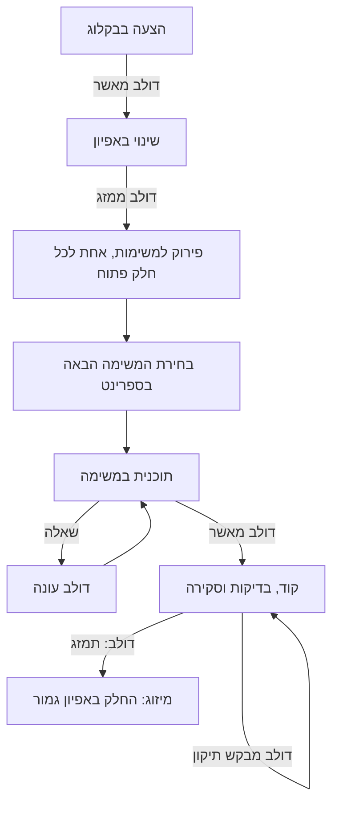
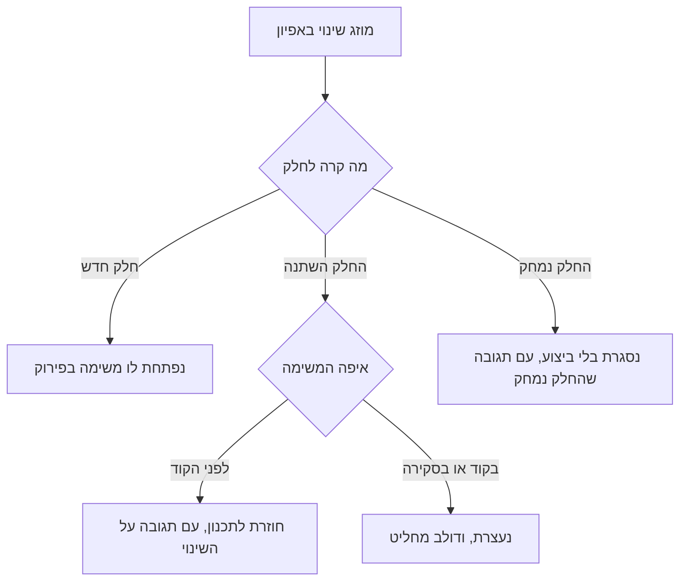

# האפיון של claude-config

האפיון הזה אומר מה יש ב-claude-config, למה, ומה עוד פתוח.

הקוראים: דולב, שמחליט מה נבנה, והסוכנים, שמתכננים וכותבים קוד לפי האפיון.

<!-- toc -->
## תוכן העניינים

- [מה זה claude-config, ולמה](#מה-זה-claude-config-ולמה)
- [איך התהליך עובד, מקצה לקצה](#איך-התהליך-עובד-מקצה-לקצה)
- [איך קוראים את המסמך הזה](#איך-קוראים-את-המסמך-הזה)
- [פרק 1 · צינור העבודה](#פרק-1--צינור-העבודה)
  - [הסדר והתוויות](#הסדר-והתוויות)
    - [הסטטוס אומר של מי התור (S-1.1)](#s-11--הסטטוס-אומר-של-מי-התור)
    - [הספרינט הוא milestone (S-1.2)](#s-12--הספרינט-הוא-milestone)
    - [הסדר בתוך הספרינט (S-1.3)](#s-13--הסדר-בתוך-הספרינט)
    - [המסלול הקטן (S-1.4)](#s-14--המסלול-הקטן)
    - [באג (S-1.5)](#s-15--באג)
    - [משימות על ניהול העבודה (S-1.6)](#s-16--משימות-על-ניהול-העבודה)
    - [משימות שעולות כסף (S-1.7)](#s-17--משימות-שעולות-כסף)
    - [שער השאלות הפתוחות (S-1.8)](#s-18--שער-השאלות-הפתוחות)
    - [הסנכרון עם הלוח (S-1.9)](#s-19--הסנכרון-עם-הלוח)
    - [התצוגות של הלוח (S-1.10)](#s-110--התצוגות-של-הלוח)
  - [השלבים](#השלבים)
    - [שינוי באפיון (S-1.11)](#s-111--שינוי-באפיון)
    - [פתיחת issues (S-1.12)](#s-112--פתיחת-issues)
    - [המשימה הבאה (S-1.13)](#s-113--המשימה-הבאה)
    - [תכנון (S-1.14)](#s-114--תכנון)
    - [קוד (S-1.15)](#s-115--קוד)
    - [מיזוג (S-1.16)](#s-116--מיזוג)
    - [התקנת הצינור בריפו (S-1.17)](#s-117--התקנת-הצינור-בריפו)
    - [טפסי ה-issues המשותפים (S-1.18)](#s-118--טפסי-ה-issues-המשותפים)
    - [lint אחיד (S-1.19)](#s-119--lint-אחיד)
    - [מדריך הקבצים (S-1.20)](#s-120--מדריך-הקבצים)
    - [מפת הריפו בתיקיות (S-1.37)](#s-137--מפת-הריפו-בתיקיות)
    - [הגנה על ה-branch הראשי (S-1.21)](#s-121--הגנה-על-ה-branch-הראשי)
    - [deploy רק כשהאתר משתנה (S-1.22)](#s-122--deploy-רק-כשהאתר-משתנה)
  - [ההחלטות והתיעוד](#ההחלטות-והתיעוד)
    - [החלטות בחלון השאלות (S-1.23)](#s-123--החלטות-בחלון-השאלות)
    - [דפי החלטות (S-1.24)](#s-124--דפי-החלטות)
    - [מסירה עשירה לסקירה (S-1.25)](#s-125--מסירה-עשירה-לסקירה)
    - [בלי התראות לטלפון (S-1.36)](#s-136--בלי-התראות-לטלפון)
    - [התרשים והעמוד "חייו של issue" (S-1.26)](#s-126--התרשים-והעמוד-חייו-של-issue)
    - [ידע מסודר ומעודכן על הצינור (S-1.27)](#s-127--ידע-מסודר-ומעודכן-על-הצינור)
  - [הסדר החדש: הצעה, אפיון, issue, קוד](#הסדר-החדש-הצעה-אפיון-issue-קוד)
    - [הפורמט של קובץ אפיון והבדיקה שלו (S-1.28)](#s-128--הפורמט-של-קובץ-אפיון-והבדיקה-שלו)
    - [השלבים קוראים את האפיון (S-1.29)](#s-129--השלבים-קוראים-את-האפיון)
    - [אפיון של כל claude-config (S-1.30)](#s-130--אפיון-של-כל-claude-config)
    - [המשימות הפתוחות עוברות לסדר החדש (S-1.31)](#s-131--המשימות-הפתוחות-עוברות-לסדר-החדש)
    - [נושא אחד מקצה לקצה (S-1.32)](#s-132--נושא-אחד-מקצה-לקצה)
    - [כל שינוי מתחיל באפיון (S-1.34)](#s-134--כל-שינוי-מתחיל-באפיון)
    - [תוכן עניינים שמתעדכן עם הכותרות (S-1.35)](#s-135--תוכן-עניינים-שמתעדכן-עם-הכותרות)
    - [כל פרק אומר איפה הוא גר (S-1.38)](#s-138--כל-פרק-אומר-איפה-הוא-גר)
    - [המצב וה-issue בתוכן העניינים (S-1.39)](#s-139--המצב-וה-issue-בתוכן-העניינים)
    - [האפיון מתאר מה, לא איך (S-1.40)](#s-140--האפיון-מתאר-מה-לא-איך)
  - [איכות הסקילים](#איכות-הסקילים)
    - [מבחנים לסקילים (S-1.33)](#s-133--מבחנים-לסקילים)
- [פרק 2 · המתזמר](#פרק-2--המתזמר)
  - [הסבב](#הסבב)
    - [מתזמר שמריץ את הספרינט (S-2.1)](#s-21--מתזמר-שמריץ-את-הספרינט)
    - [מצב הספרינט בתמונה אחת (S-2.2)](#s-22--מצב-הספרינט-בתמונה-אחת)
    - [חלון אחד לכל ההחלטות (S-2.3)](#s-23--חלון-אחד-לכל-ההחלטות)
  - [הבנים](#הבנים)
    - [פתיחת בן והחוזה שלו (S-2.4)](#s-24--פתיחת-בן-והחוזה-שלו)
    - [המעקב דרך GitHub, בלי הודעות (S-2.5)](#s-25--המעקב-דרך-github-בלי-הודעות)
    - [מצב בן: עובד, חסום, סיים או נכשל (S-2.6)](#s-26--מצב-בן-עובד-חסום-סיים-או-נכשל)
    - [בן שסיים עובר לארכיון (S-2.7)](#s-27--בן-שסיים-עובר-לארכיון)
    - [באג, קישור או פיצול שבן מצא (S-2.8)](#s-28--באג-קישור-או-פיצול-שבן-מצא)
  - [המיזוג והתחזוקה](#המיזוג-והתחזוקה)
    - [מיזוג מהמתזמר (S-2.9)](#s-29--מיזוג-מהמתזמר)
    - [שינוי בצינור באמצע ספרינט (S-2.10)](#s-210--שינוי-בצינור-באמצע-ספרינט)
    - [branches יתומים בסוף הספרינט (S-2.11)](#s-211--branches-יתומים-בסוף-הספרינט)
    - [מסירה למתזמר חדש (S-2.12)](#s-212--מסירה-למתזמר-חדש)
    - [המתזמר החדש מאמץ את הבנים (S-2.13)](#s-213--המתזמר-החדש-מאמץ-את-הבנים)
- [פרק 3 · השומרים](#פרק-3--השומרים)
  - [מיזוג ו-git](#מיזוג-ו-git)
    - [אישור לפני כל מיזוג (S-3.1)](#s-31--אישור-לפני-כל-מיזוג)
    - [כותרת המיזוג באה מה-PR (S-3.2)](#s-32--כותרת-המיזוג-באה-מה-pr)
    - [בלי force push (S-3.3)](#s-33--בלי-force-push)
    - [`/compact` אחרי מיזוג (S-3.4)](#s-34--compact-אחרי-מיזוג)
  - [התיקייה והקבצים](#התיקייה-והקבצים)
    - [שמירה על התיקייה הראשית (S-3.5)](#s-35--שמירה-על-התיקייה-הראשית)
    - [כל סוכן כותב רק בחלק שלו (S-3.6)](#s-36--כל-סוכן-כותב-רק-בחלק-שלו)
    - [עברית בסקריפטי PowerShell (S-3.7)](#s-37--עברית-בסקריפטי-powershell)
    - [עיצוב אוטומטי לקובץ Python (S-3.8)](#s-38--עיצוב-אוטומטי-לקובץ-python)
  - [סשנים](#סשנים)
    - [חלון לסשן-בן עם הרשאות רחבות (S-3.9)](#s-39--חלון-לסשן-בן-עם-הרשאות-רחבות)
    - [מתזמר לא פועל בכללים ישנים (S-3.10)](#s-310--מתזמר-לא-פועל-בכללים-ישנים)
- [פרק 4 · הכללים](#פרק-4--הכללים)
  - [איך Claude עונה לדולב](#איך-claude-עונה-לדולב)
    - [תשובה כמו דוח מנהלים (S-4.1)](#s-41--תשובה-כמו-דוח-מנהלים)
    - ["מה פתוח" בסוף כל תשובה (S-4.2)](#s-42--מה-פתוח-בסוף-כל-תשובה)
  - [נהלי הקוד](#נהלי-הקוד)
    - [נהלי קוד כלליים ולפי שפה (S-4.3)](#s-43--נהלי-קוד-כלליים-ולפי-שפה)
    - [מה בודקים בכל שינוי (S-4.4)](#s-44--מה-בודקים-בכל-שינוי)
    - [תרשים הסכמה (ERD) (S-4.5)](#s-45--תרשים-הסכמה-erd)
    - [נהלי git (S-4.6)](#s-46--נהלי-git)
  - [הסביבה](#הסביבה)
    - [המחשב של דולב (S-4.7)](#s-47--המחשב-של-דולב)
    - [סשן ענן (S-4.8)](#s-48--סשן-ענן)
  - [לקחים](#לקחים)
    - [לקחים שנכנסים לכללים רק באישור (S-4.9)](#s-49--לקחים-שנכנסים-לכללים-רק-באישור)
- [פרק 5 · סביבת הענן](#פרק-5--סביבת-הענן)
  - [ההקמה](#ההקמה)
    - [סשן ענן טוען את ההגדרות של claude-config (S-5.1)](#s-51--סשן-ענן-טוען-את-ההגדרות-של-claude-config)
    - [ריענון בתחילת כל סשן (S-5.2)](#s-52--ריענון-בתחילת-כל-סשן)
    - [שליטה מהטלפון בסשן שרץ על המחשב (S-5.3)](#s-53--שליטה-מהטלפון-בסשן-שרץ-על-המחשב)
  - [GitHub בענן](#github-בענן)
    - [הסקריפטים קוראים מ-GitHub בלי GraphQL (S-5.4)](#s-54--הסקריפטים-קוראים-מ-github-בלי-graphql)
    - [הסקילים עובדים בענן דרך טבלה אחת (S-5.5)](#s-55--הסקילים-עובדים-בענן-דרך-טבלה-אחת)
    - [ה-branch ושם הסשן בענן (S-5.6)](#s-56--ה-branch-ושם-הסשן-בענן)
  - [ההרשאות](#ההרשאות)
    - [כלים שגרתיים בלי חלון אישור (S-5.7)](#s-57--כלים-שגרתיים-בלי-חלון-אישור)
    - [חלונות שהשירות מכריח (S-5.8)](#s-58--חלונות-שהשירות-מכריח)
<!-- /toc -->

## מה זה claude-config, ולמה

התיקייה claude-config היא המקום שממנו Claude Code טוען את ההגדרות של דולב, בכל סשן ובכל ריפו.

המטרה: שכל עבודה עם Claude תתנהל באותה דרך, בלי להסביר אותה מחדש בכל פרויקט.

יש לו ארבע מטרות:
1. **התשובות של Claude לדולב הן דוח מנהלים:** בעברית, השורה התחתונה קודם, וכל שאלה בחלון השאלות.
2. **אותם נהלים בכל ריפו:** איך כותבים קוד, מה בודקים, ואיך עובדים עם git.
3. **צינור עבודה אחד לכל המשימות:** מהרעיון ועד המיזוג, כשדולב מחליט בכל שער ו-Claude עושה את השאר.
4. **שומרים שאוכפים את מה שאסור לשכוח:** מיזוג רק באישור, בלי לדרוס עבודה, ובלי לשבור את ההגדרות החיות.

הכל עובד גם בסשן ענן, כשדולב לא יושב מול המחשב.

שם גם אפשר להריץ ספרינט שלם מסשן אחד.

## איך התהליך עובד, מקצה לקצה

כל עבודה עוברת באותו סדר:
1. **הצעה:** רעיון נכנס לבקלוג כ-issue.\
   עדיין לא מחליטים עליו.
2. **אפיון:** כשדולב מאשר את ההצעה, Claude מכניס אותה לאפיון של הריפו, ב-PR: חלק חדש, או שינוי בחלק קיים.\
   האפיון הוא אחד לכל הריפו, ולא מסמך לכל הצעה או לכל issue.\
   המיזוג של ה-PR הוא האישור של ה"מה".\
   מה שלא ברור נשאל, ולא מומצא.
3. **פירוק ל-issues:** כל חלק פתוח באפיון הופך ל-issue משלו, שמצביע על החלק במזהה שלו.\
   קישורי ה-Blocked by בין ה-issues נוצרים רק לפי התלויות שכתובות באפיון, ומהם נקבע הסדר.
4. **בחירת המשימה הבאה:** בתוך הספרינט, המשימה שהכי הרבה משימות מחכות לה.\
   באג קודם.
5. **תוכנית:** Claude חוקר וכותב את ה"איך" בגוף ה-issue.\
   שאלה עוצרת את התור לטובת דולב, ודולב מאשר את התוכנית.\
   משימה קטנה ובאג מדלגים על האישור.
6. **קוד:** Claude כותב ב-branch משלו, מריץ בדיקות, סוקר את השינוי ובודק את מה שהמשתמש רואה.\
   באותו PR הוא מסמן את החלק באפיון כגמור.\
   הוא מוסר את ה-PR לדולב לסקירה, עם קישור לשינויים וצילומים.
7. **מיזוג:** רק כשדולב מבקש בצ'אט, על משימה מסוימת.\
   הסימון באפיון נכנס יחד עם הקוד, וה-issue נסגר.

התרשים מראה את הסדר, ואת השערים שבהם דולב מחליט:

בכל רגע תווית אחת אומרת של מי התור: של Claude או של דולב.

המתזמר מריץ את התכנון והקוד של כמה משימות במקביל, ומרכז את כל ההחלטות של דולב בחלון אחד.

את האפיון ואת הפירוק הוא לא מריץ: הם רצים רק כשדולב מבקש.

## איך קוראים את המסמך הזה

המסמך מחולק לחמישה פרקים:
1. צינור העבודה.
2. המתזמר.
3. השומרים.
4. הכללים.
5. סביבת הענן.

כל יכולת היא חלק עם מזהה קבוע, `S-<פרק>.<חלק>`, ש-issues מצביעים עליו.

חלק גמור מתחיל בשורה `**מצב:** Done (#N)`, עם ה-issue שבנה אותו.

חלק פתוח מתחיל בשורה `**מצב:** פתוח (#N)`, עם ה-issues שבונים אותו.

חלק שבוטל נמחק, והמספר שלו לא חוזר.

יכולת שנבנתה לפני שהיו issues מסומנת ב-Done של ה-issue הראשון שנגע בה, והחלק אומר שהיא קודמת לצינור.

הכתוב "שופר ב-#X" אומר ש-issue אחר שיפר את היכולת אחרי שנבנתה.

## פרק 1 · צינור העבודה

איך משימה עוברת מרעיון למיזוג בכל ריפו של דולב: התוויות, הספרינט, השלבים `dev-*`, וההחלטות שבדרך.
הקוראים: דולב, שמחליט בכל שער, והסוכנים שמריצים את השלבים.

### הסדר והתוויות

#### S-1.1 · הסטטוס אומר של מי התור
**מצב:** Done (#110)

לכל issue בצינור יש תווית סטטוס אחת בדיוק, והיא לבדה אומרת של מי התור: של Claude או של דולב.
המצבים: ממתין לתכנון, שאלה לדולב, תוכנית שמחכה לאישור, מאושר לביצוע, חזר לתיקון, בסקירה, מוזג, ובבקלוג.
כל מעבר הוא החלפה של תווית אחת באחרת, באותה פעולה.
תשובה של דולב לשאלה, או תוכנית שהוא מחזיר, מחזירות את ה-issue לתכנון, ושם התוכנית מתעדכנת ולא נכתבת מאפס.
התוויות עצמן קודמות לצינור. ב-#110 ירדה תווית הבעלים, ומאז הסטטוס לבדו קובע.
לא כלול: הלוח, שמשקף את התוויות (S-1.9).

#### S-1.2 · הספרינט הוא milestone
**מצב:** Done (#11)

ספרינט הוא milestone של GitHub, בלי תאריכי יעד.
הספרינט הנוכחי הוא ה-milestone הפתוח עם המספר הנמוך ביותר שיש בו issues פתוחים. כשהוא מתרוקן, הבא הופך לנוכחי לבד.
דולב קובע מה בספרינט. Claude לא משייך milestone, חוץ מבאג ומשימת `process`, שנפתחים תמיד בספרינט הנוכחי.
סריקה לא מושכת משימה מחוץ לספרינט, גם כשהתור ריק. issue שדולב נקב בשמו מטופל גם מחוצה לו.
issue פעיל בלי ספרינט מדווח כהתראה, ולא מתוקן לבד (שופר ב-#55).
הכלל של הספרינט הנוכחי קודם לצינור. ב-#164 הוא נהיה כלל אחד לכל הכלים.

#### S-1.3 · הסדר בתוך הספרינט
**מצב:** Done (#38)

בתוך הספרינט, המשימה הבאה היא זו שהכי הרבה משימות אחרות מחכות לה דרך קישורי Blocked by.
באג נבחר תמיד לפני משימה חדשה (שופר ב-#202), ואחריו משימת `process`.
משימה עם חוסם פתוח לא נלקחת, ומדווחת עם החוסמים שלה.
דולב יכול לבקש בדיקה של הסדר כולו: אילו קישורים חסרים, מיותרים, או משימות שכדאי לאחד (שופר ב-#54).
הדירוג לפי Blocked by קודם לצינור.

#### S-1.4 · המסלול הקטן
**מצב:** Done (#107)

משימה קטנה מדלגת על אישור התוכנית, ועוברת ישר לביצוע עם תוכנית מקוצרת.
היא קטנה רק כשכל ארבעת התנאים מתקיימים: עד כשלושה קבצים, בלי שינוי שמשתמש רואה, בלי מחיקה, ובלי שינוי חוזה או תלות חדשה.
דולב רואה אותה בסיכום התכנון וב-PR, ויכול להחזיר אותה למסלול הרגיל.
משימה שגדלה בביצוע מעבר לתנאים נעצרת וחוזרת לתכנון.

#### S-1.5 · באג
**מצב:** Done (#11)

באג נפתח מהטופס ישר לביצוע, בלי שלב אישור.
לפני השורה הראשונה של הקוד הוא מקבל תוכנית מקוצרת בגוף ה-issue (שופר ב-#167).
באג שהתיקון שלו מוחק משהו, משנה חוזה או מוסיף תלות חוזר לתכנון מלא.
המסלול הישיר של באג קודם לצינור.

#### S-1.6 · משימות על ניהול העבודה
**מצב:** Done (#38)

משימת `process` היא משימה על הצינור ועל הנהלים, ולא על הפרויקט: למשל יישור קו של ריפו עם claude-config.
היא עולה ראשונה בדירוג אחרי באג, ונפתחת תמיד בספרינט הנוכחי.

#### S-1.7 · משימות שעולות כסף
**מצב:** Done (#43)

משימה שדורשת הוצאה כספית מסומנת `costs-money`, ומושהית עד שדולב מאשר את ההוצאה.
היא יוצאת מהדירוג, ו-`dev-next` לא מציע אותה. משימה שדולב ביקש בשמה עובדת כרגיל.
רק דולב מסיר את הסימון.

#### S-1.8 · שער השאלות הפתוחות
**מצב:** Done (#2)

כל issue עם שאלה פתוחה לא מסומנת מקבל `has-open-questions`, והבדיקה של ה-PR שלו נכשלת עד שכל השאלות מסומנות.
השער יודע לדלג על קווים מפרידים, על ה-footer שהענן מוסיף לכל גוף (שופר ב-#142), ולספור גם שאלה מודגשת (שופר ב-#153).
עותק אחד של השער משרת את כל הריפואים.
השער קודם לצינור, ונהיה משותף ב-#2.

#### S-1.9 · הסנכרון עם הלוח
**מצב:** Done (#3)

הלוח של כל ריפו משקף את תוויות הסטטוס, בכיוון אחד: מהתווית לעמודה (שופר ב-#111).
issue שנסגר כהושלם מקבל `status:done` (שופר ב-#97), ו-issue שנסגר כ-not planned יוצא מהלוח לארכיון (שופר ב-#219).
issue של החלטה לא מקבל עמודה מחדש (שופר ב-#128).
סריקה מרכזית אחת עוברת על כל הלוחות כל כמה שעות, ונכשלת כשמספר הלוחות שהיא רואה שונה מהצפוי (שופר ב-#46, #49, #129).
הסנכרון קודם לצינור, ונהיה משותף ב-#3.

#### S-1.10 · התצוגות של הלוח
**מצב:** Done (#13)

התקנת הצינור יוצרת את התצוגות של הלוח, ותצוגת הספרינט עוקבת אחרי הספרינט הנוכחי בלי עדכון ידני (שופר ב-#17).

### השלבים

#### S-1.11 · שינוי באפיון
**מצב:** Done (#227)

הסקיל `dev-spec` כותב את ה"מה" וה"למה" של שינוי בתוך האפיון של הריפו: מוסיף חלקים, או משנה חלקים קיימים.
הוא פותח את השינוי כ-PR, והמיזוג הוא האישור של ה"מה".
לכל ריפו יש אפיון אחד, והשינוי נכנס לפרק של הנושא שלו, או לפרק חדש (שופר ב-#242).
הוא רץ רק כשדולב מבקש, על הצעה בבקלוג או על משימה שהתוצר שלה הוא אפיון.
המתזמר לא שולח בן לכתוב אפיון.
מה שלא ברור לא נכתב כדרישה: הוא שאלה פתוחה בגוף ה-PR.
לא כלול: הפירוק ל-issues, שהוא של `dev-issue` (S-1.29).

#### S-1.12 · פתיחת issues
**מצב:** Done (#11)

הסקיל `dev-issue` פותח משימות, באגים ורעיונות לבקלוג בפורמט של הצינור: הסעיפים, התוויות, ה-milestone וקישורי Blocked by.
הוא גם מפצל משימה ל-sub-issues, ומפרק אפיון ל-issue לכל חלק פתוח.
הרשימה מוצגת לדולב לפני שנוצר משהו.
משימה נפתחת רק מחלק פתוח באפיון. אין חלק כזה, או שהיא משנה חלק גמור: היא נפתחת כהצעה בבקלוג, עם ההצעה לכתוב לה אפיון.
אחרי שנפתחה משימה לחלק, PR קטן כותב בחלק את מספר ה-issue שלו, ודולב ממזג אותו (שופר ב-#243).
הסקיל קודם לצינור.

#### S-1.13 · המשימה הבאה
**מצב:** Done (#6)

הסקיל `dev-next` בוחר את המשימה הבאה לפי הסדר של S-1.3, ומנתב אותה לתכנון או לקוד לפי הסטטוס.
כשהתור מחכה לדולב, הוא אומר את זה במילים, ולא מתחיל כלום.
הסקיל קודם לצינור.

#### S-1.14 · תכנון
**מצב:** Done (#11)

הסקיל `dev-plan` חוקר issue וכותב לו תוכנית בגוף, בשתי רמות: "בקצרה" לדולב, ו"פירוט טכני" לסוכן.
התוכנית נערכת בגוף ולא נכתבת בתגובה, וההיקף נבדק לפני שהיא נכתבת (שניהם נוספו בלי issue).
יש בה סעיף קבוע של חוויית משתמש (שופר ב-#102).
ב"בקצרה" יש גם הסבר קצר, במשפט או שניים, על איפה המשימה יושבת באפיון: הפרק, מה החלק עושה בו ולמה הוא חשוב, ומה תלוי בו או במה הוא תלוי. המתזמר מראה את ההסבר בשאלת האישור (שופר ב-#238).
שאלה נכתבת כתיבה לא מסומנת, והתוכנית מחכה לאישור של דולב, חוץ מהמסלול הקטן (S-1.4).
הסקיל קודם לצינור.

#### S-1.15 · קוד
**מצב:** Done (#6)

הסקיל `dev-code` מממש issue מאושר, ב-worktree משלו, ופותח PR. הוא לא ממזג.
בזמן ש-CI רץ, סוכן סוקר את ה-diff, והאפליקציה עולה לסקירה עם קישור (שופר ב-#42, #73).
הבדיקות הממוקדות רצות בזמן הכתיבה, והחבילות המלאות רצות פעם אחת, במקביל, אחרי ה-rebase (שופר ב-#74).
משימה גדולה נכתבת במקביל, סוכן לכל חלק (שופר ב-#72).
החוויה נבדקת בדפדפן מול סעיף חוויית המשתמש, ברוחב מחשב וטלפון (שופר ב-#102).
PR אדום לא נמסר לסקירה.
הסקיל קודם לצינור.

#### S-1.16 · מיזוג
**מצב:** Done (#6)

הסקיל `dev-ship` ממזג PR אחד, מקצה לקצה: rebase, בדיקות, CI ירוק, squash, `status:done`, וניקוי.
אות המיזוג הוא בקשה של דולב בצ'אט על issue מסוים, ולא תווית ולא Approve (שופר ב-#108).
אחרי המיזוג הניקוי שלם, בלי להחליף branch בתיקייה המשותפת (שופר ב-#166), ומוצע סשן למשימה הבאה.
ההודעה האחרונה אחרי מיזוג נגמרת בפקודת `/compact` מוכנה להעתקה (S-3.4).
הסקיל קודם לצינור.

#### S-1.17 · התקנת הצינור בריפו
**מצב:** Done (#2)

הסקיל `dev-setup` מתקין את הצינור בריפו: התוויות, בדיקה שהטפסים המשותפים מגיעים, השער, הסנכרון, הספרינטים, הלוח, ושורה שמפנה לצינור בהנחיות של הריפו.
כל צעד מוצע, ודולב מאשר. תווית שכבר קיימת לא נדרסת.
ריפו שהותקן לפני הסדר החדש מקבל הצעה לעבור אליו (S-1.29).
הסקיל קודם לצינור.

#### S-1.18 · טפסי ה-issues המשותפים
**מצב:** Done (#11)

הטפסים של משימה ושל באג גרים בעותק אחד, בריפו הציבורי של דולב, ומשם מגיעים לכל הריפואים.
שינוי בטופס מגיע לכולם מיד.

#### S-1.19 · lint אחיד
**מצב:** Done (#21)

כל ריפו מקבל את אותן הגדרות lint, כעותק, ובדיקה מגלה עותק שסטה מהתבנית.
claude-config עצמו רץ על אותן הגדרות (שופר ב-#37).

#### S-1.20 · מדריך הקבצים
**מצב:** Done (#28)

לכל ריפו יש מדריך קבצים: מה כל קובץ ולמה הוא קיים.
בדיקה ב-CI נכשלת כשקובץ חסר במדריך, או כשהמדריך מזכיר קובץ שלא קיים (שופר ב-#89).
שתי שורות שנוספו בשני PRים לא מתנגשות ב-rebase (שופר ב-#121).

#### S-1.37 · מפת הריפו בתיקיות

ה-README שבשורש מראה את מבנה התיקיות של הריפו: לכל תיקייה משפט אחד שאומר מה היא, ולאיזה פרק באפיון היא שייכת.
לכל תיקייה יש README משלה, שמסביר את הקבצים שבתוכה: משפט לכל קובץ, מה הוא ולמה הוא קיים.
בלי היסטוריה ובלי מספרי issues: ההיסטוריה ב-git וב-issues.
מה שמתואר באפיון או במסמך בעלים לא מתואר שוב: ה-README מפנה אליו.

חריג: תיקייה שכל קובץ בה נטען אוטומטית לכל סשן, כמו תיקיית הכללים, לא מקבלת README. ה-README שבשורש מתאר את הקבצים שלה.

הבדיקה ב-CI ממשיכה לעבוד כמו במדריך הקבצים (S-1.20): קובץ שחסר ב-README של התיקייה שלו, או README שמזכיר קובץ שלא קיים, מכשילים אותה.
גם תיקייה חדשה בלי README מכשילה אותה.

לא כלול: ההסבר של כל כלל, שנשאר במסמך הבעלים שלו.

#### S-1.21 · הגנה על ה-branch הראשי
**מצב:** Done (#162)

ההתקנה מגינה על ה-branch הראשי: כל שינוי עובר PR, בלי force push ובלי מחיקה.

#### S-1.22 · deploy רק כשהאתר משתנה
**מצב:** Done (#50)

ריפו עם אתר ב-Netlify מקבל כלל שמדלג על deploy כשהאתר לא השתנה, כדי לחסוך קרדיטים.
ההתקנה מגלה כלל חסר או שונה מהתבנית.

### ההחלטות והתיעוד

#### S-1.23 · החלטות בחלון השאלות
**מצב:** Done (#126)

ההחלטות של דולב מוצעות לו בחלון השאלות בצ'אט: תשובה לשאלה, אישור תוכנית, מיזוג או תיקון.
ההמלצה ראשונה. קודם מוצבת התווית, ואחר כך נשאלת השאלה, כך שריצה שאף אחד לא ענה לה נשארת נכונה.
החלטה באה רק מדולב עצמו, ולא מהודעה של סשן אחר.

#### S-1.24 · דפי החלטות
**מצב:** Done (#187)

החלטה שחוצה משימות (כלי, ארכיטקטורה, כלל עבודה) מקבלת דף משלה: רקע, החלטה, חלופות שנדחו ומחיר.
דף לא משתנה. החלטה שמשתנה מקבלת דף חדש שמחליף את הקודם.
הטיוטה נכתבת בתוכנית, והדף נכנס באותו PR.

#### S-1.25 · מסירה עשירה לסקירה
**מצב:** Done (#127)

כשמשימה מוכנה לסקירה, דולב מקבל קישור לשינויים וצילומי מסך של המסך שהשתנה.
בענן הצילומים ברוחב מחשב וטלפון. במחשב רק ברוחב מחשב, כי שם אין כלי שמצלם ברוחב טלפון אמיתי.
ההערה ב-issue אומרת מה השתנה, מה נבדק, מה מצאה הסקירה ומה תוקן.

#### S-1.36 · בלי התראות לטלפון
**מצב:** Done (#236)

המסירה לסקירה לא שולחת התראה לטלפון.
דולב רואה שמשימה מוכנה לפי ההודעה בצ'אט ולפי התווית, ולא לפי התראה.
ההתראה נמחקת גם מהסקילים, מהתרשים ומהעמוד "חייו של issue".
הבדיקה: משימה שעוברת לסקירה לא שולחת התראה, ואין אזכור שלה בצינור.
המשימה: #236.

#### S-1.26 · התרשים והעמוד "חייו של issue"
**מצב:** Done (#84)

תרשים של הצינור ועמוד "חייו של issue" מראים לבני אדם איך משימה עוברת את השלבים.
לעמוד גרסה בעברית וגרסה באנגלית, שמתארות אותו תהליך (האנגלית נוספה בלי issue).
כל שינוי בשלבים, בתוויות או בשערים מעדכן את התרשים ואת שתי הגרסאות באותו PR, ומי שממזג מפרסם אותן מחדש.

#### S-1.27 · ידע מסודר ומעודכן על הצינור
**מצב:** Done (#152)

מקום אחד, מעודכן, שמסביר את הסקילים ואת הצינור כמו שהם עובדים היום, בענן ובמחשב.
הידע הקיים מפוזר במסמכי הצינור, בתרשים, בעמוד "חייו של issue" ובמדריך הקבצים, והוא נכתב לפני המעבר לענן ולפני המתזמר.
מה רוצים: להשוות אותו ל-`main`, לעדכן ולמחוק את מה שכבר לא נכון, להחליט אם הוא מתרכז במקום אחד, ולהחליט איך הוא נשאר מעודכן.
מי שקורא אותו מבין את הצינור בלי לקרוא את הסקילים עצמם.
לא כלול: פיצול מסמכי הצינור הארוכים, שהוא הצעה בבקלוג (#234).
תלוי ב-S-1.31.

### הסדר החדש: הצעה, אפיון, issue, קוד

#### S-1.28 · הפורמט של קובץ אפיון והבדיקה שלו
**מצב:** Done (#226)

האפיון מחולק לחלקים, וכל חלק מקבל מזהה קבוע ושורת מצב: גמור, או פתוח עם ה-issues שבונים אותו.
לכל ריפו יש אפיון אחד, והנושאים פרקים בו. חלק שבוטל נמחק, ו"מחוץ להיקף" כבר לא בפורמט (שופר ב-#242).
issue מצביע על החלקים שלו בשורת `אפיון:`.
בדיקה ב-CI נכשלת על שגיאה בקובץ (מזהה כפול, כותרת שבורה, שורת מצב לא מוכרת), ומזהירה על פער בין issues לאפיון: גם על חלק פתוח בלי שורה, על שורת "פתוח" שה-issue שלה סגור או לא מצביע על החלק, על "מחוץ להיקף", ועל יותר מקובץ אפיון אחד.
טבלה אחת מראה לכל חלק את המצב שלו ואת ה-issue שלו.

#### S-1.29 · השלבים קוראים את האפיון
**מצב:** Done (#227)

כל שלב בצינור עובד מול האפיון:
1. אחרי מיזוג של אפיון, `dev-ship` מציע את הפירוק: issue לכל חלק פתוח, עם שורת `אפיון:`, ו-Blocked by רק לפי התלויות שכתובות בו. הוא גם מציע לעדכן את ה-issues של חלקים שהשתנו או נמחקו (שופר ב-#244).
2. התוכנית של issue עם אפיון מקוצרת ל"איך", כי ה"מה" כבר אושר.
3. ה-PR של הקוד מסמן את החלק כגמור, כך שהמצב בקובץ משתנה רק במיזוג.
4. באג מצביע על החלק שהוא שובר, ולא מקבל אפיון חדש.
5. issue בלי חלק פתוח באפיון, שאינו באג, לא מקבל תוכנית: הוא חוזר לבקלוג כהצעה (שופר ב-#243).
6. ריפו שהותקן לפני הסדר החדש מקבל הצעה לעבור אליו.
7. המתזמר מראה פערים בין issues לאפיון כשורות בסיכום, בלי לעצור (S-2.2).

#### S-1.30 · אפיון של כל claude-config
**מצב:** Done (#230)

אפיון אחד מתאר את כל מה שיש בריפו.
הוא נפתח בהסבר על המטרות ועל תהליך העבודה, ואחריו באים חמשת הפרקים.
כל יכולת קיימת היא חלק גמור, וכל משימה פתוחה שאינה בבקלוג היא חלק פתוח, כדי שיהיה לה על מה להצביע.
התוכן נלקח מהקוד ומהמסמכים, בלי דרישות חדשות.
לא כלול: שורת `אפיון:` במשימות הפתוחות (S-1.31), והמעבר של נושא אחד מקצה לקצה (S-1.32).

#### S-1.31 · המשימות הפתוחות עוברות לסדר החדש
**מצב:** Done (#228)

גוזרים את ה-issues מהאפיון של claude-config.
לכל חלק פתוח שאף issue לא מצביע עליו נפתח issue, ומשימה פתוחה שכבר קיימת מקבלת שורת `אפיון:` לחלק שלה במקום issue חדש.
הבקלוג נשאר כמו שהוא.
ההעברה גמורה כשבדיקת האפיונים מול הריפו לא מזהירה על אף issue.
תלוי ב-S-1.30.

#### S-1.32 · נושא אחד מקצה לקצה
**מצב:** פתוח (#229)

נושא אחד עובר את כל הסדר החדש: הצעה בבקלוג, אפיון שמאושר במיזוג, issues שמצביעים על החלקים שלו, וקוד שמסמן חלק כגמור.
בסוף, באפיון רואים אילו מהחלקים של הנושא גמורים, וטבלת המצב תואמת לתוויות.
תלוי ב-S-1.31.

#### S-1.34 · כל שינוי מתחיל באפיון
**מצב:** Done (#239)

לכל ריפו יש אפיון אחד, וכל שינוי בפיתוח עובר דרכו קודם.
קודם מחליטים איפה באפיון השינוי יושב: חלק חדש, או שינוי בחלק קיים.
רק משם יוצאים לפירוק ל-issues.
מה רוצים:
1. **אפיון אחד לכל ריפו**, במקום קובץ לכל נושא. הנושאים הם פרקים בתוכו, כמו באפיון הזה.
2. **issue נפתח רק מחלק באפיון.** משימה לא נפתחת מהטופס בלי חלק, ומשימה קטנה לא מוסיפה חלק לאפיון בתוך ה-PR של הקוד.
3. **הבקלוג פטור:** הצעה נשארת בלי חלק עד שמתחילים לעבוד עליה. אז קודם משנים את האפיון, ורק אחר כך עובדים על המשימה.
4. **קשר בשני הכיוונים:** כל issue מצביע על החלק שלו, וכל חלק מצביע על ה-issue שלו.
   חלק פתוח מקבל שורה עם מספר ה-issue מתחת לכותרת, כמו שחלק גמור כותב אותו בשורת ה-Done.
5. **חלק שבוטל או הוחלף נמחק מהקובץ**, במקום הסימון "מחוץ להיקף". המספר שלו לא חוזר.
   ה-issue שמצביע עליו נסגר כ-not planned, עם תגובה שאומרת שהחלק שלו נמחק מהאפיון, ובאיזה שינוי.
6. **חלק שהשתנה:** ה-issue שלו חוזר לתכנון, עם תגובה שאומרת מה השתנה, והתוכנית מתעדכנת.
   issue שכבר בקוד או בסקירה נעצר, ודולב מחליט.
7. **מי מעדכן:** אחרי מיזוג של PR שמשנה את האפיון, `dev-ship` מציע את העדכון של ה-issues, יחד עם הצעת הפירוק.
   הרשימה מוצגת לדולב לפני שמשהו משתנה.

מה קורה ל-issue אחרי מיזוג של שינוי באפיון:

באג לא משתנה: הוא מצביע על החלק שהוא שובר, ולא מקבל חלק חדש.
הבדיקה: משימה שנפתחת בלי חלק באפיון לא עוברת לתכנון, וחלק שנמחק סוגר את ה-issue שלו עם תגובה שמסבירה למה.

#### S-1.35 · תוכן עניינים שמתעדכן עם הכותרות
**מצב:** Done (#230)

כל קובץ אפיון נפתח בתוכן עניינים: הפרקים, הקבוצות והחלקים, וכל שורה היא קישור לכותרת שלה.
בשורה של חלק השם בא קודם, והמזהה בסוגריים אחריו.
תוכן העניינים לא נכתב ביד: הבדיקה כותבת אותו מהכותרות.
חלק שנוסף, שנמחק או ששמו השתנה בלי שתוכן העניינים עודכן מכשיל את הבדיקה ב-PR.
קובץ שעוד אין לו תוכן עניינים רק מקבל אזהרה, כדי שריפו עם אפיונים ישנים לא ייכשל ביום שהבדיקה נוספה.

#### S-1.38 · כל פרק אומר איפה הוא גר
**תלוי ב-S-1.37.**

כל פרק באפיון נפתח בשורה "בריפו:", שמפנה לתיקיות שבהן הפרק גר.
כך מי שקורא פרק, אדם או סוכן, מגיע ממנו לתיקייה, ומשם ל-README שלה ולקובץ.
השורה ברמת הפרק ולא ברמת החלק: תיקייה כמעט לא זזה, וקובץ זז הרבה.
פרק שהשורה שלו מפנה לתיקייה שלא קיימת מכשיל את הבדיקה של האפיון.

#### S-1.39 · המצב וה-issue בתוכן העניינים

בתוכן העניינים, ליד כל חלק, מופיעים גם המצב שלו וה-issue שלו: גמור או פתוח, ועם הקישור ל-issue.
כך מי שפותח את האפיון רואה בתמונה אחת מה נבנה ומה עוד פתוח, בלי לגלול ובלי עמוד נוסף.
תוכן העניינים עדיין נכתב אוטומטית מהקובץ, והבדיקה נכשלת כשהוא לא תואם (S-1.35).

#### S-1.40 · האפיון מתאר מה, לא איך

חלק באפיון אומר מה המשתמש רואה, מי מחליט, מה אסור ומה קורה בכל מצב.
הוא לא חוזר על פרטים שמסמך בעלים אחראי עליהם: סדר מדויק, צורות של פקודות, ספירות ושמות של כלים.
כשפרט כזה חשוב להבנה, החלק מפנה אליו במילים, בלי להעתיק אותו.
כך שינוי במימוש לא משאיר את האפיון מאחור.

כל אפיון חדש נכתב כך.
החלקים הקיימים שמפרטים מימוש נכתבים מחדש לפי הכלל, ומה שהם אומרים לא משתנה.

### איכות הסקילים

#### S-1.33 · מבחנים לסקילים
**מצב:** Done (#183)

שלב ראשון: `dev-ship`, `dev-code`, `dev-plan`.

תרחישים קבועים לכל סקיל של הצינור, שתופסים נסיגה כשמשנים את הטקסט של סקיל.
לכל תרחיש: הקלט, ומה חייב לקרות (התוויות, מבנה גוף ה-issue, העצירה לפני מיזוג).
סט נפרד של תרחישים נשמר בצד ולא מכווננים עליו, כדי שהציון לא ייראה טוב יותר מהשימוש האמיתי.
ההרצה רק כשנוגעים בסקיל, ולא בכל PR.
הבדיקה: שינוי שמקלקל בכוונה כלל בסקיל (למשל מוריד את העצירה לפני מיזוג) נתפס בהרצה.
לא כלול: בדיקת קצה לקצה אוטומטית בדפדפן, שהוחלט לא לבנות (S-4.4).
תלוי ב-S-1.31.

## פרק 2 · המתזמר

סשן ענן אחד שמריץ את כל הספרינט: פותח סשן-בן לכל משימה שכבר לא חסומה, עוקב אחריהם, ומרכז מול דולב את כל ההחלטות.
הקוראים: דולב, שמפעיל אותו ועונה בחלון אחד, והסוכנים שרצים כמתזמר או כבן.
מה שהבנים עושים בפועל (תכנון, קוד) מתואר בפרק של צינור העבודה. כאן רק הניהול שלהם.

### הסבב

#### S-2.1 · מתזמר שמריץ את הספרינט
**מצב:** Done (#150)

דולב מפעיל את המתזמר בסשן ענן, במשפט כמו "תריץ את הספרינט".
המתזמר פותח בן לכל משימה שכבר לא חסומה, עד שלושה בנים פעילים לכל ריפו: בן תכנון למשימה שמחכה לתוכנית, ובן קוד למשימה מאושרת.
הוא לא מתעורר מעצמו בלי סיבה (שופר ב-#203), ולא ממזג בלי בקשה של דולב על אותו issue.
בתחילת הסבב דולב רואה תמונה: מה נפתח עכשיו, מה מחכה לחוסם או לקובץ משותף, ומה מחכה לו.
כל בדיקה נגמרת בשורת סיכום אחת, וכשאין מה לפתוח ואין מה לשאול, השורה אומרת למה הספרינט מחכה.
לא כלול: אפיון. המתזמר לא שולח בן לכתוב אפיון (S-1.11).

#### S-2.2 · מצב הספרינט בתמונה אחת
**מצב:** Done (#174)

בכל בדיקה המתזמר קורא את מצב הספרינט בפעולה אחת: מה מוכן לבן, מה מחכה לדולב, ומה מוכן למיזוג.
משימה שנוגעת בקובץ שבן אחר כבר משנה מחכה, והמתזמר אומר על איזה issue (שופר ב-#203).
פערים בין issues לאפיון מופיעים כשורות בסיכום, ולא עוצרים כלום (שופר ב-#227).
issue עוטף נחשב רק כשיש לו sub-issue פתוח (שופר ב-#211).

#### S-2.3 · חלון אחד לכל ההחלטות
**מצב:** Done (#150)

כל מה שמחכה לדולב נאסף לחלון שאלות אחד, הכי חשוב ראשון: שאלות של תוכנית, תוכנית לאישור, PR מוכן למיזוג, ובן שנתקע.
שאלת מיזוג מראה את מפת השינויים, את מצב ה-CI, ועם אילו משימות פעילות ה-PR חולק קבצים (שופר ב-#203).
יש רק שאלת מיזוג אחת בכל חלון.
אחרי הבחירה המתזמר מזיז את התווית, כותב תגובה, ופותח בן חדש כשצריך.

### הבנים

#### S-2.4 · פתיחת בן והחוזה שלו
**מצב:** Done (#150)

כל בן נפתח עם הריפו, עם השם של סשן ענן (S-5.6), ועם תגיות שמזהות את המתזמר, את הריפו ואת ה-issue (שופר ב-#217).
הבן מקבל חוזה קבוע: לעבוד רק על ה-issue שלו וב-branch שלו, לא לשאול את דולב ישירות, לא לגעת בקישורים ובמשימות אחרות, לא לשלוח הודעות, ולעולם לא למזג.
הדיווח של הבן הוא מה שהוא משאיר ב-GitHub: התוכנית והתווית, או PR, תווית והערת מסירה.
בן אחד לכל issue: לפני שנפתח בן חדש, הקודם עובר לארכיון.
בן שנפתח בלי הריפו לא יכול לעבוד, ולכן הריפו תמיד מועבר לו (שופר ב-#206).

#### S-2.5 · המעקב דרך GitHub, בלי הודעות
**מצב:** Done (#184)

בן לא שולח הודעות, כי כל הודעה מקפיצה לדולב חלון הרשאה.
שלושה דברים מעירים את המתזמר, ואף אחד מהם לא מקפיץ חלון:
1. בדיקה ברקע, שיוצאת כשהסטטוס של issue של בן זז או כשנוספה בו תגובה.
2. אירוע ב-PR של בן: CI, תגובה, מיזוג.
3. בדיקת גיבוי מתוזמנת, שתופסת בן שנעצר בלי לכתוב כלום.
תגובה של המתזמר עצמו מסומנת, ולא מעירה אותו (שופר ב-#203).
מה שהעיר את המתזמר הוא אות, לא החלטה: הוא בודק ב-GitHub את התוכנית, את ה-PR ואת מה שלא אמור להיות שם.

#### S-2.6 · מצב בן: עובד, חסום, סיים או נכשל
**מצב:** Done (#150)

המתזמר מבחין בין בן שעובד, בן שחסום על חלון הרשאה, בן שסיים את התור ובן שנכשל.
בן חסום מדווח לדולב: איזה כלי, באיזה סשן, עם קישור, ושזה חלון הרשאה ולא שאלה.
בן שסיים ומחכה להחלטה לא נחשב חסום ולא נספר בתקרה (שופר ב-#189).
כשהחשבון עובר לחיוב נוסף (overage), לא נפתח בן חדש, ודולב נשאל. שום צעד לא מציע שדרוג או שירות בתשלום.

#### S-2.7 · בן שסיים עובר לארכיון
**מצב:** Done (#203)

בן שסיים את התור עובר לארכיון באותה בדיקה שבה המתזמר אימת את מה שהשאיר ב-GitHub.
לפני כן דולב מקבל שורה: כמה חלונות הרשאה יגיעו, ושהם חלונות הרשאה.
השיחה של הבן נשארת לקריאה. תשובה, החזרה או תיקון פותחים בן חדש.
בסוף הספרינט כל בן שעוד לא בארכיון עובר אליו, כגיבוי.

#### S-2.8 · באג, קישור או פיצול שבן מצא
**מצב:** Done (#150)

בן לא נוגע בקישורים ובפיצולים. הוא מציע בתגובה, והמתזמר מחליט:
1. באג שפוגע במשימות אחרות נפתח בספרינט, חוסם את המשימות שנפגעות, והבנים שלהן נעצרים עד שהוא נסגר.
2. באג שנוגע רק למשימה של הבן מתוקן באותו branch.
3. קישור או פיצול שהבן מציע נשאלים בחלון של דולב. חפיפת קבצים לבדה לא מצדיקה קישור.

### המיזוג והתחזוקה

#### S-2.9 · מיזוג מהמתזמר
**מצב:** Done (#150)

מיזוג אחד בכל פעם, רק על בקשה של דולב לאותו issue, בהקלדה או בחלון.
המתזמר ממזג בעצמו, באותה דרך שבה ממזגים מחוץ לו: rebase, בדיקות ו-CI מחדש בכל פעם שה-branch הראשי זז.
אחרי מיזוג הוא מציע `/compact`, עם הפקודה המלאה.
החפיפה עם עבודה פעילה נמדדת לפי הקבצים שה-PR משנה בפועל, ולא רק לפי התוכנית (שופר ב-#203).

#### S-2.10 · שינוי בצינור באמצע ספרינט
**מצב:** Done (#192)

כשמוזג שינוי בצינור באמצע ספרינט, המתזמר מזהה אותו.
שינוי בסקילים, בסקריפטים או בשומרים: המתזמר מרענן את הקבצים וקורא את הסקיל מחדש.
שינוי בהנחיות, בכללים או בהגדרות, שנטענים רק בפתיחת סשן: המתזמר מוסר את הספרינט למתזמר חדש (S-2.12).
הזיהוי עובד גם מריפו של פרויקט, שאין לו גישה ל-API של claude-config (שופר ב-#211, #214).
כשהזיהוי לא רץ, דולב מקבל שורה על זה.

#### S-2.11 · branches יתומים בסוף הספרינט
**מצב:** Done (#206)

כל branch של משימה שנסגרה נשאר ב-GitHub, ומהענן אי אפשר למחוק אותו.
לכן בסוף הספרינט המתזמר מדווח לדולב על כל branch כזה, עם ה-issue שלו וקישור לדף שבו מוחקים ביד.
branch של issue פתוח לא נכנס לרשימה: הוא עוד עבודה.

#### S-2.12 · מסירה למתזמר חדש
**מצב:** פתוח (#272)
**תלוי ב-S-3.10.**

כשהמתזמר צריך להתחלף, כי השתנו הנחיות, כללים או הגדרות שנטענים רק בפתיחת סשן, או כי הרענון נכשל, הוא מוסר את הספרינט בעצמו.
המסירה מיידית: הוא לא מחכה לבנים שבאמצע תור, לא פותח בנים חדשים ולא ממזג.
הבנים לא עוברים לארכיון במסירה. הם ממשיכים לעבוד, והמתזמר החדש מאמץ אותם (S-2.13).

דולב מקבל שורה אחת לפני: מה השתנה, עם קישור ל-commit, ושיגיעו שני חלונות הרשאה, פתיחה וארכוב.
שני החלונות הם האישור, בלי שאלה נוספת בחלון השאלות.

הסדר:
1. המתזמר מפסיק להקשיב: הבדיקה ברקע נעצרת, ההרשמה לאירועי ה-PRים מבוטלת, והלולאה נעצרת.
2. הוא פותח את המתזמר החדש, עם פרומפט פתיחה שנבנה אוטומטית ולא נכתב ביד:
   1. שורת המצב של הבדיקה האחרונה.
   2. הבנים שרצים, ומה כל אחד עושה.
   3. מה מוזג בסשן, ומה מחכה לדולב.
   4. מה דולב אמר בשיחה ולא נכתב ב-GitHub.
3. רק אחרי שהמתזמר החדש עלה, הישן עובר לארכיון.

**הפתיחה נכשלה, או שדולב דחה את החלון:** הישן לא עובר לארכיון.
הוא שולח לדולב את פרומפט הפתיחה, מוכן להדבקה בסשן שדולב פותח בעצמו, ועוצר.

לא כלול: השינוי עצמו בצינור, והזיהוי שלו (S-2.10).

#### S-2.13 · המתזמר החדש מאמץ את הבנים
**מצב:** פתוח (#273)
**תלוי ב-S-2.12.**

מתזמר מוצא את הבנים לפי התגיות שלהם, ולא לפי מי שפתח אותם (S-2.4).
לכן מתזמר חדש סופר, עוקב ומארכב את הבנים של הקודם כמו את שלו, מהבדיקה הראשונה.
הבן לא צריך לדעת שהמתזמר התחלף: הוא מדווח ב-GitHub, ולא להורה (S-2.5).

הבדיקה הראשונה של מתזמר שנפתח במסירה מתחילה משורת המצב שבפרומפט, ולא מאפס.
כך היא רואה גם מה השתנה ב-GitHub בין הבדיקה האחרונה של הקודם לבין הפתיחה שלו.

**בן שנכשל לא הולך לאיבוד.**
כשתור של בן נכשל, השירות מודיע על זה רק לסשן שפתח אותו, ואחרי מסירה זה הסשן הישן.
בן שנכשל גם לא יכול לדווח בעצמו: התור שלו כבר נגמר.
לכן המתזמר בודק בכל בדיקה את המצב של כל בן, וכך בן שנכשל מתגלה לכל המאוחר בבדיקת הגיבוי הבאה, בתוך חצי שעה.
דולב מקבל עליו שורה, כמו על כל בן שנכשל (S-2.6).

## פרק 3 · השומרים

בדיקות קטנות שרצות לפני או אחרי כל פעולה של Claude, בכל סשן ובכל ריפו, ואוכפות את מה שאסור לשכוח.
הקוראים: דולב, שרואה את החלון או את החסימה, והסוכנים, שמקבלים את הסיבה במילים.
שומר מבין גם פקודה עטופה (בסוגריים, בתנאי, אחרי משתנה סביבה, בתוך `bash -c`), ולא נופל על טקסט שלא רץ, כמו הערה או גוף של heredoc (שופר ב-#163, #172, #194).

### מיזוג ו-git

#### S-3.1 · אישור לפני כל מיזוג
**מצב:** Done (#61)

לפני כל מיזוג של PR קופץ לדולב חלון אישור, בכל דרך שבה Claude ממזג: פקודה, קריאה ישירה ל-API, כלי של GitHub, או מיזוג אוטומטי (שופר ב-#135).
החלון קופץ גם כשההרשאות של הסשן מתירות את הפעולה, וגם בסשן ענן.
דולב דחה: Claude עוצר ומדווח, ולא ממזג בדרך אחרת.
החלון הוא רשת ביטחון. אות המיזוג עצמו הוא הבקשה בצ'אט (S-1.16).

#### S-3.2 · כותרת המיזוג באה מה-PR
**מצב:** Done (#87)

מיזוג עם כותרת commit שנכתבה ביד נחסם.
הכותרת שנשארת ב-branch הראשי תמיד באה מהכותרת של ה-PR ומהמספר שלו.

#### S-3.3 · בלי force push
**מצב:** Done (#61)

הפקודה `git push --force` נחסמת, וגם הצורות האחרות שדורסות עבודה של מישהו אחר: דגל מקוצר, `+` לפני ה-branch, ודחיפה של כל ה-refs (שופר ב-#163).
`--force-with-lease` עובר, כי הוא לא דורס בשקט.
החסימה אומרת ל-Claude במילים מה לעשות במקום.

#### S-3.4 · `/compact` אחרי מיזוג
**מצב:** Done (#199)

אחרי מיזוג, ההודעה האחרונה של התור חייבת להיגמר בפקודת `/compact` מלאה, מוכנה להעתקה.
Claude מקבל תזכורת מיד אחרי המיזוג. תור שנגמר בלי הפקודה נעצר פעם אחת, עם הסיבה.
השומר לא מריץ את הפקודה: רק דולב מריץ אותה.
לא כלול: הכלל עצמו, איך נראית הפקודה ומה נכנס לתקציר (S-4.2).

### התיקייה והקבצים

#### S-3.5 · שמירה על התיקייה הראשית
**מצב:** Done (#62)

התיקייה הראשית של claude-config היא הסקילים וההנחיות החיים, שכל סשן טוען.
לכן עריכה של קובץ מהריפו בתיקייה הזו נחסמת, וגם פקודות git שמחליפות branch או מוחקות עבודה שלא נשמרה.
מה שמותר לכתוב שם בכוונה (זיכרון, תוכניות, הגדרות מקומיות) עובר.
השומר מזהה גם נתיבים בצורה של Git Bash ב-Windows (שופר ב-#69).
לא כלול: ריפו אחר. שם הכלל נשען על נהלי git (S-4.6), בלי חסימה.

#### S-3.6 · כל סוכן כותב רק בחלק שלו
**מצב:** Done (#261)

בעבודה במקביל, כל סוכן-משנה מקבל חלק ורשימת נתיבים.
עריכה מחוץ לנתיבים של החלק נחסמת, והסוכן כותב את מה שהוא צריך כבקשה לסשן הראשי בדוח שלו, במקום לעצור.
הסשן הראשי עצמו לא מוגבל.
החסימה ונוסח הבקשה נבנו ב-#82.

סוכן שנחסם לא עוקף את החסימה בדרך אחרת, למשל בפקודת shell או בסקריפט שכותבים את הקובץ במקום כלי העריכה.
הכלל חל גם כשלדעת הסוכן החסימה שגויה, למשל כשהקובץ נראה לו בתוך החלק שלו.
במקרה כזה הוא כותב את השינוי כבקשה לסשן הראשי, כמו כל בקשה, ומציין בדוח שהחסימה נראית לו שגויה ולמה.
כך הסשן הראשי רואה כל חסימה, ומחליט בעצמו אם לבצע את השינוי או לתקן את רשימת הנתיבים.
הכלל כתוב בתדריך שכל סוכן מקבל (שופר ב-#261, לקח מ-#227).
לא כלול: חסימה של כתיבה דרך פקודת shell. החסימה תופסת רק את כלי העריכה, והכלל בתדריך הוא מה שמונע את העקיפה.

#### S-3.7 · עברית בסקריפטי PowerShell
**מצב:** Done (#63)

קובץ PowerShell ש-Claude כתב או ערך נשמר עם סימן הקידוד שבלעדיו Windows PowerShell משבש עברית.
השומר לא חוסם כלום, ועל שגיאה הוא משאיר את הקובץ כמו שהוא.

#### S-3.8 · עיצוב אוטומטי לקובץ Python
**מצב:** Done (#64)

קובץ Python ש-Claude כתב או ערך מעוצב מיד לפי הגדרות ה-lint של הריפו.
שגיאות lint שנשארו חוזרות ל-Claude, והוא מתקן אותן בעצמו. אין תיקון אוטומטי, כדי לא למחוק import שהעריכה הבאה צריכה.
בלי הגדרות lint בריפו, או בלי הכלי, השומר לא עושה כלום.

### סשנים

#### S-3.9 · חלון לסשן-בן עם הרשאות רחבות
**מצב:** Done (#175)

כשסשן פותח סשן-בן, קופץ לדולב חלון אישור אם הבן מקבל יותר ממה שהוא צריך:
1. כלי כתיבה מעבר לשלושה שהבן של המתזמר צריך: פתיחת PR, עדכון PR ותגובה ב-issue.
2. סביבה שנקבעה במפורש, כי השומר לא יכול לדעת אם היא שונה, עם רשת והרשאות אחרות. בלי סביבה מפורשת, הבן יורש את זו של מי שפתח אותו.
3. בן של המתזמר בלי תגית ריפו שתואמת לריפו שלו (שופר ב-#217).
החלון מונה מה בדיוק עובר לבן. דחייה: הסשן לא נפתח.

#### S-3.10 · מתזמר לא פועל בכללים ישנים
**מצב:** פתוח (#271)

השומר זוכר עם איזו גרסה של ההנחיות, הכללים וההגדרות נפתח הסשן.
בסשן של מתזמר, לפני פתיחת בן ולפני מיזוג, הוא בודק אם הגרסה ב-branch הראשי של claude-config זזה מאז.
זזה: הפעולה נחסמת, והסיבה אומרת ל-Claude למסור את הספרינט למתזמר חדש (S-2.12).
הפתיחה של המתזמר החדש עצמו לא נחסמת.

תור של מתזמר שצריך להתחלף לא נגמר לפני שהמסירה נעשתה: הוא נעצר פעם אחת, עם הסיבה, כמו השומר של `/compact` (S-3.4).
כך הזיהוי לא נשען על כך שהסוכן זוכר להשוות, בתוך שיחה ארוכה.

השומר חל רק בסשן של מתזמר. סשן רגיל ממשיך לפעול ולמזג כמו היום.
כשאי אפשר לקרוא את הגרסה (git נכשל), השומר לא חוסם, והמתזמר מדווח שהבדיקה לא רצה, כמו היום (S-2.10).

## פרק 4 · הכללים

ההנחיות שחלות על כל סשן ובכל ריפו: איך Claude עונה לדולב, נהלי הקוד והבדיקות, git, והסביבה שבה העבודה רצה.
הקוראים: דולב, שקורא את התשובות, והסוכנים, שכותבים קוד לפי הנהלים.
ריפו מוסיף רק את מה שספציפי לו, ולא חוזר על הכללים האלה.

### איך Claude עונה לדולב

#### S-4.1 · תשובה כמו דוח מנהלים
**מצב:** Done (#6)

כל תשובה נפתחת ברשימת קישורים, ואחריה השורה התחתונה: מה קרה, מה ההמלצה או מה התשובה.
אחריה רק מה שצריך כדי להבין או להחליט. פרטים טכניים בסוף.
התשובה תמיד בעברית, במילים פשוטות, משפט בשורה, ורשימה ממוספרת אחרי נקודתיים.
כל שורה וכל סעיף מתחילים במילה בעברית, כדי שהמסך לא יישר את הרשימה לשמאל.
כל שאלה לדולב נשאלת בחלון השאלות, וההמלצה היא האפשרות הראשונה.
הדמיה רק כשהיא חוסכת קריאה: מפת שינויים, תרשים זרימה, ERD, טבלת השוואה, או עמוד לסיכום גדול.
הסגנון שבו Claude מסביר תוך כדי עבודה הוא סגנון הלמידה, כברירת מחדל.
ההנחיות קודמות לצינור, ועברו למקום אחד ב-#6. השורה התחתונה בשורה משלה, המספור, המילה העברית בראש שורה, והשאלות בחלון נוספו אחר כך בלי issue.

#### S-4.2 · "מה פתוח" בסוף כל תשובה
**מצב:** Done (#181)

כל תשובה נגמרת בחלק קצר בשם "מה פתוח": מה התחיל ולא נגמר, מה לא נבדק, ומה מחכה למישהו.
אין כלום פתוח: המלצה על המשימה הבאה, בשמה ובמספר שלה.
כשמומלץ `/compact`, הפקודה מגיעה מלאה, בבלוק אחד מוכן להעתקה, עם התקציר שחייב לשרוד את הדחיסה.
אחרי מיזוג ההמלצה הזו חובה (שופר ב-#199, והאכיפה ב-S-3.4).

### נהלי הקוד

#### S-4.3 · נהלי קוד כלליים ולפי שפה
**מצב:** Done (#20)

נהלים אחידים לכל ריפו: קובץ ופונקציה קצרים עם אחריות אחת, קוד משותף רק בשימוש השני, שמות שאומרים מה הדבר, ובלי קוד מת.
התיעוד במקום שלו: למה בקוד, ההחלטות ב-issue, החלטה שחוצה משימות בדף משלה, ומה כל קובץ במדריך הקבצים.
סודות רק בקובץ סביבה מקומי, לעולם לא ב-git.
נהלים נפרדים ל-Python ול-React נטענים רק כשעובדים על קבצים מהסוג שלהם.

#### S-4.4 · מה בודקים בכל שינוי
**מצב:** Done (#109)

כל שינוי מקבל את הבדיקות של הסוג שלו, לפי טבלה אחת: endpoint, לוגיקה עסקית, קומפוננטה, תיקון באג, migration, שינוי בסכמה, סקריפט, ופרמטר חדש.
אין יעד אחוזי כיסוי. רפקטור לא מוסיף בדיקות, אלא אם לקוד אין בדיקות בכלל.
כל שירות חיצוני מוחלף ב-mock, והחבילה רצה בלי רשת. בדיקה מול השירות האמיתי רצה רק כשנוגעים באזור שלה.
אין בדיקת קצה לקצה אוטומטית בדפדפן: הבדיקה הידנית בקידוד היא הבדיקה מקצה לקצה. ההחלטה בדף משלה.

#### S-4.5 · תרשים הסכמה (ERD)
**מצב:** Done (#118)

כל ריפו עם מסד מחזיק תרשים סכמה אחד, באותה צורה, בעברית, עם תיאור לכל טבלה ופירוש לכל קשר.
בדיקה משווה את התרשים למודלים, בלי מסד, ונכשלת כששינוי בסכמה לא עדכן את התרשים באותו PR.
ריפו בלי תרשים מקבל אותו בשינוי הסכמה הראשון, מתבנית.
ברוחב טלפון התרשים גולל בתוך המסגרת שלו, והמקרא מחוצה לה, כדי שלא ייחתך (שופר ב-#124).
מי שממזג PR שנגע בתרשים מפרסם מחדש את העמוד שלו.

#### S-4.6 · נהלי git
**מצב:** Done (#31)

כל branch נחתך מה-branch הראשי של ה-remote אחרי עדכון, ולא מהעותק המקומי.
לפני PR: rebase ואז הבדיקות, כדי לתפוס שני שינויים שנכנסים בלי התנגשות אבל שוברים יחד.
דחיפה מחדש רק ב-`--force-with-lease`. מיזוג רק באישור מפורש של דולב.
התנגשות היא עצירה ושאלה, לא משימה.
לא מחליפים branch בתיקייה הראשית של ריפו, כי מישהו אחר עלול לעבוד בה. עובדים ב-worktree, ובסשן ענן ב-clone של הסשן.

### הסביבה

#### S-4.7 · המחשב של דולב
**מצב:** Done (#27)

הכללים של המחשב: עברית בפלט של Python, קבצי PowerShell עם עברית, אילו כלים קיימים ואילו לא, ואיך מצלמים עמוד.
רוחב טלפון נבדק רק בכלי שקובע את רוחב המסך באמת, ולא בצילום של חלון צר (שופר ב-#123).
כל מה שסוכן עלול להריץ במקום אחר (CI, ענן, מחשב אחר) עובד גם ב-Linux וב-macOS. קובץ של Windows בלבד מסומן ככזה במדריך הקבצים.

#### S-4.8 · סשן ענן
**מצב:** Done (#136)

הכללים של סשן ענן: מערכת Linux, מה מותקן בה, הרשת שעוברת דרך proxy, ו-GitHub רק דרך REST.
הבדיקה הוויזואלית היא צילומי מסך בדפדפן בלי חלון, והאפליקציה לסקירה עולה בתוך הסשן.
מה שנשאר למחשב (כלי של Windows, שירות שהרשת חוסמת) נאמר במסירה.
לא כלול: ההתקנה וההרשאות של הסביבה עצמה (הפרק של סביבת הענן).

### לקחים

#### S-4.9 · לקחים שנכנסים לכללים רק באישור
**מצב:** Done (#182)

היום לקח נכנס לכללים רק כשמישהו זוכר לכתוב אותו ביד. לקחים מסשנים אחרים הולכים לאיבוד, או נשמרים בזיכרון של פרויקט אחד בלי מקור.
מה רוצים:
1. בסוף משימה בקוד או במיזוג, הסוכן מציע לקח אחד, רק אם היה כזה: מה קרה, מה הכלל, ואיפה הוא אמור לגור.
2. הלקח לא נכתב ישר לכללים. הוא נפתח כהצעה בבקלוג, או מוצע בחלון השאלות.
3. הוא נכנס לכללים או לסקיל רק אחרי שדולב אישר, ב-PR רגיל.
4. לכל לקח יש מקור (issue או PR) ותאריך, ולקח ישן שמוחלף מסומן ולא נמחק בשקט.
הבדיקה: אחרי משימה שבה קרה משהו לא צפוי, מוצע לדולב לקח אחד עם מקור, והוא נכנס לכללים רק אחרי אישור שלו.
תלוי ב-S-1.31.

## פרק 5 · סביבת הענן

איך claude-config עובד כשדולב לא יושב מול המחשב: סשן ענן מלא, או סשן על המחשב שנשלט מהטלפון.
הקוראים: דולב, שמגדיר את הסביבה פעם אחת, והסוכנים, שצריכים לדעת איפה הם רצים ומה חסום שם.
הכללים לעבודה בתוך סשן ענן (מה מותקן, הרשת) הם בפרק של הכללים (S-4.8).
כאן ההקמה, הגישה וההרשאות.

### ההקמה

#### S-5.1 · סשן ענן טוען את ההגדרות של claude-config
**מצב:** Done (#132)

אחרי הגדרה חד-פעמית של סביבת הענן, כל סשן בה עולה עם ההנחיות, הכללים, הסקילים והשומרים של claude-config, בגרסה של ה-branch הראשי.
ההגדרה: סביבה משלך, וסקריפט התקנה שמודבק בה כמו שהוא.
הסקריפט לא נוגע בשינויים שלא נשמרו, ואף פעם לא נכשל: כשההתקנה לא מצליחה הוא כותב אזהרה, והסשן עולה בלי ההגדרות.
כך נראה סשן שההתקנה שלו נכשלה: אין סקילים `dev-*`, והתשובות לא במבנה של דולב.
claude-config ציבורי, כי סשן על ריפו פרטי אחר לא מקבל גישה לריפו פרטי נוסף.

#### S-5.2 · ריענון בתחילת כל סשן
**מצב:** Done (#132)

השירות ממחזר את הדיסק של ההתקנה עד כשבוע, ולכן ההגדרות היו יכולות לפגר.
בתחילת כל סשן ענן ההגדרות מתעדכנות ל-branch הראשי, בשקט. במחשב זה לא קורה.
המתזמר יכול לבקש ריענון גם באמצע סשן, ומקבל תשובה: רוענן, או למה לא (S-2.10).

#### S-5.3 · שליטה מהטלפון בסשן שרץ על המחשב
**מצב:** Done (#132)

דרך שנייה, בלי התקנה: הסשן רץ על המחשב, ודולב שולט בו מהטלפון.
צריך שהמחשב יהיה דולק והאפליקציה של Claude פתוחה.
היא מתאימה כשהעבודה צריכה את המחשב, למשל כלי של Windows.

### GitHub בענן

#### S-5.4 · הסקריפטים קוראים מ-GitHub בלי GraphQL
**מצב:** Done (#138)

בסשן ענן GraphQL חסום, ולכן כל סקריפט של הצינור קורא מ-GitHub דרך REST בלבד.
רשימה ארוכה נקראת עד הסוף, ולא נעצרת בעמוד הראשון. שגיאה זמנית מקבלת ניסיון חוזר (שופר ב-#174).

#### S-5.5 · הסקילים עובדים בענן דרך טבלה אחת
**מצב:** Done (#139)

כל פקודת GitHub של הסקילים מתורגמת בענן לפי טבלה אחת: מה רץ במקומה, ואיך נקראים הערכים שחוזרים.
בדיקה שומרת שכל שדה שסקיל קורא מופיע בטבלה (שופר ב-#148).
מה שחסום גם ב-REST (הלוח, הכתיבה להגנה על ה-branch) נאמר בטבלה, ולא מאולתר.

#### S-5.6 · ה-branch ושם הסשן בענן
**מצב:** Done (#134)

בענן לכל סשן יש clone משלו, ולכן הוא עובד ישר על ה-branch של המשימה, בלי worktree, ולא על ה-branch שהשירות נתן לסשן.
שם הסשן הוא `<repo>: <branch>` (שופר ב-#222).
מחיקה של branch מהענן חסומה: הריפו מוחק branch אחרי המיזוג בעצמו.

### ההרשאות

#### S-5.7 · כלים שגרתיים בלי חלון אישור
**מצב:** Done (#155)

כלים שרק קוראים, וכלים שנוגעים רק בסשן עצמו, מאושרים מראש, כדי שסשן-בן לא ייעצר על חלון שאף אחד לא רואה.
כל כלי אחר שכותב מחוץ לסשן שואל תמיד, ומיזוג שואל תמיד, גם כשהוא מאושר מראש (S-3.1).
שלושת כלי הכתיבה שהבן של המתזמר צריך מאושרים מראש, כדי שיעברו אליו.
בדיקה שומרת על הרשימה: שמות מלאים בלבד, ובלי כוכבית.

#### S-5.8 · חלונות שהשירות מכריח
**מצב:** Done (#179)

השירות מקפיץ חלון על פתיחת סשן, על העברה לארכיון ועל הודעה של סשן-בן, ושום הגדרה לא עוקפת אותו.
לכן בן לא שולח הודעות, והמתזמר אומר לדולב מראש כמה חלונות יגיעו ושהם חלונות הרשאה.
בדיקה שרצה ברקע לא מקפיצה חלון.
איך המתזמר מבחין בין בן שמחכה לאישור לבן שסיים: S-2.6.
