# תרשים הצינור

```mermaid
---
config:
  flowchart:
    wrappingWidth: 320
---
flowchart TD
    PROP(["דולב פותח הצעה בבקלוג<br/>status:backlog"]):::human
    PROP --> SPASK(["דולב מבקש אפיון להצעה<br/>או משייך אותה ל-milestone של הספרינט<br/>ואז בן של המתזמר כותב אותו<br/>זה האישור שלה"]):::human
    SPASK --> SPEC

    subgraph SG["שלב האפיון — לפני התכנון"]
      SPEC["dev-spec<br/>docs/specs/repo.md<br/>branch claude/spec-slug<br/>spec_check.py --no-issues<br/>PR: Refs #N for a proposal"]:::routine
      SPEC --> SREV(["דולב סוקר ומאשר את חלון המיזוג<br/>המיזוג הוא האישור של המה"]):::human
      SREV --> SSHIP["dev-ship<br/>squash merge<br/>מריץ את הפירוק<br/>מציע את העדכון של ה-issues"]:::routine
      SSHIP --> SPLIT["dev-issue<br/>משימה לכל חלק פתוח<br/>בלי שאלת אישור<br/>milestone לכל issue<br/>שורת אפיון בכל משימה<br/>Blocked by<br/>לפי הסדר באפיון<br/>ההצעה נסגרת<br/>שורת פתוח בכל חלק<br/>small PR, Dolev merges it"]:::routine
    end

    SPLIT -- "status:explore" --> PLAN

    START(["דולב פותח משימה חדשה<br/>task.yml / bug.yml / dev-issue"]):::human
    START --> L0["התבנית מדביקה תוויות אוטומטית<br/>task → status:explore<br/>bug → status:ready-to-execute"]:::auto

    L0 -- "task" --> PLAN
    L0 -- "bug" --> RDY

    subgraph PG["שלב התכנון — סשן מקומי או ענן"]
      PLAN["dev-plan<br/>עד 3 פריטים בכל ריצה<br/>מטרייה שהתחילה קודם<br/>ואז מה שהכי פחות מחכות לו"]:::routine
      PLAN --> PBLK{"חסום ע״י issue פתוח<br/>Blocked by"}:::gate
      PBLK -- "כן" --> PBSKIP(["מדלג עליו ומדווח במה הוא חסום"]):::gate
      PBLK -- "לא" --> PSPEC{"יש חלק פתוח באפיון<br/>או שזה באג"}:::gate
      PSPEC -- "לא" --> PBACK(["חוזר לבקלוג כהצעה<br/>status:backlog<br/>בספרינט: המתזמר כותב לו אפיון<br/>אחרת: תכתוב אפיון ל-#N"]):::gate
      PSPEC -- "כן" --> PW["חוקר היתכנות<br/>כותב את התוכנית בגוף<br/>קורא את החלק באפיון<br/>תוכנית מקוצרת<br/>בקצרה בשלוש שורות<br/>ואז פירוט טכני<br/>באג שחזר לתכנון<br/>תוכנית מלאה<br/>החלטה שחוצה משימות<br/>נכתבת כטיוטה בתוכנית<br/>opens a branch off the default branch<br/>claude/issue-N-slug"]:::routine
      PBLK -. "דולב נקב בשמו<br/>וביקש במפורש" .-> PW
      PW --> PQ{"נשארו שאלות שחוסמות תכנון"}:::routine
      PW -.-> COST(["נדרשת הוצאה<br/>costs-money<br/>מושהית עד שדולב מסיר"]):::gate
    end

    PQ -- "לא<br/>בלי אישור תוכנית<br/>הקידוד מתחיל מיד, באותו סשן" --> RDY["status:ready-to-execute<br/>התור של Claude"]:::routine
    PQ -- "כן" --> QQ["status:plan-questions<br/>התור של דולב<br/>השאלות נרשמות כתיבות סימון<br/>גם משימה ידנית, שרק דולב יכול לבצע"]:::human

    QQ --> ANS(["דולב עונה בתגובה<br/>ומחזיר ל-status:explore<br/>או עונה בחלון השאלות בצ'אט<br/>והתכנון ממשיך באותה ריצה<br/>ואז הקוד, בלי אישור"]):::human
    ANS --> BACK["status:explore<br/>התור של Claude<br/>יש כבר תוכנית: Claude מעדכן אותה"]:::routine
    BACK --> PLAN
    PBACK -. "דולב מבקש אפיון<br/>או milestone של הספרינט" .-> SPASK


    RDY --> EXEC

    subgraph EG["שלב הביצוע — סשן מקומי או ענן"]
      EXEC["dev-code<br/>פריט אחד בדיוק בכל ריצה"]:::routine
      EXEC --> WIP{"שלושה או יותר ממתינים<br/>status:in-review"}:::gate
      WIP -- "כן" --> STOP(["שואל את דולב אם להמשיך<br/>כולל מה שכבר נסקר ועוד לא התבקש מיזוג<br/>תיקונים פטורים מהשער<br/>בן של המתזמר לא שואל<br/>בן קוד: המתזמר בודק לפניו<br/>בן שמתכנן: בודק בעצמו, וסגור עוצר"]):::gate
      WIP -- "לא" --> SPRINT["סריקה רק בספרינט הנוכחי<br/>issue שנקבת בשמו גם מחוצה לו<br/>תיקון, אחריו באג, לפני משימה חדשה<br/>אחריהם<br/>priority:high<br/>ואז רמת הסטטוס: תוכנית מוכנה לפני תוכנית לכתוב<br/>בתוך הרמה, קודם<br/>process<br/>ואז משימה ממטרייה שהתחילה<br/>ובכל קבוצה מה שהכי פחות מחכות לו"]:::routine
      SPRINT --> BLK{"חסום ע״י issue פתוח<br/>Blocked by<br/>או מטריה עם sub-issue פתוח"}:::gate
      BLK -- "כן" --> BSKIP(["מדלג עליו ומדווח במה הוא חסום<br/>או אילו sub-issues פתוחים"]):::gate
      BLK -- "לא" --> IMPL["מממש את התוכנית<br/>באג בלי תוכנית: תוכנית מקוצרת קודם<br/>מוסיף טסט לכל שינוי<br/>טיוטת החלטה רוחבית<br/>הופכת לדף החלטה באותו PR<br/>מסמן את החלק באפיון כגמור<br/>חלק עם כמה משימות<br/>מוחק רק את המספר שלו<br/>spec_check.py --toc<br/>ואז --no-issues<br/>באג לא מסמן"]:::routine
      IMPL --> RB{"rebase onto the default branch"}:::gate
      RB -- "התנגשות" --> RSTOP(["עוצר ומדווח באישיו<br/>no PR is opened"]):::gate
      RB -- "נקי" --> CODE["מריץ בדיקות על הקוד המשולב<br/>שינוי בסקיל: גם תרחישי הסקיל<br/>opens a PR that closes the issue"]:::routine
      CODE --> WCI["CI checks run<br/>מחכים להם ב-wait_ci.py ברקע<br/>CI אדום: תיקון וחזרה להמתנה<br/>נכשל בגלל החיוב: דגל החיוב נדלק<br/>דגל דולק: מסירה ומיזוג בלי CI<br/>ובאותו זמן<br/>סוכן לקריאה בלבד סוקר את השינויים<br/>אפליקציית הסקירה עולה<br/>אחרי שהיא עולה<br/>בדיקת חוויית משתמש בדפדפן<br/>בשני רוחבים"]:::routine
      WCI --> HAND["מסירה: קישור לשינויים<br/>צילומי מסך בצ'אט<br/>טלפון רק בענן"]:::routine
    end

    HAND --> LESS(["משימות המשך: מוצר ותהליך<br/>כותרת קבועה בהערת המסירה<br/>אחת בכל חלון, לפני המיזוג<br/>אישור פותח הצעה בבקלוג<br/>בלי אדם: הצעה בבקלוג, בלי ספרינט<br/>בן: בהערת המסירה<br/>כלל משתנה רק במיזוג שלה"]):::human
    HAND --> REV["status:in-review<br/>התור של דולב"]:::human
    REV -.-> GATE["open-questions-gate.yml<br/>shared action in claude-config<br/>בודק את סעיף השאלות הפתוחות"]:::auto
    GATE -.-> WARN["נשארה תיבה לא מסומנת<br/>תגובה ותווית אזהרה<br/>הפלת ריצה שולחת מייל"]:::gate

    REV --> RC(["Dolev reviews the PR"]):::human
    RC -- "נדרש תיקון<br/>בתווית או במילים בצ'אט" --> REP["status:needs-repair<br/>התור של Claude"]:::routine
    REP --> EXEC
    RC -- "תקין<br/>החלון קופץ כבר בסוף המסירה" --> ASK(["חלון ההרשאה הוא שאלת המיזוג<br/>אחרי מסירה עם CI ירוק, בלי שאלה פתוחה<br/>ואחרי משימות ההמשך: Claude מריץ, החלון שואל<br/>בקשה מוקלדת: תמזג את #N, בלי חלון<br/>בלי אדם בצ'אט: אין מיזוג"]):::human
    ASK -- "דחייה<br/>לא חוזר מעצמו" --> REV

    ASK -- "אישור" --> SHIP["dev-ship<br/>הדרך היחידה למיזוג"]:::routine
    SHIP --> MERGE["rebase onto the default branch<br/>runs the tests<br/>push, then opens or reuses the PR<br/>waits for CI checks<br/>דגל החיוב דולק: לא מחכים<br/>בודק את השאלות הפתוחות<br/>not MERGEABLE: back to the rebase<br/>squash merge"]:::routine
    MERGE -. "ממה שקרה במיזוג" .-> LESS
    MERGE --> DONE(["dev-ship sets status:done<br/>status:done = merged<br/>Closes #N closes the issue<br/>the card lands in Done<br/>ניקוי במחשב<br/>app, worktree, local branch<br/>ניקוי בענן<br/>checkout --detach, local branch"]):::routine

    ORCGO(["דולב: תריץ את הספרינט<br/>רק בסשן ענן"]):::human --> ORC

    subgraph OG["המתזמר — סשן ענן אחד"]
      ORC["dev-orchestrate<br/>sprint_state.py --spec<br/>בונה את התמונה מחדש בכל בדיקה<br/>פער מול האפיון: אזהרה בלבד<br/>הצעה בבקלוג עם milestone של הספרינט: בן אפיון ראשון, אחד בכל פעם<br/>חלק פתוח כבר מצביע עליה: שאלה, להחזיר לתכנון<br/>מיזוג האפיון: בחלון<br/>הפירוק: בלי שאלה"]:::routine
      ORC --> KID["סשן-בן לכל משימה שלא חסומה<br/>עד 3 במקביל, לכל ריפו<br/>tags: repo:owner/name, issue:N<br/>בן אחד מהתוכנית ועד המסירה<br/>חפיפת קבצים: אחת אחרי השנייה<br/>שער WIP לפני בן קוד למשימה חדשה: המתזמר שואל<br/>בן שמתכנן בודק לפני הקוד<br/>sprint_state.py --may-code<br/>סגור, או חפיפה שלא נגמרה: עוצר לפני הקוד"]:::routine
      KID --> REPORT["הבן כותב ב-GitHub<br/>תווית, תגובה, PR<br/>המתזמר מתעורר מהבדיקה ברקע"]:::routine
      REPORT --> CHECK["המתזמר בודק את התוצאה<br/>ושואל את דולב בחלון אחד<br/>כללים שזזו מאז הפתיחה: נאכף<br/>אין בן ואין מיזוג עד המסירה<br/>המסירה: מתזמר חדש עם המצב בפרומפט, הישן לארכיון<br/>החדש מאמץ את הבנים, ומתחיל משורת המצב שבפרומפט<br/>פתיחה שנכשלה: הפרומפט לדולב<br/>משימת המשך אחת בכל חלון מכל הבנים<br/>הבחירה נרשמת בתגובה ולא נשאלת שוב"]:::routine
      CHECK --> ORC
    end

    COST -. "יוצאת מהדירוג<br/>חוץ ממשימה שדולב נקב בשמה" .-> SPRINT
    KID -. "תחקור את #N" .-> PLAN
    KID -. "תקודד את #N" .-> EXEC
    CHECK -. "תמזג את #N<br/>רק מדולב" .-> SHIP

    classDef human fill:#fff4d6,stroke:#9a6700,color:#24292f
    classDef routine fill:#ddf0ff,stroke:#0969da,color:#24292f
    classDef auto fill:#dcffe4,stroke:#1a7f37,color:#24292f
    classDef gate fill:#ffe3e3,stroke:#cf222e,color:#24292f
```

**מקרא:** צהוב: פעולה של דולב · כחול: Claude, בסקיל · ירוק: אוטומציה ב-GitHub Actions ·
אדום: שער שעוצר או מתריע.

**שלב האפיון** (`dev-spec`, `specs.md`) בא לפני התכנון, בלי תווית חדשה: ההצעה נשארת `status:backlog`
עד הפירוק. משימה נפתחת רק מחלק פתוח: משימה בלי חלק, או שמשנה חלק גמור, חוזרת מהתכנון לבקלוג כהצעה
(`dev-plan`, claude-config #243). אחרי הפירוק, PR קטן כותב בכל חלק את שורת "פתוח" עם מספר ה-issue.
שינוי באפיון אחרי שכבר נפתחו משימות: חלק שנמחק סוגר את ה-issue שלו כ-not planned, חלק שהשתנה מחזיר
issue שלפני הקוד ל-`status:explore`, ו-issue בקוד או בסקירה לא זז, ודולב מחליט (`dev-ship` צעד 8, claude-config #244).

**משימות המשך** (`follow-ups.md`) לא מוסיפות תווית: `dev-code` במסירה כותב אותן תחת כותרת קבועה, מוצר או תהליך (`process-tasks.md`),
ואישור של דולב פותח לכל אחת הצעה בבקלוג. `dev-ship` אחרי המיזוג מציע משימות תהליך ממה שקרה במיזוג, בלי מגבלה, אחת בכל חלון, באותן אפשרויות.

**התוכנית היא לא שער** (S-1.64, `pipeline.md`): תוכנית בלי שאלה פתוחה עוברת ל-`status:ready-to-execute`, והקידוד מתחיל מיד, באותו סשן.
שאלה פתוחה היא העצירה היחידה, ודולב מאשר את הקוד בסקירה של ה-PR. מי שרוצה לעצור משימה לפני הקוד משהה אותה (`paused`).

**המתזמר** (`dev-orchestrate`, `orchestrate.md`) לא מוסיף שלבים: הבנים שלו עוברים באותו צינור, והוא
מרכז מול דולב את השאלות והמיזוגים. בן אחד מתכנן ומקודד את אותה משימה, באותו תור (S-2.17).

**העמוד "חייו של issue"** ([`issue-lifecycle.html`](issue-lifecycle.html), מפורסם ב-
https://claude.ai/artifact/FcDGAbuAhUSpyYT34zHg1A) מראה את אותו צינור לבני אדם, ומוסיף את ציר
ה-git. אף סקיל לא קורא את הקובץ הזה או את העמוד בזמן ריצה.

**איפה כתוב כל כלל:** התרשים מקצר, ולא מחזיק את הנוסח המלא. הקובץ שבו כתוב כל כלל: [`owners.md`](owners.md). בעמוד, ליד כל כלל, תגית קטנה מפנה לקובץ הבעלים שלו.

**`costs-money`** (`pipeline.md`, אוצר המילים) לא מזיזה סטטוס: היא מוציאה את המשימה מהדירוג של כל הסריקות, עד שדולב מסיר אותה.
**`paused`** עושה אותו דבר, בהשהיה שמושמת ומוסרת רק בהחלטה של דולב (S-1.3, S-1.44). דולב מבקש משימה מושהית במספר: Claude שואל בחלון, עם הסיבה, אם להסיר את התווית, לפני שמשהו מתחיל (`chat-decisions.md`). שתיהן לא בתרשים, כי הן לא שלב.

**התרשים והעמוד מתעדכנים יחד עם כל שינוי בצינור**, באותו PR. הכלל המלא: `.claude/CLAUDE.md` של claude-config. הפרסום מחדש של העמוד אחרי מיזוג: [`after-merge.md`](after-merge.md), "פרסום מחדש של עמוד Artifact".

**כלל עריכה לתרשים: כל שורה בתווית היא עברית בלבד או אנגלית בלבד.** Mermaid מייצר SVG בלי
כיווניות RTL, ושורה מעורבת נסדרת מחדש משמאל לימין. הפתרון הוא פיצול לשורות חד-כיווניות, לא
תווי כיווניות נסתרים. `wrappingWidth` מונע קיצוץ של מזהים ארוכים כמו `status:ready-to-execute`.
