# תרשים הצינור

```mermaid
---
config:
  flowchart:
    wrappingWidth: 320
---
flowchart TD
    START(["דולב פותח משימה חדשה<br/>task.yml / bug.yml / dev-issue"]):::human
    START --> L0["התבנית מדביקה תוויות אוטומטית<br/>task → status:explore<br/>bug → status:ready-to-execute"]:::auto

    L0 --> PLAN

    subgraph PG["שלב התכנון — סשן מקומי או ענן"]
      PLAN["dev-plan<br/>עד 3 פריטים בכל ריצה<br/>לפי כמה משימות מחכות להם"]:::routine
      PLAN --> PW["חוקר היתכנות<br/>כותב את התוכנית בגוף<br/>כולל סעיף חוויית משתמש<br/>חוץ ממשימה קטנה<br/>opens a branch off the default branch<br/>claude/issue-N-slug"]:::routine
      PW --> PQ{"נשארו שאלות שחוסמות תכנון"}:::routine
      PQ -- "לא" --> SZ{"משימה קטנה<br/>עד כ-3 קבצים, בלי שינוי שמשתמש רואה<br/>בלי מחיקה, בלי שינוי חוזה"}:::routine
    end

    SZ -- "כן" --> SMALL["size:small<br/>תוכנית מקוצרת<br/>בלי אישור תוכנית"]:::routine
    SMALL --> RDY
    SZ -- "לא" --> WAIT["status:waiting-approval<br/>התור של דולב"]:::human
    PQ -- "כן" --> QQ["status:plan-questions<br/>התור של דולב<br/>השאלות נרשמות כתיבות סימון"]:::human

    QQ --> ANS(["דולב עונה בתגובה<br/>ומחזיר ל-status:explore"]):::human
    ANS --> BACK["status:explore<br/>התור של Claude<br/>יש כבר תוכנית: Claude מעדכן אותה"]:::routine
    BACK --> PLAN

    WAIT --> APP(["דולב קורא את התוכנית"]):::human
    APP -- "מאשר" --> RDY["status:ready-to-execute<br/>התור של Claude"]:::routine
    APP -- "יש לי הסתייגות" --> BACK
    SMALL -. "דולב עוצר אותה" .-> BACK

    RDY --> EXEC

    subgraph EG["שלב הביצוע — סשן מקומי או ענן"]
      EXEC["dev-code<br/>פריט אחד בדיוק בכל ריצה"]:::routine
      EXEC --> WIP{"שלושה או יותר ממתינים<br/>status:in-review"}:::gate
      WIP -- "כן" --> STOP(["שואל את דולב אם להמשיך<br/>תיקונים פטורים מהשער"]):::gate
      WIP -- "לא" --> SPRINT["סריקה רק בספרינט הנוכחי<br/>issue שנקבת בשמו גם מחוצה לו<br/>תיקון לפני משימה חדשה<br/>ואז לפי כמה משימות מחכות לה"]:::routine
      SPRINT --> BLK{"חסום ע״י issue פתוח<br/>Blocked by"}:::gate
      BLK -- "כן" --> BSKIP(["מדלג עליו ומדווח במה הוא חסום"]):::gate
      BLK -- "לא" --> IMPL["מממש את התוכנית<br/>מוסיף טסט לכל שינוי"]:::routine
      IMPL --> RB{"rebase onto the default branch"}:::gate
      RB -- "התנגשות" --> RSTOP(["עוצר ומדווח באישיו<br/>no PR is opened"]):::gate
      RB -- "נקי" --> CODE["מריץ בדיקות על הקוד המשולב<br/>opens a PR that closes the issue"]:::routine
      CODE --> WCI["CI checks run<br/>ובאותו זמן<br/>סוכן לקריאה בלבד סוקר את השינויים<br/>אפליקציית הסקירה עולה<br/>אחרי שהיא עולה<br/>בדיקת חוויית משתמש בדפדפן<br/>בענן: צילומי מסך בשני רוחבים"]:::routine
    end

    WCI --> REV["status:in-review<br/>התור של דולב"]:::human
    REV -.-> GATE["open-questions-gate.yml<br/>shared action in claude-config<br/>בודק את סעיף השאלות הפתוחות"]:::auto
    GATE -.-> WARN["נשארה תיבה לא מסומנת<br/>תגובה ותווית אזהרה<br/>הפלת ריצה שולחת מייל"]:::gate

    REV --> RC(["Dolev reviews the PR"]):::human
    RC -- "נדרש תיקון" --> REP["status:needs-repair<br/>התור של Claude"]:::routine
    REP --> EXEC
    RC -- "תקין" --> ASK(["דולב מבקש מיזוג בצ'אט<br/>תמזג את #N"]):::human

    ASK --> SHIP["dev-ship<br/>הדרך היחידה למיזוג"]:::routine
    SHIP --> MERGE["checks the open questions<br/>verifies the PR still merges cleanly<br/>rebase, then tests<br/>waits for CI checks<br/>squash merge"]:::routine
    MERGE --> DONE(["המשימה נסגרת אוטומטית<br/>status:done = merged<br/>the card lands in Done"]):::auto

    classDef human fill:#fff4d6,stroke:#9a6700,color:#24292f
    classDef routine fill:#ddf0ff,stroke:#0969da,color:#24292f
    classDef auto fill:#dcffe4,stroke:#1a7f37,color:#24292f
    classDef gate fill:#ffe3e3,stroke:#cf222e,color:#24292f
```

**מקרא:** צהוב: פעולה של דולב · כחול: Claude, בסקיל · ירוק: אוטומציה ב-GitHub Actions ·
אדום: שער שעוצר או מתריע.

**העמוד "חייו של issue"** ([`issue-lifecycle.html`](issue-lifecycle.html), מפורסם ב-
https://claude.ai/artifact/FcDGAbuAhUSpyYT34zHg1A) מראה את אותו צינור לבני אדם, ומוסיף את ציר
ה-git. הסקילים קוראים את הקובץ הזה, לא את העמוד.

**התרשים והעמוד מתעדכנים יחד עם כל שינוי בצינור**, באותו PR. הכלל המלא, והפרסום מחדש של העמוד אחרי מיזוג: `.claude/CLAUDE.md` של claude-config.

**כלל עריכה לתרשים: כל שורה בתווית היא עברית בלבד או אנגלית בלבד.** Mermaid מייצר SVG בלי
כיווניות RTL, ושורה מעורבת נסדרת מחדש משמאל לימין. הפתרון הוא פיצול לשורות חד-כיווניות, לא
תווי כיווניות נסתרים. `wrappingWidth` מונע קיצוץ של מזהים ארוכים כמו `status:ready-to-execute`.
