# תרשים הצינור

```mermaid
---
config:
  flowchart:
    wrappingWidth: 320
---
flowchart TD
    PROP(["דולב פותח הצעה בבקלוג<br/>status:backlog"]):::human
    PROP --> SPASK(["דולב מבקש אפיון להצעה<br/>הבקשה היא האישור שלה"]):::human
    SPASK --> SPEC

    subgraph SG["שלב האפיון — לפני התכנון"]
      SPEC["dev-spec<br/>docs/specs/repo.md<br/>branch claude/spec-slug<br/>spec_check.py --no-issues<br/>PR: Refs #N for a proposal"]:::routine
      SPEC --> SREV(["דולב סוקר ומבקש מיזוג<br/>המיזוג הוא האישור של המה"]):::human
      SREV --> SSHIP["dev-ship<br/>squash merge<br/>מציע את הפירוק"]:::routine
      SSHIP --> SPLIT["dev-issue<br/>משימה לכל חלק פתוח<br/>שורת אפיון בכל משימה<br/>Blocked by<br/>לפי הסדר באפיון<br/>ההצעה נסגרת"]:::routine
    end

    SPLIT -- "status:explore" --> PLAN

    START(["דולב פותח משימה חדשה<br/>task.yml / bug.yml / dev-issue"]):::human
    START --> L0["התבנית מדביקה תוויות אוטומטית<br/>task → status:explore<br/>bug → status:ready-to-execute"]:::auto

    L0 -- "task" --> PLAN
    L0 -- "bug" --> RDY

    subgraph PG["שלב התכנון — סשן מקומי או ענן"]
      PLAN["dev-plan<br/>עד 3 פריטים בכל ריצה<br/>לפי כמה משימות מחכות להם"]:::routine
      PLAN --> PBLK{"חסום ע״י issue פתוח<br/>Blocked by"}:::gate
      PBLK -- "כן" --> PBSKIP(["מדלג עליו ומדווח במה הוא חסום"]):::gate
      PBLK -- "לא" --> PW["חוקר היתכנות<br/>כותב את התוכנית בגוף<br/>קורא את החלק באפיון<br/>תוכנית מקוצרת<br/>בקצרה בשלוש שורות<br/>ואז פירוט טכני<br/>בלי אפיון ולא באג<br/>תוכנית מלאה<br/>וטיוטה של חלק חדש לאפיון<br/>החלטה שחוצה משימות<br/>נכתבת כטיוטה בתוכנית<br/>opens a branch off the default branch<br/>claude/issue-N-slug"]:::routine
      PBLK -. "דולב נקב בשמו<br/>וביקש במפורש" .-> PW
      PW --> PQ{"נשארו שאלות שחוסמות תכנון"}:::routine
      PQ -- "לא" --> SZ{"משימה קטנה<br/>עד כ-3 קבצים, בלי שינוי שמשתמש רואה<br/>בלי מחיקה, בלי שינוי חוזה"}:::routine
    end

    SZ -- "כן" --> SMALL["size:small<br/>תוכנית מקוצרת<br/>בלי אישור תוכנית"]:::routine
    SMALL --> RDY
    SZ -- "לא" --> WAIT["status:waiting-approval<br/>התור של דולב"]:::human
    PQ -- "כן" --> QQ["status:plan-questions<br/>התור של דולב<br/>השאלות נרשמות כתיבות סימון"]:::human

    QQ --> ANS(["דולב עונה בתגובה<br/>ומחזיר ל-status:explore<br/>או עונה בחלון השאלות בצ'אט<br/>והתכנון ממשיך באותה ריצה"]):::human
    ANS --> BACK["status:explore<br/>התור של Claude<br/>יש כבר תוכנית: Claude מעדכן אותה"]:::routine
    BACK --> PLAN

    WAIT --> APP(["דולב קורא את התוכנית"]):::human
    APP -- "מאשר ב-GitHub" --> RDY["status:ready-to-execute<br/>התור של Claude"]:::routine
    APP -- "יש לי הסתייגות" --> BACK
    SMALL -. "דולב עוצר אותה" .-> BACK
    WAIT -- "אישור בצ'אט<br/>התווית עוברת<br/>וציטוט ביומן התוכנית" --> RDY

    RDY --> EXEC

    subgraph EG["שלב הביצוע — סשן מקומי או ענן"]
      EXEC["dev-code<br/>פריט אחד בדיוק בכל ריצה"]:::routine
      EXEC --> WIP{"שלושה או יותר ממתינים<br/>status:in-review"}:::gate
      WIP -- "כן" --> STOP(["שואל את דולב אם להמשיך<br/>תיקונים פטורים מהשער"]):::gate
      WIP -- "לא" --> SPRINT["סריקה רק בספרינט הנוכחי<br/>issue שנקבת בשמו גם מחוצה לו<br/>תיקון, אחריו באג, לפני משימה חדשה<br/>ואז לפי כמה משימות מחכות לה"]:::routine
      SPRINT --> BLK{"חסום ע״י issue פתוח<br/>Blocked by<br/>או מטריה עם sub-issue פתוח"}:::gate
      BLK -- "כן" --> BSKIP(["מדלג עליו ומדווח במה הוא חסום"]):::gate
      BLK -- "לא" --> IMPL["מממש את התוכנית<br/>באג בלי תוכנית: תוכנית מקוצרת קודם<br/>מוסיף טסט לכל שינוי<br/>טיוטת החלטה רוחבית<br/>הופכת לדף החלטה באותו PR<br/>מסמן את החלק באפיון כגמור<br/>spec_check.py --no-issues<br/>משימה קטנה מוסיפה את החלק שלה<br/>באג לא מסמן"]:::routine
      IMPL --> RB{"rebase onto the default branch"}:::gate
      RB -- "התנגשות" --> RSTOP(["עוצר ומדווח באישיו<br/>no PR is opened"]):::gate
      RB -- "נקי" --> CODE["מריץ בדיקות על הקוד המשולב<br/>opens a PR that closes the issue"]:::routine
      CODE --> WCI["CI checks run<br/>ובאותו זמן<br/>סוכן לקריאה בלבד סוקר את השינויים<br/>אפליקציית הסקירה עולה<br/>אחרי שהיא עולה<br/>בדיקת חוויית משתמש בדפדפן<br/>בשני רוחבים"]:::routine
      WCI --> HAND["מסירה: קישור לשינויים<br/>צילומי מסך בצ'אט<br/>טלפון רק בענן"]:::routine
    end

    HAND --> LESS(["לקח מוצע, רק אם היה<br/>אחד לכל היותר, עם מקור<br/>שאלה שנייה בחלון השאלות<br/>אישור פותח משימה<br/>בלי אדם: הצעה בבקלוג<br/>בן: בהערת המסירה<br/>כלל משתנה רק במיזוג שלה"]):::human
    HAND --> REV["status:in-review<br/>התור של דולב"]:::human
    REV -.-> GATE["open-questions-gate.yml<br/>shared action in claude-config<br/>בודק את סעיף השאלות הפתוחות"]:::auto
    GATE -.-> WARN["נשארה תיבה לא מסומנת<br/>תגובה ותווית אזהרה<br/>הפלת ריצה שולחת מייל"]:::gate

    REV --> RC(["Dolev reviews the PR"]):::human
    RC -- "נדרש תיקון<br/>בתווית או בחלון השאלות" --> REP["status:needs-repair<br/>התור של Claude"]:::routine
    REP --> EXEC
    RC -- "תקין" --> ASK(["דולב מבקש מיזוג בצ'אט<br/>תמזג את #N<br/>בהקלדה או בחלון השאלות"]):::human

    ASK --> SHIP["dev-ship<br/>הדרך היחידה למיזוג"]:::routine
    SHIP --> MERGE["rebase onto the default branch<br/>runs the tests<br/>push, then opens or reuses the PR<br/>waits for CI checks<br/>בודק את השאלות הפתוחות<br/>not MERGEABLE: back to the rebase<br/>squash merge"]:::routine
    MERGE -. "ממה שקרה במיזוג" .-> LESS
    MERGE --> DONE(["dev-ship sets status:done<br/>status:done = merged<br/>Closes #N closes the issue<br/>the card lands in Done<br/>ניקוי: אפליקציה, worktree, branch מקומי"]):::routine

    ORCGO(["דולב: תריץ את הספרינט<br/>רק בסשן ענן"]):::human --> ORC

    subgraph OG["המתזמר — סשן ענן אחד"]
      ORC["dev-orchestrate<br/>sprint_state.py --spec<br/>בונה את התמונה מחדש בכל בדיקה<br/>פער מול האפיון: אזהרה בלבד<br/>לא שולח בן לכתוב אפיון"]:::routine
      ORC --> KID["סשן-בן לכל משימה שלא חסומה<br/>עד 3 במקביל<br/>חפיפת קבצים: אחת אחרי השנייה<br/>שער WIP לפני בן קוד למשימה חדשה: המתזמר שואל, הבן מדלג"]:::routine
      KID --> REPORT["הבן כותב ב-GitHub<br/>תווית, תגובה, PR<br/>המתזמר מתעורר מהבדיקה ברקע"]:::routine
      REPORT --> CHECK["המתזמר בודק את התוצאה<br/>ושואל את דולב בחלון אחד"]:::routine
      CHECK --> ORC
    end

    KID -. "תחקור את #N" .-> PLAN
    KID -. "תקודד את #N" .-> EXEC
    CHECK -. "תמזג את #N<br/>רק מדולב" .-> SHIP

    classDef human fill:#fff4d6,stroke:#9a6700,color:#24292f
    classDef routine fill:#ddf0ff,stroke:#0969da,color:#24292f
    classDef auto fill:#dcffe4,stroke:#1a7f37,color:#24292f
    classDef gate fill:#ffe3e3,stroke:#cf222e,color:#24292f
```

**מקרא:** צהוב: פעולה של דולב · כחול: Claude, בסקיל · ירוק: אוטומציה ב-GitHub Actions ·
אדום: שער שעוצר או מתריע.

**שלב האפיון** (`dev-spec`, `specs.md`) בא לפני התכנון, בלי תווית חדשה: ההצעה נשארת `status:backlog`
עד הפירוק. משימה שנפתחה מהטופס בלי אפיון נכנסת ישר לתכנון, כמו קודם.

**לקח מוצע** (`lessons.md`) לא מוסיף תווית: `dev-code` במסירה ו-`dev-ship` אחרי המיזוג מציעים לקח אחד לכל היותר,
ואישור של דולב פותח לו משימה רגילה.

**המתזמר** (`dev-orchestrate`, `orchestrate.md`) לא מוסיף שלבים: הבנים שלו עוברים באותו צינור, והוא
מרכז מול דולב את השאלות, האישורים והמיזוגים.

**העמוד "חייו של issue"** ([`issue-lifecycle.html`](issue-lifecycle.html), מפורסם ב-
https://claude.ai/artifact/FcDGAbuAhUSpyYT34zHg1A) מראה את אותו צינור לבני אדם, ומוסיף את ציר
ה-git. אף סקיל לא קורא את הקובץ הזה או את העמוד בזמן ריצה.

**התרשים והעמוד מתעדכנים יחד עם כל שינוי בצינור**, באותו PR. הכלל המלא, והפרסום מחדש של העמוד אחרי מיזוג: `.claude/CLAUDE.md` של claude-config.

**כלל עריכה לתרשים: כל שורה בתווית היא עברית בלבד או אנגלית בלבד.** Mermaid מייצר SVG בלי
כיווניות RTL, ושורה מעורבת נסדרת מחדש משמאל לימין. הפתרון הוא פיצול לשורות חד-כיווניות, לא
תווי כיווניות נסתרים. `wrappingWidth` מונע קיצוץ של מזהים ארוכים כמו `status:ready-to-execute`.
